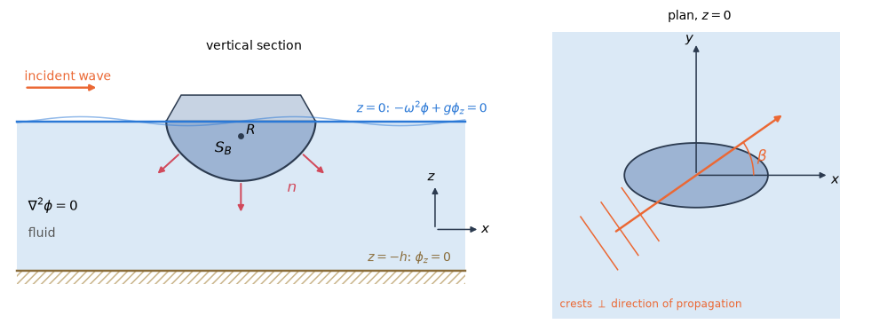
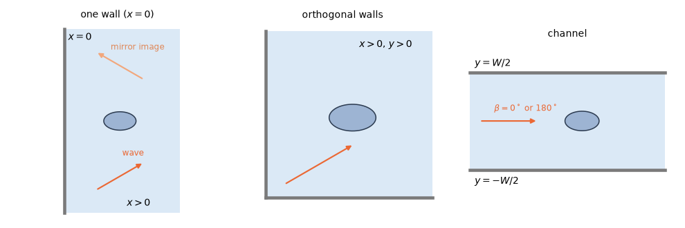

# 1. Coordinates and the boundary-value problem

This chapter states the problem that every other chapter solves, discretizes or post-processes.
It fixes the axes and the sign conventions in which all results are reported (§1.1), the
equations the velocity potential satisfies in the water and on its boundaries (§1.2), and what
becomes of them at zero and infinite frequency (§1.3). A reader who compares HydroBEM's results
with another source should start here: most apparent disagreements are differences of axes, of
the time factor or of the reference point of the moments.

## 1.1 Coordinates and conventions

### Global and body axes

The global axes have $z$ pointing up. The undisturbed free surface is the plane $z = 0$ and the
bottom the plane $z = -h$; the depth may be infinite, $h = \infty$ (Figure 1).

Each body is described in its own body-local coordinates $x'$. It is placed in the global axes
by a rotation about the vertical (the yaw) and a translation:

$$
x = R_z(\text{yaw})\, x' + \text{position}. \tag{1.1}
$$

*Figure 1. The fluid domain. Left: a vertical section with the free surface $z = 0$, the bottom
$z = -h$, the wetted surface $S_B$ of a body, its normal $n$ pointing into the fluid and the
rotation centre $R$. Right: the plan view with the heading $\beta$ of the incident wave, its
direction of propagation measured from $+x$ counter-clockwise.*

### The reference point of the first-order results

The first-order results, that is the forces, the added mass, the damping, the motions and the
hydrostatic stiffness, are given **in body axes about $R$ = `rotation_center`**
(reference/inputs-bodies §1.1). The centres of buoyancy and gravity of the hydrostatics are
positions in body coordinates, like the input centre of gravity.

### The reference point of the second-order loads

The second-order loads of each body follow the same convention. These are the mean drifts by
pressure integration (§11.2) and by the control surface (§11.3), their quadratic QTFs, the force
of the second-order potential (§12.1) and Newman's approximation built from them. All have their
moments about $R$ in body axes.

The integrals are formed about the body origin $O$, and the moments are then moved to $R$ by

$$
M_R = M_O - R \times F. \tag{1.2}
$$

The transfer is exact because $R$ is fixed in the body and the loads are in the body's mean
axes.

These loads are the loads with the second-order displacement of $R$ equal to zero. The
second-order rotation $H$ of the body is applied about $R$, as $H(x - R)$ (§11.2), just as the
motions are about $R$. The loads are therefore the right-hand side of the second-order equation
of motion about $R$.

This choice has a consequence for the forces, not only for the moments. Compared with $H$ applied
about $O$, the loads contain the load of the rigid second-order translation $-H R$. For a moving
body the second-order forces therefore depend on $R$ as well (§11.2).

The momentum drift (§11.1) is the exception. It is the far-field total of all bodies together,
which has no single $R$, so it stays in global axes, with its moment about the global $z$ axis.

### Time dependence

All quantities are complex amplitudes of a harmonic motion with the time factor $e^{+i\omega t}$.
The velocity potential is

$$
\Phi = \operatorname{Re}\lbrace \phi\, e^{i\omega t} \rbrace, \tag{1.3}
$$

and every other first-order quantity is read in the same way,
$\operatorname{Re}\lbrace \phi\, e^{+i\omega t} \rbrace$ for its amplitude $\phi$.

### The wave number

The wave number $k$ of the frequency $\omega$ is the real root of the dispersion relation

$$
\omega^2 = g k \tanh(k h), \tag{1.4}
$$

which in infinite depth reduces to $k = \omega^2/g$. The infinite-depth wave number

$$
K = \nu = \frac{\omega^2}{g} \tag{1.5}
$$

appears in the free-surface condition at every depth; both symbols are used in these chapters.
The package function `hb.wavenumber` returns $k$ (reference/queries).

### The incident wave

The incident wave has unit amplitude, $A = 1$ m, and the heading $\beta$, its direction of
propagation measured from $+x$ counter-clockwise (Figure 1). Its potential is

$$
\phi_I = \frac{i g A}{\omega}\, Z(z)\, \exp\bigl(-i k (x \cos\beta + y \sin\beta)\bigr), \tag{1.6}
$$

with the depth function

$$
Z(z) = \frac{\cosh k(z + h)}{\cosh kh} \qquad (e^{kz} \text{ for } h = \infty). \tag{1.7}
$$

Since $Z(0) = 1$, the free-surface elevation $\eta = -(i\omega/g)\, \phi$ at $z = 0$ (§4.1) of
this potential is

$$
\eta_I = -\frac{i\omega}{g} \cdot \frac{i g A}{\omega}\, e^{-i k \cdot x} = A \exp(-i k \cdot x), \tag{1.8}
$$

a wave of amplitude $A$ with its crest at the origin at $t = 0$; here $k$ is the wave-number
vector $k (\cos\beta, \sin\beta)$.

### The generalized normal

The radiation problems and the forces use one normal per rigid mode $j$. With $n$ the unit
normal pointing **out of the body into the fluid**,

$$
(n_1, n_2, n_3) = n, \qquad (n_4, n_5, n_6) = (x - R) \times n. \tag{1.9}
$$

The first three are the normal velocities of unit translations, the last three those of unit
rotations about $R$. The normals are in body-local axes, and the modes are numbered body by body
(body-major).

## 1.2 Field equations and boundary conditions

In linear potential flow the water is ideal and incompressible, the flow is irrotational, and the
waves and motions are small enough for every boundary condition to be applied on the mean
position of its surface. The complex potential $\phi$ then satisfies a linear boundary-value
problem. This section lists its equations; the following chapters solve it.

### The fluid and its horizontal boundaries

In the fluid the potential satisfies Laplace's equation:

$$
\nabla^2\phi = 0. \tag{1.10}
$$

On the free surface $z = 0$ the kinematic and dynamic conditions combine into

$$
-\omega^2 \phi + g \phi_z = 0 \qquad \text{on } z = 0. \tag{1.11}
$$

On the bottom the water cannot pass:

$$
\phi_z = 0 \qquad \text{on } z = -h. \tag{1.12}
$$

At infinity the radiation condition requires the waves made by the bodies to be outgoing.

### The body surface

The body surface $S_B$ is the set of wetted panels. Two kinds of problem are solved on it.

In the radiation problem of mode $j$, $\phi_j$ is the potential of the body moving in that mode
with unit velocity. Its normal derivative is the generalized normal (1.9):

$$
\frac{\partial \phi_j}{\partial n} = n_j \qquad \text{on } S_B. \tag{1.13}
$$

In the diffraction problem the body is held fixed in the incident wave. The unknown can be the
scattered potential $\phi_S$ or the total potential $\phi_D = \phi_I + \phi_S$:

$$
\frac{\partial \phi_S}{\partial n} = -\frac{\partial \phi_I}{\partial n} \quad \text{(scattered unknown)}, \qquad
\frac{\partial \phi_D}{\partial n} = 0 \quad \text{(total unknown)}. \tag{1.14}
$$

The two formulations give the same forces within the accuracy targets. Which one is solved is the
option `first_order.diffraction_formulation` (reference/inputs-orders).

### Walls and channel

Vertical walls can bound the domain: the plane $x = 0$, the plane $y = 0$, both, or the two
planes $y = \pm W/2$ of a channel of width $W$ (Figure 2). On every wall the water cannot pass,

$$
\phi_n = 0 \qquad \text{on the walls}. \tag{1.15}
$$

The bodies lie strictly inside the fluid, which occupies the region of Table 1. The incident wave
then includes its reflections: with the wall $x = 0$ (`x_wall`) it is the wave and its mirror
image about $x = 0$, and so on for the other walls. In a channel the incident wave propagates
along $\pm x$, $\beta \in \lbrace 0^\circ, 180^\circ \rbrace$.

*Table 1. The domains with walls (the input `domain`: reference/inputs-model).*

| Walls | Fluid | Incident wave |
|---|---|---|
| $x = 0$ | $x > 0$ | the wave and its mirror image about $x = 0$ |
| $y = 0$ | $y > 0$ | the wave and its mirror image about $y = 0$ |
| $x = 0$ and $y = 0$ | $x > 0$, $y > 0$ | the wave and its mirror images about both walls |
| $y = \pm W/2$ (channel) | $\lvert y \rvert < W/2$ | along $\pm x$ only, $\beta \in \lbrace 0^\circ, 180^\circ \rbrace$ |

*Figure 2. The domains with walls in plan, the fluid shaded. Left: one wall $x = 0$, with an
incident wave and its mirror image. Middle: the orthogonal walls $x = 0$ and $y = 0$. Right: the
channel $\lvert y \rvert < W/2$, where the incident wave propagates along $\pm x$.*

### Partly reflecting channel walls **[C]**

Real basin walls do not reflect perfectly. The channel reflection $R \in [0, 1]$
(`channel_reflect`; here $R$ is a reflection factor, not the rotation centre) scales every wall
image of the channel by one uniform factor:

$$
G_R = G_{\text{open}} + R\, \bigl(G_{\text{channel}} - G_{\text{open}}\bigr). \tag{1.16}
$$

The Green function is thus linear between two limits. At $R = 0$ it is that of the open sea of
the same depth: no wall image is summed, and the channel has no resonance. At $R = 1$ it is that
of the reflecting channel.

For every $R > 0$ the resonances of the channel, $W = n\lambda/2$, remain. A factor
$R^{\lvert m \rvert}$ per image $m$, which would weaken the distant images more, would need a damped
lattice sum and is not used.

## 1.3 Frequency limits ($\omega = 0$ and $\omega = \infty$)

The added mass at zero and at infinite frequency is needed for time-domain models and as a check
of the frequency-dependent results. Both limits follow from the free-surface condition (1.11)
written with $K = \omega^2/g$ (1.5), $\phi_z = K \phi$.

As $\omega \to 0$, $K \to 0$ and the free surface becomes a rigid lid:

$$
\phi_z = 0 \qquad \text{on } z = 0 \quad (\omega \to 0). \tag{1.17}
$$

As $\omega \to \infty$, $\phi_z / K \to 0$ and the potential vanishes on the free surface:

$$
\phi = 0 \qquad \text{on } z = 0 \quad (\omega \to \infty). \tag{1.18}
$$

Neither limit radiates waves. Only the added mass, $A(0)$ and $A(\infty)$, is defined there; the
damping and the excitation are not.

The special surfaces of chapter 9 take their own limits (Table 2).

*Table 2. The special surfaces at the frequency limits.*

| Surface | $\omega \to 0$ | $\omega \to \infty$ |
|---|---|---|
| physical damping lid (§9.1) | as the free surface | as the free surface |
| pressure surface (§9.3) | a Neumann surface of its mode | a Dirichlet surface of its mode |
| free-surface plate (§9.7) | a moving part of the rigid lid $z = 0$ | a rigid thin sheet in $z = 0$ of the odd-image problem |

In finite depth, and in a channel, a mode with a net volume flux has a divergent $A(0)$. Such
modes are rejected, never regularized.
