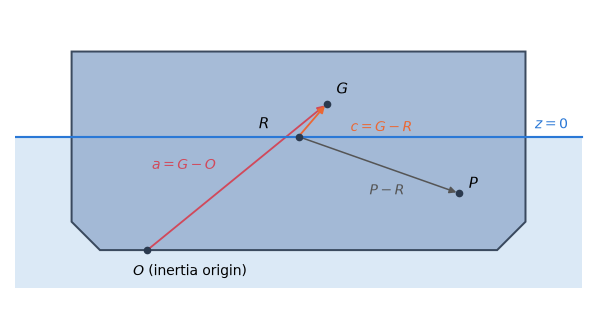

# 3. Motions and hydrostatics

The coefficients of chapter 2 describe the water. To find how a body actually moves in waves they
are combined with its inertia, its hydrostatic restoring and any external stiffness and damping
into the equation of motion. This chapter sets up that equation (§3.1), derives the hydrostatic
restoring from the wetted surface (§3.2) and states how the integrals of both are evaluated and
how accurately (§3.3).

## 3.1 Rigid-body motions

### The equation of motion

For each frequency the complex motion amplitudes $\xi$ satisfy

$$
\bigl[C - \omega^2(M + A) + i\omega(B + B_{\text{ext}})\bigr]\, \xi = X, \tag{3.1}
$$

with $M$ the inertia, $A$ and $B$ the added mass and damping (2.2), $C$ the restoring,
$B_{\text{ext}}$ an additional damping and $X$ the exciting force. The equation is solved for the
free coordinates (`Body.modes`) and the pressure coordinates (§9.3); fixed coordinates have
$\xi = 0$ exactly. No artificial damping or regularization is added.

The exciting force $X$ of a body is that of pressure integration (2.3) or of the Haskind relation
(2.5), chosen per body by `excitation_method` (reference/inputs-bodies §1.1).

The results are complex amplitudes per unit wave amplitude: metres for translations, radians for
rotations and metres of head for pressure coordinates.

### The inertia matrix about $R$

The motions are about the rotation centre $R$ (§1.1), so the inertia matrix is formed about $R$
too. Figure 1 shows the points involved.

*Figure 1. The points of a body's equation of motion: the inertia origin $O$ at which the inertia
tensor is entered, the centre of gravity $G$, the rotation centre $R$ and a point $P$ at which
additional matrices are given; $a = G - O$ and $c = G - R$.*

With the mass $m$, $c = G - R$, $E$ the identity and $S(v)$ the cross-product matrix
($S(v)\, w = v \times w$),

$$
M = \begin{bmatrix} m E & -m S(c) \\ m S(c) & J_R \end{bmatrix}. \tag{3.2}
$$

The inertia tensor about $R$ follows from the entered tensor $J_O$ about the inertia origin $O$ by
the parallel-axis theorem applied twice, from $O$ to $G$ and from $G$ to $R$:

$$
J_R = J_O - m\bigl(\lvert a \rvert^2 E - a a^{\mathsf{T}}\bigr) + m\bigl(\lvert c \rvert^2 E - c c^{\mathsf{T}}\bigr), \qquad a = G - O. \tag{3.3}
$$

The entered tensor is used without a change of sign:

$$
J_O = \begin{bmatrix} I_{xx} & I_{xy} & I_{xz} \\ I_{xy} & I_{yy} & I_{yz} \\ I_{xz} & I_{yz} & I_{zz} \end{bmatrix}. \tag{3.4}
$$

Its entries are the components of the inertia tensor

$$
J = \int \bigl(\lvert r \rvert^2 E - r r^{\mathsf{T}}\bigr) \,\mathrm{d}m, \tag{3.5}
$$

so that $I_{xy} = -\int x y \,\mathrm{d}m$ is minus the product of inertia $\int x y \,\mathrm{d}m$.
This is the convention of the parallel-axis terms in (3.3). An inertia entered at $R$ is used as
given.

### Additional matrices given about another point

An additional stiffness or damping $K_P$ may be given about a point $P$. The rigid displacement at
$P$ is $T x_R$, with

$$
T = \begin{bmatrix} E & -S(P - R) \\ 0 & E \end{bmatrix}, \tag{3.6}
$$

so the same matrix about $R$ is

$$
K_R = T^{\mathsf{T}} K_P\, T. \tag{3.7}
$$

A coupling $(K_P)_{ij}$ of body $i$ with body $j$ gives the forces of body $i$ against the motions
of body $j$ (reference/inputs-bodies §1.3). Each side is transferred with its own body:

$$
(K_R)_{ij} = T_i^{\mathsf{T}} (K_P)_{ij}\, T_j, \tag{3.8}
$$

where $T_i$ uses body $i$'s input origin and $T_j$ body $j$'s own input origin.

### The stiffness and damping in the equation

The matrices of (3.1) are assembled per kind of coordinate (Table 1).

*Table 1. The restoring and the additional damping in the equation of motion.*

| Coordinates | Restoring $C$ | Additional damping $B_{\text{ext}}$ |
|---|---|---|
| rigid | hydrostatic restoring with the weight terms (§3.2) plus the additional stiffness $K_R$ | the additional damping |
| pressure | the restoring of §9.3 and the mode stiffness | the mode damping |
| generalized | the restoring of §10.1 and the body's mode stiffness | the body's mode damping |

Generalized modes (§10.1) are free coordinates that follow the six rigid ones of their body.
`mode_mass`, `mode_damping` and `mode_stiffness` (reference/inputs-bodies §1.1) give their
inertia, damping and stiffness, including the couplings with the rigid modes.

### Massless directions **[C]**

A light lid, a piston or a free-surface mode of a moonpool has almost no mass of its own. The
inertia of a body's free coordinates (the rigid $M$ on its free rigid modes, `mode_mass` on its
generalized ones, and their couplings) therefore need only be positive semi-definite.

This is possible because (3.1) is solved by LU at ordinary frequencies only; there are no motions
at $\omega = 0$ or $\omega = \infty$. $M$ is never inverted. A massless direction $v$ ($M v = 0$)
has the inertia $v^{\mathsf{T}} A(\omega)\, v$ and the damping $v^{\mathsf{T}} B(\omega)\, v$ of
the water it moves.

The motions are continuous as the mass of such a direction tends to zero, linearly in the mass.
Table 2 shows this for the free surface of a moonpool of radius 1 m, modelled as a piston mode of
the hull with an added mass of about 1e3 kg.

*Table 2. The change of the motions of a moonpool piston mode with its mass, against a massless
piston.*

| Mode mass | Change of the motions, relative to their peak |
|---|---|
| 1 kg | 7.3e-4 |
| 1e-3 kg | 7.8e-7 |

Two kinds of direction are refused:

- a direction with a negative kinetic energy, $v^{\mathsf{T}} M v < 0$;
- a massless direction that moves no water, its normal velocity zero on the wetted surface, the
  thin sheets, the free-surface plates and the tank walls (a generalized mode of the interior
  surface only, say). It has no added mass or damping at any frequency, and its row of the
  equation has the stiffness only.

The test scales $M$ to a unit diagonal on the coordinates of nonzero mass; a coordinate of zero
mass with a coupling is indefinite. The eigenvalues of the scaled matrix are then classified as in
Table 3.

*Table 3. The classification of the eigenvalues of the scaled inertia.*

| Eigenvalue | Taken as |
|---|---|
| below $-10^{-9}$ | negative (refused) |
| below $10^{-12}$ | zero (a massless direction) |

A massless direction can still meet a resonance, where its impedance
$C - \omega^2 A + i\omega B$ vanishes. The equation is then singular, as for any body, and the
LU says so.

## 3.2 Hydrostatics

The hydrostatic restoring is the change of the buoyancy and of the weight as the body moves. It is
computed from the wetted surface alone, by the divergence theorem.

### Volume and centre of buoyancy

The wetted surface $S$, with its outward normals (out of the body), is closed by the waterplane
$W$. The divergence theorem turns each volume integral into an integral over $S$; the waterplane
contributes nothing to the integrals below, because there $z = 0$ and $n_x = n_y = 0$. All
integrals are in body axes about $R$.

Three estimates of the volume follow from the three coordinate directions:

$$
V_x = \int x\, n_x \,\mathrm{d}S, \qquad V_y = \int y\, n_y \,\mathrm{d}S, \qquad V_z = \int z\, n_z \,\mathrm{d}S. \tag{3.9}
$$

They are equal for a closed surface and are reported separately. The centre of buoyancy is

$$
V x_b = \int \tfrac{1}{2} x^2 n_x \,\mathrm{d}S, \qquad V y_b = \int \tfrac{1}{2} y^2 n_y \,\mathrm{d}S, \qquad
V z_b = \int \tfrac{1}{2} z^2 n_z \,\mathrm{d}S, \qquad V = V_z. \tag{3.10}
$$

### The waterplane

The integrals over the waterplane (its area, first and second moments) follow from the same
theorem applied to a function $f(x, y)$, whose vertical flux through the closed surface is zero:

$$
\int_W f \,\mathrm{d}A = -\int_S f\, n_z \,\mathrm{d}S. \tag{3.11}
$$

### The restoring matrix

With $A$ the waterplane area, the waterplane integrals of (3.11) written $\int y$, $\int x^2$, ...,
and the coordinates relative to $R$, the nonzero entries are

$$
\begin{aligned}
C_{33} &= \rho g A, \qquad C_{34} = \rho g \int y, \qquad C_{35} = -\rho g \int x,\\
C_{44} &= \rho g\Bigl(\int y^2 + V z_b\Bigr) - m g z_G, \qquad C_{45} = -\rho g \int xy,\\
C_{46} &= -\rho g V x_b + m g x_G, \qquad C_{55} = \rho g\Bigl(\int x^2 + V z_b\Bigr) - m g z_G,\\
C_{56} &= -\rho g V y_b + m g y_G,
\end{aligned} \tag{3.12}
$$

with the 3–5 block symmetric. The terms in $m g$ are the weight terms. The mass $m$ is
`Body.mass`: a number, or for `"displaced"` the displaced mass $\rho V_x$ less the fluid of the
tanks (reference/inputs-bodies §1.1).

The weight terms need both a centre of gravity and a mass. Without either there are no weight
terms, and the `.hst` file, which needs both for every body, is not written.

### Which surfaces count

Not every surface of a body is part of its displaced volume or its waterplane (Table 4).

*Table 4. The surfaces of a body in the hydrostatics.*

| Surface | Displaced volume and centre of buoyancy | Waterplane |
|---|---|---|
| wetted surface | yes | yes |
| pressure surface | yes | no (its restoring is that of §9.3) |
| free-surface plate (§9.7) | no (adds no volume) | yes |
| thin sheets, interior and lid elements | no | no |

### How the integrals are evaluated

Low-order panels use the one-point (area-centroid) rule of the constant-panel method **[P]**. This
is the discrete hydrostatics of a constant-panel model, which reproduces published constant-panel
results. Higher-order patches use Gauss quadrature **[C]**: of the patch polynomial degree, exact
for flat and non-rational B-spline patches; 12 points per span for rational ones; and
$12 \times 12$ points (about 1e-12) for analytic ones. The integrands of the last two are not
polynomials; 12 points reproduce the closed-form hydrostatics of the analytic shapes to 1e-12
(§3.3).

### Surfaces that are not closed

An open or inward-wound surface is reported as computed, with differing or negative volumes
(3.9); it is not refused.

## 3.3 Hydrostatics and motion matrices: the integration

The matrices of §3.1 and §3.2 are assembled and stored in float64. Their surface integrals are
evaluated by the rules of Table 5.

*Table 5. The integration rules of the hydrostatics and the motion matrices.*

| Surface | Rule | Accuracy |
|---|---|---|
| low-order panels | one point, the area centroid (the constant-panel method) | the discrete hydrostatics of the panel model |
| flat and B-spline patches | Gauss quadrature of the patch polynomial degree | exact |
| rational B-spline patches | 12 points per span | about 1e-12 |
| analytic patches | $12 \times 12$ points | about 1e-12 |

The integrands of rational and analytic patches are not polynomials, so no Gauss order is exact
for them. The 12 points reproduce the closed-form volume, $C_{33}$ and $C_{44}$ of every analytic
shape to 1e-12.
