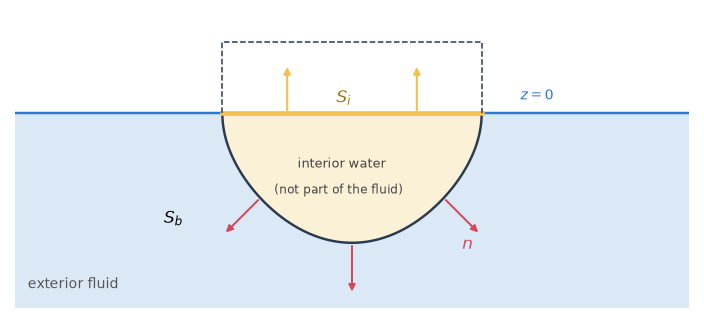

# 5. Irregular frequencies and interior surfaces

The boundary-integral equation of the exterior problem fails at certain frequencies even though
the physical problem is well posed there. Near these irregular frequencies the added mass, damping
and exciting force of an ordinary mesh show spurious spikes. This chapter explains where they come
from and how an interior surface in the waterplane of a body removes them (§5.1), and then
describes the extended equation, its discretization and its use in the velocities (§5.2).

## 5.1 Irregular frequencies

The irregular frequencies are those of the interior problem: the water that would fill the
inside of the hull, with the free-surface condition on its waterplane $z = 0$. At their
eigenfrequencies the integral equation of the exterior problem is not uniquely solvable, and its
solution is spoiled near them.

HydroBEM removes them by the extended boundary-integral method of Lee, Newman & Zhu (1996)
**[P]**. An interior surface at $z = 0$ inside the body (reference/inputs-bodies §2.6) carries
an unknown of its own, with the interior free-surface condition. Only the wetted body panels
produce forces.

Results with and without the interior surface agree away from the irregular frequencies, within
the accuracy targets. At them, the interior surface removes the spurious behaviour.

*Figure 1. The interior surface $S_i$ of a hull in a vertical section: the wetted surface $S_b$
with its normal $n$ into the fluid, and $S_i$ in the waterplane $z = 0$ inside the body, its
normal up. The interior water is not part of the fluid; its eigenfrequencies are the irregular
frequencies.*

## 5.2 Interior surfaces

### The extended equation

The interior panels lie in $z = 0$ with their normals up (Figure 1). With $S_b$ the wetted body
surface and $S_i$ the interior surface, the rows of the body panels are

$$
2\pi\phi - \int_{S_b + S_i} \phi\, \frac{\partial G}{\partial n} \,\mathrm{d}S = -\int_{S_b} G\, \frac{\partial\phi}{\partial n} \,\mathrm{d}S, \tag{5.1}
$$

and the rows of the interior panels are the same with the free term $-4\pi$:

$$
-4\pi\phi - \int_{S_b + S_i} \phi\, \frac{\partial G}{\partial n} \,\mathrm{d}S = -\int_{S_b} G\, \frac{\partial\phi}{\partial n} \,\mathrm{d}S. \tag{5.2}
$$

Since the Green function satisfies the free-surface condition, the dipole of an interior panel is
$K$ times its source:

$$
\frac{\partial G}{\partial \zeta} = K G \qquad \text{on } \zeta = 0. \tag{5.3}
$$

The total diffraction potential has the right-hand side $4\pi\phi_I$ on both kinds of rows. The
forces, the Haskind relation and the field points use $S_b$ only.

When interior surfaces and lids appear in one system, each keeps its own free term: $-4\pi$ on an
interior (artificial) panel and $4\pi$ on a lid (a physical surface, §9.1).

### The frequency limits

The limits $\omega = 0$ and $\omega = \infty$ have no irregular frequencies. They are solved
without the interior unknowns.

### In a channel

In a channel the interior panels, like the lids and sheets, take the channel kernel of §8.5, as
the body panels do. The interior problem is that of the open sea, since the walls lie outside it.
Every far image satisfies the free-surface condition, so the dipole of an interior panel is $K$
times its source for the far images too (5.3).

### Why it works, and the evidence

The irregular frequencies are those of the interior problem with the free-surface condition on
$z = 0$. The extended equation is that of a uniquely solvable problem (Lee, Newman & Zhu 1996,
§2), so the frequencies disappear, and nothing changes away from them.

A truncated cylinder (radius = draft = 1) shows both. At its first irregular frequency,
$Ka = 2.4446$, the heave added mass of the plain equation deviated by 1.6 % on the finest mesh
tested, while the extended equation stayed smooth. Elsewhere the two agreed within the
discretization difference ($\le$ 1e-3).

### The discretization of the interior surface

The interior surface may be selected from the body's mesh, given as an external mesh or generated
(§14; the choices in reference/inputs-bodies §2.6). The potential formulation is insensitive to
the interior discretization, so non-conforming triangles of the size of the waterline segments
suffice.

### The source formulation with an interior surface

The velocities of the low order come from the source formulation (§4.2). With an interior surface
the sources lie on $S_b$ and $S_i$, and on $S_i$ the Neumann condition of the interior flow
applies:

$$
\frac{\partial\phi}{\partial z} = V \qquad \text{on } S_i. \tag{5.4}
$$

$V$ must equal the vertical velocity of the exterior flow at the waterline, $K\phi$ there (Lee,
Newman & Zhu 1996, §3, eq. 38). A jump between the two makes the source strength logarithmically
singular at the waterline and the tangential velocity of the body panels next to it unbounded.

Each interior panel therefore takes $V = K\phi$ of the wetted waterline panel of its body nearest
to it, with $\phi$ from the potential formulation (the scattered potential for the diffraction).

The rigid lid $V = 0$ was worse. With it, the body velocity at the waterline differed from that
without the interior surface by 2–4 % on meshes of 12 and 24 panels a quadrant, and the mean drift
by pressure integration did not converge to the momentum drift.
