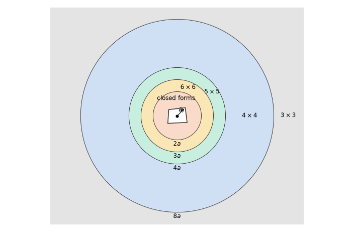
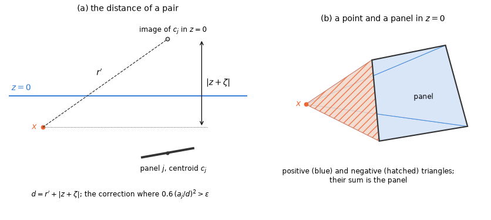

# 6. The low-order method

The low-order method is the classical panel method: the wetted surface is cut into flat panels,
the potential is taken constant on each panel, and Green's identity is imposed at one point per
panel. It needs nothing but a mesh of quadrilaterals and triangles, and it converges as the square
of the panel size. Its cost lies almost entirely in the panel integrals of the Green function: for
$N$ panels there are $N^2$ pairs, each with a Rankine part and a wave part, and many of these pairs
are close enough for the integrands to be singular or nearly so.

This chapter describes how those integrals are evaluated. §6.1 treats the Rankine part, which is
integrated exactly near the panel and by cheap Gauss rules farther away. §6.2 treats the
logarithmic singularity of the wave part near the free surface. §6.3 shows how mesh symmetry and
walls split the system into smaller independent ones. The Green function itself is the subject of
chapter 8, the geometry of the panels that of chapter 14.

## The integral equation

Each panel carries one unknown, the value of the potential on it; the equation is imposed at the
panel centroid (collocation). The exterior Neumann problem is solved in the potential (Green's
identity) formulation,

$$
2\pi\phi(x) - \int \phi(\xi) \frac{\partial G(x, \xi)}{\partial n_\xi} \,\mathrm{d}S_\xi = -\int G(x, \xi) \frac{\partial \phi}{\partial n_\xi} \,\mathrm{d}S_\xi \tag{6.1}
$$

on the body, with the normals pointing into the fluid and the normal derivative taken at the source
point $\xi$ on the integrated panel ($G$ is the Green function of §8). The other kinds of surface
enter with other free terms: $-4\pi$ on an interior surface and $+4\pi$ on a lid (§9.2). Once the
potentials are known, the added mass, damping and exciting force are the integrals (§2.1)

$$
A - \frac{i}{\omega} B = -\rho\int n_i \phi_j \,\mathrm{d}S, \qquad X = i\omega\rho\int n_i \phi_D \,\mathrm{d}S. \tag{6.2}
$$

The constant-panel method needs planar panels. The panels it integrates are therefore the
projected planar polygons of §14, not the raw quadrilaterals of the mesh file.

## 6.1 Rankine integrals

Every pair of panels needs the integrals of the source $1/r$ and of the dipole
$\partial(1/r)/\partial n$ over the source panel. When the field point is close to the panel these
integrands vary strongly across it, and on the panel itself they are singular; far from the panel
they are smooth and a few Gauss points suffice. HydroBEM therefore uses two different evaluations,
switched by the distance $r$ of the field point from the panel centroid, measured in panel radii
$a$ (the largest centroid–vertex distance). Figure 1 and Table 1 show the regions.

*Figure 1. The evaluation of the Rankine integrals of a panel by the distance $r$ of the field
point from its centroid: the closed forms within $2a$, Gauss rules of decreasing order beyond
(drawn to scale; $a$ the panel radius).*

*Table 1. The evaluation of the Rankine source and dipole integrals of a panel by the distance $r$
of the field point from its centroid.*

| Distance | Evaluation |
|---|---|
| $r < 2a$ | exact closed forms, double precision |
| $2a \le r < 3a$ | $6 \times 6$ Gauss rule of the bilinear map, float32 |
| $3a \le r < 4a$ | $5 \times 5$ |
| $4a \le r < 8a$ | $4 \times 4$ |
| $r \ge 8a$ | $3 \times 3$ |

### Near the panel: closed forms

Within $2a$ of the centroid the integrals are evaluated in closed form, exactly at any distance.
The source integral of a plane polygon is

$$
\int \frac{\mathrm{d}S}{r} = \sum_e d_e \log\frac{R_a + R_b + s}{R_a + R_b - s} - w\Phi \tag{6.3}
$$

(Newman 1986, eq. 3.10; the edge terms as in the velocities of Hess & Smith 1964). The sum runs
over the edges $e$ of the panel: $d_e$ is the in-plane distance between the field point and the
line of the edge, along the outward normal of the edge (positive when the point lies on the inner
side of the edge), $R_a$ and $R_b$ are the distances of the field point from the two ends $a$, $b$
of the edge, $s$ is the edge length and $w$ the height of the field point above the panel plane, on
the side of its normal. $\Phi$ is the dipole integral, the solid angle under which the panel is seen
from the field point; it is evaluated by the formula of Van Oosterom & Strackee (1983) per triangle
of a fan of the panel, and its principal value on the panel plane is 0.

When the field point lies near the extension of an edge, $R_a + R_b$ is close to $s$ and the
denominator of (6.3) loses its digits by cancellation. It is therefore evaluated as

$$
R_a + R_b - s = \frac{2(R_aR_b + a \cdot b)}{R_a + R_b + s}, \tag{6.4}
$$

with $a$ and $b$ here the vectors from the field point to the two ends of the edge.

### Farther away: Gauss rules in single precision

Beyond $2a$, in the production path, the integrals are $n \times n$ Gauss rules of the bilinear map
of the panel, evaluated in float32 with AVX2. Two details keep single precision accurate: the
reciprocal square root is refined by one Newton step, and the field point is taken relative to the
centroid in double precision before the float differences are formed. The order falls with the
distance as in Table 1.

### Why two evaluations

The closed forms are exact at any distance, but a Gauss rule is the cheaper evaluation wherever it
meets the accuracy. Each tier of Table 1 is the cheapest rule that keeps an error of 1e-6 at its
inner boundary. The $6 \times 6$ rule already reaches that limit at $2a$ (9.7e-7, below), so the
closed forms take the pairs nearer than $2a$.

The Gauss tiers run in float32 because they stay ten times inside the 1e-5 allowed for the
single-precision path. Gauss rules of the same orders in double precision were slower than the
closed forms and are not used. The diagnostic double-precision mode (§13.2) replaces the tiers by
the closed forms, and so bounds what the tiers cost in accuracy.

### Accuracy

The tiers were measured by `scripts/panel_rule_error_map.py`
([panel_rule_error_map.md](../development/error-maps/panel_rule_error_map.md)) on four panel shapes,
400 orientations per tier, against $8 \times 8$ cells of $16 \times 16$ points. The source error is
measured relative to $\lvert S\rvert$, the dipole error relative to $A/r_c^2$.

- Every tier errs by at most 1e-6. The worst case is 9.7e-7, the dipole of the $6 \times 6$ rule at
  $2a$: ten times inside the 1e-5 allowed for the single-precision path.
- The closed forms agree with high-precision quadrature to 1.1e-8 (test-plan A1).
- The production path agrees with the closed forms to 7.6e-7 over 12 000 points.

### Finite depth

In finite depth the Rankine terms of the image points $(x, y, -z - 2h)$, $(x, y, -z)$,
$(x, y, z \pm 2h)$ and $(x, y, -z - 4h)$ (the six Rankine terms of §8.2) are integrated the same
way, the two farthest in double precision. Their sum serves the ordinary frequencies and
$\omega = 0$. A second static set, with the free-surface images negated, is built only when
$\omega = \infty$ is requested.

## 6.2 The logarithmic singularity of the wave kernel

The wave part of the Green function is smooth except at one place: where the field point and the
image of the source point in $z = 0$ meet, it has a logarithmic singularity (§8.1). For panels in
or near the free surface (the waterline panels of a hull, an interior surface, a lid) the
integrand of a nearby pair is then not smooth, and evaluating it at the centroid, as is done for
the smooth part, would be inaccurate. The singular part is therefore split off and integrated
separately.

### The split

The wave kernel is split exactly into a logarithm with a constant coefficient and a regular
remainder,

$$
K \cdot \mathrm{Ft} = -2K \psi + K(\mathrm{Ft} + 2\psi), \qquad \psi = \log(r' + \lvert z + \zeta\rvert), \tag{6.5}
$$

where $\psi$ is the logarithm of the distance to the image point (Newman 1985; Newman & Sclavounos
1988). Because the singular part has a constant coefficient, its integral is independent of the
frequency and is computed once, with the statics.

The split would be exact with any smooth coefficient of the logarithm. The weighted coefficient
$e^{-Y} J_0(X)$ also makes it exact and converges to the same limit under refinement, but only the
constant coefficient $-2K$ makes the singular integral independent of the frequency, so that it is
computed once with the statics.

### The analytic correction

With `logarithmic_integration=True`, $\int\psi$ and $\int\partial\psi/\partial n$ over the source
panel are integrated analytically. The result is stored as a correction to the centroid value,

$$
\delta = \int_j \psi \,\mathrm{d}S - A_j \psi(c_j), \tag{6.6}
$$

and the regular remainder of (6.5) is taken at the centroid (centroid value times area). The
integrals of $\psi$ are Gauss rules whose order rises as the distance $r/a$ falls (Table 2). Below
$r = 1$, and for $1 \le r < 2$ when the image point is less than $a/2$ above the highest vertex of
the panel, an adaptive $4 \times 4$ rule is used instead.

*Table 2. The rules of the integrals of $\psi$ by the distance $r/a$.*

| $r/a$ | Rule |
|---|---|
| beyond 12 | $3 \times 3$ |
| from 6 | $4 \times 4$ |
| from 3 | $5 \times 5$ |
| from 2 | $6 \times 6$ |
| from 1.5 | $8 \times 8$ |
| from 1 | $10 \times 10$ |
| below 1 (and $1 \le r < 2$ with the image point less than $a/2$ above the highest vertex) | adaptive $4 \times 4$ |

The measured error is at most 5.2e-9 of $A \max(1, \lvert\psi(c)\rvert)$ for the value and at most
1.2e-7 of $A/d_c$ for the normal derivative. Both lie below the 4.7e-7 of the derivative tables
they are added to (§8.1).

### A point and a panel both in the free surface

When the point and the panel both lie in $z = 0$, as on an interior surface or a lid, the in-plane
integral of $\log\lvert\xi - x\rvert$ is exact: the panel is decomposed into signed triangles from
the point to every edge, and each triangle is integrated in polar coordinates about the point
(Figure 2b). The regular remainder at the panel's own centroid is its limit,

$$
-2K(\gamma - \log 2 + \log K). \tag{6.7}
$$

*Figure 2. (a) The distance $d = r' + \lvert z + \zeta\rvert$ of a pair: $r'$ from the field point
$x$ to the image of the centroid $c_j$ of the source panel, $\lvert z + \zeta\rvert$ the vertical
distance between them. (b) A point and a panel both in $z = 0$: the triangles from the point to
every edge, positive or negative by their orientation, sum to the panel.*

### Which pairs get the correction

The correction matters only for pairs near the free surface and near each other. It is applied to
a pair where

$$
0.6 \left(\frac{a_j}{d}\right)^2 > \epsilon, \qquad d = r' + \lvert z + \zeta\rvert, \tag{6.8}
$$

with $d$ measured to the image of the centroid (Figure 2a), $a_j$ the radius of the source panel
and $\epsilon$ the option `log_tolerance` (default 1e-4); $\epsilon = 0$ applies the correction to
every pair.

The constant 0.6 is derived, not fitted. The centroid rule errs by the second-order term
$O(A a^2/d^2)$ of $\psi$, and `scripts/log_correction_bound.py` measures

$$
\frac{\lvert\delta\rvert}{A} \le C \left(\frac{a}{d}\right)^2, \qquad C \le 0.56, \tag{6.9}
$$

for squares, 4:1 rectangles and triangles, with the normal-derivative correction below it for
$d > 3a$; hence the constant 0.6. The tolerance $\epsilon$ is then the tolerated correction relative
to the area weight, and its default 1e-4 is the accuracy target of complete results.

With 1e-4, which cuts the correction off at 77 panel radii, complete results move by at most 2.3e-5
of their peak against applying it to every pair. For distant bodies the tolerance removes most of
the corrections: for four cylinders 20 m apart (1536 panels) the static phase fell from 0.68 to
0.44 s with the results changed by 8e-7; with the cylinders 4 m apart the cost is unchanged.

### Without the correction

With `logarithmic_integration=False` the whole wave kernel is taken at the centroids. This is
allowed only without interior surfaces, lids, pressure surfaces in $z = 0$, free-surface plates and
a channel, whose panels lie in the free surface (the model rules: reference/inputs-rules §1,
rule 8).

## 6.3 Symmetry sectors and walls

A body with planes of symmetry, or a body next to a wall, has a system matrix with a block
structure: the influence of panel $n$ on panel $k$ is the same as that of its mirror image on the
mirror image of $k$. Exploiting this structure solves several small systems instead of one large
one.

The reflections of the mesh symmetry form a group $G$. For one body these are its own planes of
symmetry; for several bodies, a global plane on which every body lies and for which each has a
matching symmetry plane. Walls add their reflections (the method of images, which imposes the
Neumann condition on the wall); of the characters of the group only those even under every wall
reflection are solved.

The system splits into one system per one-dimensional character $\chi$ of the group,

$$
M_\chi(k, n) = \sum_g \chi(g) M(k, g \cdot n), \tag{6.10}
$$

where $g \cdot n$ is the image of panel $n$ under the reflection $g$. The right-hand sides are
projected with $(1/\lvert G\rvert) \sum_g \chi(g)$, and the potential is recovered from the
character solutions as

$$
\phi(g \cdot n) = \sum_\chi \chi(g) \phi_\chi(n). \tag{6.11}
$$

Each pair kernel is evaluated once for all characters.

The result equals the full solve within float32 round-off, at most 1e-6 of each peak (test-plan B).
An interior mesh whose symmetry flags differ from those of its body mesh disables the
decomposition.
