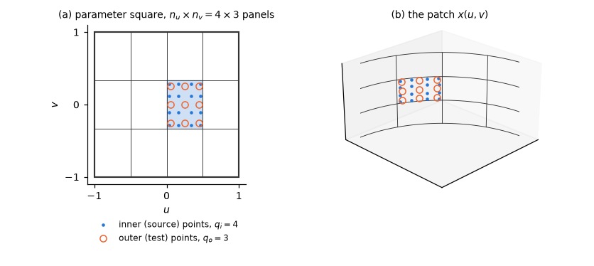
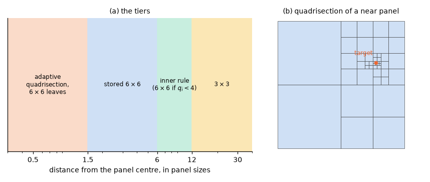
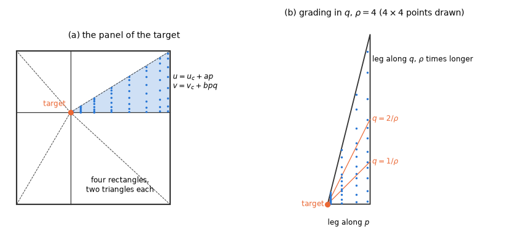

# 7. The higher-order method

The higher-order method represents the potential on each surface patch by a smooth B-spline instead
of a constant per panel, and uses the geometry of the patch exactly instead of flat facets. For a
given accuracy it needs far fewer unknowns than the low order of chapter 6: a floating hemisphere
reaches the four-digit published values with a few dozen unknowns per quadrant. The price is in
the integrals. Each matrix entry is a double integral over two patches, the inner one with a
singular or nearly singular kernel, and the wave kernel must be evaluated at every inner Gauss
point.

This chapter first describes the discretization and the Galerkin equations, then the integrals:
§7.1 the static (Rankine) integrals by distance tiers and the singular integral on a target's own
panel, §7.2 the wave part and the right-hand sides, §7.3 how a discretization follows from a panel
size. The method follows Maniar (1995) and Lee & Newman (2005).

## The discretization

The surface is a set of patches, each a map $x(u, v)$ of the parameter square $[-1, 1]^2$ onto the
surface (Figure 1). On each patch the potential is a tensor-product B-spline of orders
$(k_u, k_v)$ on $n_u \times n_v$ uniform panels of the parameter square, with open knots,

$$
\phi(u, v) = \sum_{m, n} c_{mn} N_m^{k_u}(u) N_n^{k_v}(v), \tag{7.1}
$$

independent per patch: the splines of neighbouring patches are not joined. The panels are the
cells of the knot grid; their number per direction is the number of spans.

*Figure 1. A patch. (a) Its parameter square with $4 \times 3$ panels (spans) and, on one panel,
the outer (test) Gauss points of order $q_o = 3$ and the inner (source) points of order $q_i = 4$.
(b) The same panels and points on the surface, here a quarter of a vertical cylinder.*

The geometry is used exactly: flat bilinear, B-spline and rational B-spline, analytic and trimmed
patches. A rational patch is evaluated as a quotient,

$$
x = \frac{A}{W}, \qquad A = \sum w N P, \qquad W = \sum w N, \qquad x_u = \frac{A_u - x W_u}{W}, \tag{7.2}
$$

with $P$ the control points, $w$ their weights and $N$ the B-spline basis of the patch.

### Galerkin testing

The boundary-integral equation is tested in the Galerkin sense in parameter space (Maniar 1995;
Lee & Newman 2005): it is multiplied by every basis function $U_i$ of (7.1) and integrated over the
parameter square of its patch. Two Gauss rules do this on every panel. The outer (test) rule, of
order $q_o$ per panel, carries the parametric weights; the inner (source) rule, of order $q_i$,
integrates over the surface with the area element. The linear systems are complex128.

The column of a patch in the equation follows its kind as in the low order (§5.2, §9.4), and so
does its free term (Table 1).

*Table 1. The column and the free term of a patch by its kind.*

| Kind of patch | Column | Free term |
|---|---|---|
| wet | the dipole | $2\pi$ |
| interior | $K \cdot S$ (0 at the limits) | $-4\pi$ |
| submerged pressure patch | $D + K \cdot S$ | $2\pi$ |
| pressure patch in $z = 0$ | none | $4\pi$ |

Under a reflection $(s_x, s_y)$ the six rigid modes have the parities
$(s_x, s_y, 1, s_y, s_x, s_x s_y)$.

### Why Galerkin rather than collocation

Collocation at Gauss points gives an overdetermined system solved by least squares. Its accuracy
depends on the points chosen, and its solution and storage are the larger cost. The Galerkin
procedure gives a square system of the size of the unknowns, and integrated quantities of its
solution are more accurate than the solution itself (Maniar 1995, §8.4–§8.5).

In practice the hemisphere reaches the four-digit published values with 36 unknowns per quadrant in
the default order 3, and with 25 in order 4
([validation: floating hemisphere](../validation/cases/floating_hemisphere.md),
[validation: constants](../validation/cases/constants.md)).

### Why double precision

The low order rounds its systems to complex64 (§13.1); the higher order does not. Two properties of
the Galerkin systems make single precision too coarse here:

- The Galerkin systems on overlapping B-spline bases are worse conditioned. Their 2-norm condition
  numbers are 2e2–3e3 (order 3 about 2e2 and nearly independent of the refinement, order 4 up to
  2e3; row and column equilibration does not lower them), against 3–6 for a wetted body in the low
  order.
- The body velocity is a parametric derivative of the solution, which amplifies a coefficient error
  that alternates between neighbouring basis functions, most at a collapsed patch side.

Measured on 38 problems with the LU in complex64, integrated outputs moved by at most 5.4e-6 of
their peak, but the body velocity by up to 5.9e-3. Identities of the equations that hold to 1e-10
in double precision (a lid of zero damping is no lid, a channel without reflection is the open sea)
were met only to 3e-8–4e-6.

Nor would single precision save much. The LU is 0.1–1 % of a higher-order solve, and the kernel
evaluation runs at nearly the same speed in float32 and float64 (scalar arithmetic), so complex64
would save under 1 % of the time and about 5 % of the memory.

## 7.1 Static (Rankine) integrals, by tiers

The static part of the kernel, $1/r$ and its images, must be integrated over every panel for every
outer Gauss point (the target). Its difficulty depends only on how far the target is from the
panel. A distant panel needs a handful of Gauss points; a panel at one or two panel sizes needs
many, because the nearest singularity is close to the panel; and on the target's own panel the
integrand is singular. HydroBEM picks the rule of each panel by the distance of the target and of
its images (the free-surface image and, in finite depth, the bottom images) from the panel centre,
in panel sizes (the largest centre–corner distance of the panel; Table 2, Figure 2).

*Table 2. The rules of the static integrals of a panel by the distance of the target and its
images from the panel centre, in panel sizes, and the bounds of their errors.*

| Distance | Rule | Error bound |
|---|---|---|
| > 12 sizes from all images | $3 \times 3$ Gauss per panel (spline orders $\le$ 4; higher orders keep the inner rule) | the nearest singularity 17 half-widths away: $\rho = 34$, $\rho^{-6} < 10^{-9}$; exact for the polynomial degree $\le$ 5 of order-4 bases on flat patches (the basis degree $k - 1 \le 3$, the area element 1 and the linear variation of the kernel 1) |
| 6–12 | the inner rule ($6 \times 6$ when $q_i < 4$) | — |
| 1.5–6 | a stored $6 \times 6$ rule | a $1/r$ source at 1.5 sizes (2.1 half-widths of a square panel): $\rho \approx 4.4$ on the panel normal, $\rho^{-12} \approx 2 \cdot 10^{-8}$; worst in the panel plane on the axis through an edge midpoint, $\rho \approx 4.0$, $\rho^{-12} \approx 6 \cdot 10^{-8}$ (the order of the error; its constant, not given here, is above 1) |
| < 1.5 | adaptive quadrisection with $6 \times 6$ leaves at 1.5 sizes | as above |
| the target's own panel | four Duffy (1982) rectangles with their corners at the target, each two triangles ($u = u_c + ap$, $v = v_c + bpq$), $8 \times 8$ points, graded in $q$ | below |

In the three near tiers, images farther than 6 sizes are integrated by the rule of their own
distance.

*Figure 2. (a) The tiers of Table 2 by the distance from the panel centre. (b) The adaptive
quadrisection of a panel whose target lies just above it: a cell is split into quarters until it
lies more than 1.5 of its own sizes from the target, then integrated by a $6 \times 6$ rule.*

### Where the tier boundaries come from

The error bounds of Table 2 follow from the convergence of Gauss–Legendre quadrature. On an
integrand analytic inside a Bernstein ellipse of parameter $\rho$, an $n$-point rule errs by

$$
O(\rho^{-2n}), \tag{7.3}
$$

and $\rho$ grows with the distance of the nearest singularity from the panel. Each tier boundary is
the nearest distance at which the cheaper rule still meets that bound.

Two boundaries were set by measurement. The adaptive leaves stop at 1.5 sizes rather than at 3: the
$6 \times 6$ rule is accurate there (Table 2), and the static phase of an air-cushion vessel with
two pressure modes fell from 8.4 to 3.5 s with the results changed by at most 1.5e-7. A $2 \times 2$
rule beyond 6–12 sizes was tried and rejected: it changed the results by 1e-5 to 3e-4.

### The target's own panel: Duffy rectangles

On its own panel the target is a singular point of the integrand. The panel is cut at the target
into four rectangles with a corner at the target, and each rectangle into two triangles
(Figure 3a). On each triangle the Duffy (1982) map

$$
u = u_c + ap, \qquad v = v_c + bpq, \qquad p, q \in [0, 1], \tag{7.4}
$$

collapses the corner at the target $(u_c, v_c)$ into the side $p = 0$; its Jacobian $\lvert ab\rvert p$
cancels the $1/r$ singularity, and the integrand becomes smooth in $p$ and $q$. Each triangle is
integrated with $8 \times 8$ points.

*Figure 3. (a) The panel of the target, cut into four rectangles with a corner at the target and two
Duffy triangles each; the points of one triangle. (b) An elongated triangle ($\rho = 4$): the $q$
range split at $1/\rho$, $2/\rho$ and 1, a Gauss rule on each piece.*

### Elongated panels: grading in q

On an elongated panel a Duffy triangle is long and thin, and the integrand, though smooth, varies
quickly near $q = 0$. Let $\rho$ be the physical length of the triangle's leg along $q$ divided by
its leg along $p$. After the Duffy map the integrand varies on the scale $1/\rho$ near $q = 0$.

For $\rho > 2$ the $q$ range is therefore split at $1/\rho$, $2/\rho$, $4/\rho$, … up to 1, with
$8 \times 8$ points per piece (Figure 3b). The geometric pieces give every piece the same relative
smoothness, so a fixed rule reaches the same accuracy at any aspect, with $\log_2 \rho$ pieces. On
a column with panels of aspect 4–8 the surge added mass is converged to 5e-6 between meshes and
quadrature orders.

### A target in the free surface: the log term

For a target in $z = 0$ the log term of the wave kernel adds a logarithmic singularity. After the
Duffy map the $p$-integrand has the form

$$
A(p) \log p + B(p), \tag{7.5}
$$

with $A$ and $B$ smooth. $p$ is then integrated by the generalized Gauss rule of 12 points that is
exact for $p^k$ and $p^k \log p$, $k = 0, \dots, 11$ (Ma, Rokhlin & Wandzura 1996;
`scripts/gen_log_gauss.py`). Table 3 compares it with 40 Gauss points on the geometric pieces
$[0, 1/256]$, …, $[1/4, 1]$.

*Table 3. The error of the 12-point log rule and of 40 Gauss points on geometric pieces.*

| Integrand | 12-point log rule | 40 Gauss points |
|---|---|---|
| $p \log p$ | exact to rounding | 3.2e-9 |
| $p \log(p(1 + 0.8p))$ | 9e-16 | 2e-8 |
| $1/\sqrt{1 + 3p^2}$ (smooth) | 3e-11 | 7e-12 |

### Accuracy

Against rules of $8 \times 8$ leaves and 12-point Duffy rules the coefficients change by at most
2.5e-6.

## 7.2 Wave part and right-hand sides

The wave part of the kernel is smooth away from the free-surface image of the target, but it is
expensive: evaluating it at every inner Gauss point is most of the cost of a higher-order frequency.
The rules below use as few points as the accuracy allows.

### The rule of the wave part

- When the panel centre is within 3 sizes of the image of the target in $z = 0$ (in finite depth
  also its image in the bottom), the wave kernel is evaluated at every inner Gauss point (the inner
  rule).
- Otherwise the Gauss rule of order $q_i - 1$ is used. For the regular wave part at 3 sizes with
  $n = 3$ the bound (7.3) gives $\rho \approx 7.6$, about 5e-6 per panel, smaller in the sum.

The lower far rule took about 40 % off the frequency time of an air-cushion vessel and changed its
results by at most 2.8e-6.

The log singularity $\psi$ of the wave kernel (§6.2) is integrated separately where the inner rule
is not accurate: in the near tiers of §7.1, and always on the target's own panel. It is stored as
the difference to the value of the rule the wave part uses on that panel. Elsewhere the Gauss rule
integrates it.

### Right-hand sides and outputs

- Radiation: $-\int G n_j \,\mathrm{d}S$.
- Total diffraction: $4\pi\int U_i \phi_I$.
- Scattered diffraction: $-\partial\phi_I/\partial n$ projected on the basis ($L^2$, area weights).

Forces, the Haskind relation, field points and motions are integrated by the inner rule.

### Evaluation

In finite depth the per-frequency depth factors of every point (the propagating-mode exponentials,
$\cos$ and $\sin k_n(z + h)$) are computed once per frequency.

The wave kernel is evaluated four consecutive Gauss points of a panel at a time where the four share
a table tile (§8.3); the sums follow in the order of the points.

## 7.3 Discretization from a panel size

Instead of a discretization per patch, a mesh may give a panel size $s$ (`panel_size=s`;
reference/inputs-meshes §2). Each patch then gets

$$
n = \left\lfloor \frac{L}{s} + 10^{-5} \right\rfloor + 1 \tag{7.6}
$$

spans per direction, $L$ the longer of the two patch edges in that direction (arc lengths for spline
and analytic patches), with spline order 3 and Gauss orders 3 (outer) and 4 (inner) unless given.
The discretization converges the solution (test-plan A); the quadrature tiers above are fixed by
the method.

The defaults have these grounds ([validation: constants](../validation/cases/constants.md)):

- The outer rule needs at least as many points as the spline order: Gauss 2/3 with order 3 errs
  about sixteen times more at $s$ = 0.8 m.
- Order 3 with Gauss 3/4 reaches the accuracy of the published hemisphere values with 36 unknowns
  per quadrant; order 4 with Gauss 4/5 does so with 25, at a larger cost per unknown.
- The $10^{-5}$ in (7.6) keeps an edge that is an exact multiple of $s$, up to the rounding of its
  measured length, at the intended $n$.
