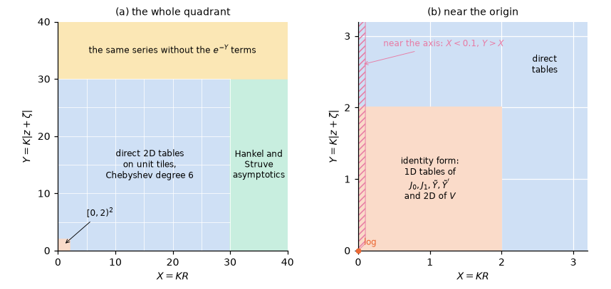
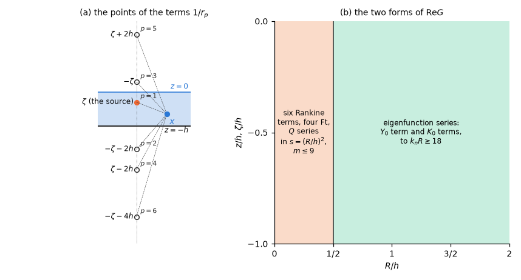
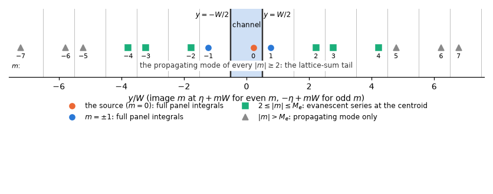

# 8. The free-surface Green function

The free-surface Green function is the kernel of every panel integral of both methods: the
potential of a pulsating source below the free surface that satisfies the linearized free-surface
condition, the bottom condition and the radiation condition. It has no closed form. It is a
principal-value integral (infinite depth) or a series of eigenfunctions (finite depth), and a
problem of a few thousand panels needs it, with its first and second derivatives, at many millions
of points per frequency. Evaluating the integral representation by quadrature at each point would
dominate the solve.

HydroBEM therefore evaluates the Green functions and their derivatives from the published
representations only, through tables and approximations that are generated by scripts from
high-precision evaluation and checked against it. This chapter gives the targets they are built to
and the procedure, then the representations and the method in each region: §8.1 infinite depth,
§8.2 finite depth, §8.3 the evaluation of four points at once, §8.4 the frequency limits, §8.5
walls and the channel.

## Targets and procedure

The approximations are built to three targets:

- **Domain.** Every source and field position in the fluid: all $\nu R$ and
  $\nu \lvert z + \zeta\rvert$ in infinite depth; all $R$, $z$, $\zeta$ and $kh$ in finite depth,
  including the near-surface, near-axis and far regimes.
- **Accuracy**, against an arbitrary-precision evaluation of the integral representation: the
  regular part and its derivatives within 2e-6 of $\max(\lvert\text{value}\rvert, \text{scale})$,
  where the scale is the local magnitude of the singular part; in the far field the propagating-wave
  asymptotics are matched.
- **Cost.** In the production path, table and approximation evaluation, not quadrature.

The tables share one form. On each tile a function is a polynomial interpolant at Chebyshev points,
stored in the power basis of the tile variable and evaluated by Horner's rule. For a function
analytic around the tile its error falls geometrically with the degree (Trefethen 2019, ch. 2–4,
8), so a degree is the lowest that meets the target on the error map.

Every approximation is chosen by the same procedure:

1. Reference values over the whole domain (mpmath, 30 digits, cross-checked between
   representations).
2. A choice of approximation per regime from the literature.
3. An error map of every approximation on a dense grid including the edges of the domain; regions
   are split or orders raised until the target holds everywhere.
4. The cheapest combination that meets the target.

The region boundaries and orders are HydroBEM's own; results are compared at the accuracy targets,
not bit by bit. The same procedure fixes the near/far switches of the panel integrals (§6.1, §7.1).

## 8.1 Infinite depth

### The representation

The Green function of a source at $\xi = (\xi, \eta, \zeta)$ and a field point $x = (x, y, z)$, with
the time factor $e^{i\omega t}$ (§1.1) and normalized as $1/r$ ($\nabla^2 G = -4\pi\delta(x - \xi)$,
not $1/(4\pi r)$), is (Newman 1985, eqs. 1–3)

$$
G(x, \xi) = \frac{1}{r} + \frac{1}{r'} + K \,\mathrm{Ft}(X, Y) + i K \,\mathrm{Gi}(X, Y), \tag{8.1}
$$

with $r = \lvert x - \xi\rvert$, $r' = \lvert x - \xi'\rvert$ the distance to the image
$\xi' = (\xi, \eta, -\zeta)$ in $z = 0$, $R$ the horizontal distance and

$$
X = K R, \qquad Y = K \lvert z + \zeta\rvert, \qquad R_0 = \sqrt{X^2 + Y^2} = K r'. \tag{8.2}
$$

The wave part has the real and imaginary parts

$$
\mathrm{Ft}(X, Y) = 2 \operatorname{PV}\!\int_0^\infty \frac{e^{-kY} J_0(kX)}{k - 1} \,\mathrm{d}k, \qquad \mathrm{Gi}(X, Y) = -2\pi e^{-Y} J_0(X). \tag{8.3}
$$

$\mathrm{Ft}$ is the wave part with the image term removed (Newman's $F$ less $1/R_0$). It is smooth
except for the logarithm at $X = Y = 0$ (§6.2), and it obeys the exact identity (from Newman 1985)

$$
\mathrm{Ft} = -2e^{-Y} J_0(X)\left(\log(Y + R_0) + \gamma - \log 2\right) - \pi e^{-Y} \tilde{Y}(X) - 2 R_0 V(X, Y), \tag{8.4}
$$

where $\tilde{Y} = Y_0 - (2/\pi)(\log(X/2) + \gamma) J_0$ is entire and $V$ is smooth on the closed
quadrant. The vertical derivative and the imaginary part follow without tables:

$$
\frac{\partial\mathrm{Ft}}{\partial Y} = -\mathrm{Ft} - \frac{2}{R_0}, \qquad \mathrm{Gi} = -2\pi e^{-Y} J_0(X). \tag{8.5}
$$

### The method by region

The quadrant $X, Y \ge 0$ is divided into four regions (Figure 1, Table 1).

*Figure 1. The evaluation of the wave part over $(X, Y)$. (a) The whole quadrant: direct tables on
unit tiles below 30, the asymptotic forms beyond. (b) Near the origin: the identity (8.4) in
$[0, 2)^2$, around the logarithm at the origin, and the strip near the vertical axis where the
quotients of the second derivatives are taken with care.*

*Table 1. The evaluation of the infinite-depth wave part by region.*

| Region | Method | Measured error |
|---|---|---|
| $(X, Y)$ outside $[0, 2)^2$, both below 30 | direct 2D tables of $\mathrm{Ft}$, $\partial\mathrm{Ft}/\partial X$, $e^{-Y} J_0$ and $e^{-Y} J_1$ on unit tiles, Chebyshev degree 6 | $\le$ 2.5e-7 |
| $[0, 2)^2$ | the identity (8.4) with 1D tables of $J_0$, $J_1$, $\tilde{Y}$, $\tilde{Y}'$ (degree 16) and 2D tables of $V$, $\partial V/\partial X$ (degree 7) | $V$: 1.9e-10 |
| $X \ge 30$ ($Y < 30$) | Hankel and Struve asymptotics (Abramowitz & Stegun 9.2.5–9.2.10, 12.1.29; 14 terms) and the remaining integral by partial integration | $\le$ 1.6e-14 |
| $Y \ge 30$ (any $X$) | the same series without the $e^{-Y}$ terms | $\le$ 1.6e-14 |

The partial-integration series is stopped when the bound of its next term is below 1e-14, or after
15 terms; at $X = 30$ that bound is 6e-12, while the measured error of the asymptotic forms is at
most 1.6e-14. Where both $X$ and $Y$ reach 30, the $Y \ge 30$ form is used.

### Why these degrees and forms

- **Direct tables, degree 6.** It is the lowest degree meeting 2e-6: measured 2.5e-7 for the
  direct tables, an eightfold margin; degree 5 gave 5.1e-6.
- **The identity inside $[0, 2)^2$.** There the curvature of the logarithm raises the derivative
  error of direct tables to 4e-6, above the target. The identity (8.4) takes the logarithm out
  analytically and leaves smooth functions to the tables.
- **$V$ of degree 7.** It is the cheapest degree with four orders of margin to 2e-6 (1.9e-10);
  degree 6 gave 5e-9, degree 8 4e-12.
- **Direct tables outside $[0, 2)^2$.** Of the two forms that meet the target there, the direct
  tables are the cheaper: one Horner pass gives $\mathrm{Ft}$, $\partial\mathrm{Ft}/\partial X$,
  $e^{-Y} J_0$ and $e^{-Y} J_1$ together, while the identity needs the logarithm and three tables.
  The identity form took 58 ns per evaluation, the asymptotic forms 78 ns ($Y \ge 30$) and 121 ns
  ($X \ge 30$) (Intel i5-13500); the cost target of this chapter is met by tables and series
  alone.

### Accuracy

Measured by `scripts/gen_green_tables.py`
([green_inf_error_map.md](../development/error-maps/green_inf_error_map.md)): the direct tables
within 2.5e-7, the asymptotics within 1.6e-14. Over 1474 reference points $\mathrm{Ft}$ is within
8.6e-8 and $\partial\mathrm{Ft}/\partial X$ within 4.7e-7, relative to
$\max(\lvert\text{value}\rvert, \text{singular scale})$. A checksum of the tables is verified before
their first use.

### Second derivatives near the vertical axis

The second derivatives contain the quotients $F_X/X$ and $\mathrm{Gi}_X/X$, which a small $X$ would
turn into a division of a table error by a small number. Near the vertical axis ($X < 0.1$, $Y > X$)
the table value on the axis is subtracted before the division ($F$ is even in $X$), and on the axis
itself the limits are used:

$$
\frac{F_X}{X} \to -\frac{F_{YY}}{2}, \qquad \frac{\mathrm{Gi}_X}{X} \to \pi e^{-Y} \qquad (X \to 0). \tag{8.6}
$$

The other second derivatives follow from $\mathrm{Ft}_Y = -\mathrm{Ft} - 2/R_0$, Laplace's equation and
Bessel's equation.

## 8.2 Finite depth

In water of depth $h$ the Green function must also satisfy the bottom condition. HydroBEM uses two
representations, each where it converges fast: Newman's (1985) decomposition, as analysed by
Wuillaume (2022), for horizontal distances small compared with the depth, and John's (1950) series
of eigenfunctions for the others. The time factor and normalization are those of §8.1.

### Notation

With $H = Kh$, $R$ the horizontal distance and $X = KR$, the six Rankine terms of the decomposition
have the distances $r_p = \sqrt{R^2 + v_p^2}$ with the vertical distances

$$
\begin{aligned}
&v_1 = \lvert z - \zeta\rvert, \quad v_2 = z + \zeta + 2h, \quad v_3 = \lvert z + \zeta\rvert,\\
&v_4 = z - \zeta + 2h, \quad v_5 = -z + \zeta + 2h, \quad v_6 = z + \zeta + 4h,
\end{aligned} \tag{8.7}
$$

and $V_p = K v_p$. They are the distances from the field point to the source and to its images in
the free surface and the bottom (Figure 2a).

*Figure 2. (a) The points whose distances from the field point $x$ are the six $r_p$: the source
and its images in the free surface and the bottom. (b) The two forms of $\operatorname{Re} G$ over
the horizontal distance: the decomposition for $R/h < 1/2$, the eigenfunction series beyond.*

### Near: the decomposition, $R/h < 1/2$

$$
\begin{aligned}
\operatorname{Re} G = {}&\sum_{p=1}^{6} \frac{1}{r_p} + K\left[\mathrm{Ft}(X, V_3) + \mathrm{Ft}(X, 2H - V_1) + \mathrm{Ft}(X, 2H + V_1) + \mathrm{Ft}(X, 2H + V_2)\right]\\
&+ \frac{1}{h}\left[Q(s, w_1) + Q(s, w_2)\right], \qquad Q = \sum_{m=0}^{9} s^m Q_m(w, H), \quad s = (R/h)^2,
\end{aligned} \tag{8.8}
$$

with $w_p = (v_p/h)^2$ and the infinite-depth $\mathrm{Ft}$ of §8.1. The series in $s$ is truncated at
$m = 9$: the $m = 9$ term is at most 1.2e-11 at $s = 1/4$.

### Far: the eigenfunction series, $R/h \ge 1/2$

$$
\operatorname{Re} G = -A_0 E Y_0(k_0 R) + \sum_n c_n \cos k_n(z + h) \cos k_n(\zeta + h) K_0(k_n R), \qquad c_n = \frac{4(k_n^2 + K^2)}{k_n^2 h + K^2 h - K}, \tag{8.9}
$$

the propagating term with $Y_0$ and the evanescent terms with $K_0$. The series is stopped at
$k_n R \ge 18$: a term there is at most $K_0(18)/K_0(1/2) \approx 5 \cdot 10^{-9}$ of the first, its
$R$-derivative about 1e-7.

### The imaginary part

In both forms

$$
\operatorname{Im} G = -A_0 E J_0(k_0 R), \tag{8.10}
$$

with the coefficient of the propagating mode and its depth factor

$$
A_0 = \frac{2\pi k_0}{1 - e^{-4k_0h} + 4 k_0 h e^{-2k_0h}}, \qquad E = \sum_{p=3}^{6} e^{-k_0 v_p} = (1 + e^{-2k_0h})^2 Z(z) Z(\zeta), \qquad Z = \frac{\cosh k_0(z + h)}{\cosh k_0h}. \tag{8.11}
$$

In infinite depth $A_0 \to 2\pi K$ and $E \to e^{K(z + \zeta)}$, which is the $\mathrm{Gi}$ of §8.1.

### Tables and tiles

*Table 2. The approximations of the finite-depth Green function.*

| Part | Approximation | Measured error |
|---|---|---|
| $Q_m$ | 2D Chebyshev tables in $w$ (degree 12) and $\log H$ (degree 14) on 12 regions of $[10^{-12}, 50]$ split by the error map; in $1/H$ (degree 8) above 50; the $H \to 0$ limit below 1e-12 | $\sum_m 4^{-m} \lvert\Delta Q_m\rvert \le 2.0 \cdot 10^{-10}$, derivatives $\le$ 1.7e-9 |
| $K_0$, $K_1$ | scaled $e^x \sqrt{x} K_0$, $K_1$ tiles (degree 17) | |
| the two smooth parts, per frequency | $8 \times 8$ and $8 \times 16$ tiles of Chebyshev degree 5, the value and both derivatives each fitted to their direct values | against direct: $\le$ 2.2e-8 (values), 2.0e-7 (derivatives) |

The $Q_m$ are computed by verified double contour quadrature (`scripts/green_finite_quad.py`; error
map [green_fin_error_map.md](../development/error-maps/green_fin_error_map.md)).

Per frequency, the two smooth parts of (8.8) are interpolated on tiles. The value and both
derivatives are each fitted to their direct values: differentiating the fit of the value amplified
the table noise to 8e-6.

### Why these choices

- The switch at $R/h = 1/2$ and the expansion in $s$ follow Newman (1985). On the near side the $s$
  series is truncated at $m = 9$, on the far side the series stops at $k_n R \ge 18$ (both above).
- Degree 12 in $w$, because degree 10 left 1.7e-8 in the derivative of $Q_m$ near $H = 8$.
- The per-frequency tiles replace the sum of the $Q_m$ tables over $H$ at every evaluation by two
  tile polynomials. When they were introduced, an evaluation of the integral form took 145–200 ns
  instead of 300–550 ns (Intel i5-13500).
- $8 \times 8$ tiles of degree 5 are the cheaper of the two refinements that meet the target:
  $4 \times 4$ tiles of degree 5 left 6.6e-7 at $H = 1000$; $8 \times 8$ tiles or degree 7 reduce
  that 300-fold.

### Accuracy

Measured over 1960 points ($R/h$ 0–5, from the surface to the bottom, $H$ = 1e-14–1e5 and both
limits): $\operatorname{Re} G$ within 8.2e-8, the derivatives within 3.0e-7,
$\operatorname{Im} G$ within 2e-15.

### Dispersion roots

The propagating root solves

$$
x_0 \tanh x_0 = H \tag{8.12}
$$

by Newton's method safeguarded by bisection on the bracket
$\max(H, \sqrt{H}) \le x_0 \le (H + \sqrt{H^2 + 4H})/2$ ($x_0 = H$ for $H \ge 40$). The evanescent
roots $x_n = n\pi - d$ solve

$$
(n\pi - d) \sin d - H \cos d = 0 \tag{8.13}
$$

likewise. Both are iterated until the step no longer changes the iterate: within 2 ulp of 40-digit
roots (test-plan A3).

## 8.3 Four points at a time

The wave kernel at the Gauss points takes 61–71 % of the CPU time of a higher-order solve (and
55–70 % of the low-order assembly), and scalar float32 is no faster than float64, so only the
vector width can shorten it. The assemblies (the low-order panel pairs of a row in the order of the
loops, the higher-order Gauss points of a panel) therefore evaluate the kernel four pairs at a time
with AVX2 where the four share the coefficients of one table tile, and one pair at a time
otherwise.

### Where four points share a tile

- **Infinite depth, ordinary frequencies.** The near branch of §8.1 (one unit tile of $[0, 2)^2$:
  the Horner chains of the 1D and $V$ tables in the four lanes, $e^{-Y}$ and $\log(Y + R_0)$ per
  point) and the direct tables (one unit tile outside $[0, 2)^2$).
- **Finite depth, $R/h < 1/2$, with the per-frequency tiles.** The two smooth parts where the four
  share a tile, the $\mathrm{Ft}(X, V_3)$ term by the infinite-depth branches above, and
  $J_0$, $J_1(k_0 R)$ by the 1D table where the four share a unit tile, each part separately; the
  rest of the kernel per point.
- **Finite depth, $R/h \ge 1/2$** (four pairs all in the series form). The scaled $K_0$, $K_1$ of
  every root four pairs at a time (the tile of each lane gathered, since the tiles differ per pair
  and root), and $(J_0, Y_0, J_1, Y_1)(k_0 R)$ where the four share a tile; the exponentials,
  square roots, sums and Rankine terms per pair, each pair stopping at its own root. A group across
  $R/h = 1/2$ goes one pair at a time.

### Identical to one point at a time

Each operation is the one-point operation in the same order (multiplication then addition, no
fused multiply-add), so the kernels and every result are equal to the bit to the one-point
evaluation. Fused multiply-add and vector exponentials and logarithms would be faster still (18.7 ns
for the near branch with FMA) but change the last bits; they are not used, so that the four-point and
the one-point evaluation stay identical.

### Why broadcasting works, and what it gains

In the order of the loops 91–93 % of the groups of four consecutive points share one tile, so the
coefficients of a tile are broadcast to the four lanes without a gather (a gather per lane gained
only 1.1 times in a prototype). Table 3 gives the measured gains.

*Table 3. The gain of the four-point evaluation.*

| Branch | Gain |
|---|---|
| infinite depth, near branch | 53.7 $\to$ 22.4 ns per point |
| finite depth, integral form | 2.2–2.7 times faster |
| finite depth, series form | 1.1 times (its scalar exponential of every root dominates) |

## 8.4 Frequency limits

At $\omega = 0$ and $\omega = \infty$ the free-surface condition becomes a rigid lid and a
pressure-release surface, and the Green function becomes a sum of Rankine images. HydroBEM solves
these limits directly rather than approximating them by small or large finite frequencies.

- **$\omega = 0$**: the rigid-lid (Neumann image) kernel. In finite depth it is the kernel with the
  gauge constant $C = -(\log Kh + i\pi)/h$ removed, whose series form is

  $$
  -\frac{2}{h}\left(\log\frac{R}{2h} + \gamma\right) + \frac{4}{h} \sum_n \cos\frac{n\pi(z+h)}{h} \cos\frac{n\pi(\zeta+h)}{h} K_0\!\left(\frac{n\pi R}{h}\right). \tag{8.14}
  $$

  For the zero-net-flux modes that are admitted (reference/inputs-rules §1, rule 9) $C$ drops out of
  the equation, so the solution is the limit of the finite-frequency solutions.
- **$\omega = \infty$**: $\phi = 0$ on $z = 0$ (Dirichlet images). In finite depth the kernel is
  $1/r_1 + 1/r_2 - \sum_{p=3}^{6} 1/r_p$ plus the series

  $$
  \frac{4}{h} \sum_n \cos\frac{(n - \tfrac{1}{2})\pi(z+h)}{h} \cos\frac{(n - \tfrac{1}{2})\pi(\zeta+h)}{h} K_0\!\left(\frac{(n - \tfrac{1}{2})\pi R}{h}\right). \tag{8.15}
  $$

At the limits the log-singularity integral is off and the smooth part is taken at the centroid. The
limits are solved first, radiation only. They are never replaced by small or large finite
frequencies; finite frequencies converge to them (test-plan B).

## 8.5 Walls and channel

### Walls

Walls $x = 0$ and $y = 0$ are represented by the method of images: 1 or 3 image bodies with the
same normal velocity per panel. The incident wave includes its reflections, also in the Haskind
relation.

### The channel

A channel has walls at $y = \pm W/2$ in finite depth. Its Green function is the sum over the wall
images of the source,

$$
G_{\mathrm{ch}} = \sum_m G(x, \xi_m), \tag{8.16}
$$

the image $m$ at $\eta + mW$ for $m$ even and at $-\eta + mW$ for $m$ odd, each image scaled by the
reflection factor (below). The sum converges slowly, because the propagating part of a distant
image decays only like the inverse square root of its distance; the images are therefore treated in
three groups (Figure 3, Table 4).

*Figure 3. The wall images of a source in a channel, by how they are summed: the source and the
images $m = \pm 1$ with the full panel integrals, the evanescent series of the images up to $M_e$
at the centroid, and the propagating mode of every image $\lvert m\rvert \ge 2$ by the lattice-sum
tail.*

*Table 4. The images of the channel sum and their evaluation.*

| Images | Evaluation |
|---|---|
| $m = 0, \pm 1$ | the full panel integrals and the per-frequency kernel |
| $2 \le \lvert m\rvert \le M_e$, evanescent modes | the evanescent series at the centroid, $M_e = 1 + \lceil 18/(k_1W)\rceil$ (the next image below $e^{-18}$) |
| $\lvert m\rvert \ge 2$, propagating mode | the tail from the lattice sum $F$ minus its nearest terms (below) |
| $\lvert m\rvert \ge 2$, $\omega = 0$ | the 2D term $-(2/h) \log R_m$ in closed form (below) |

The propagating tail is taken from the lattice sum

$$
F(x, s) = \sum_j H_0^{(2)}\!\left(k_0\sqrt{x^2 + (s - 2jW)^2}\right) \tag{8.17}
$$

minus its nearest terms. It is evaluated by the strip-mode series for $x \ge 2\tilde{a}d$ ($d = 2W$,
until $\lambda_n x > 40$) and by the Ewald form of Linton (1999) below. His parameter $\tilde{a}$ is
here $\min(0.4, 2/(k_0d))$ **[C]**, so that $k_0\tilde{a}d/2 \le 1$ and the two parts of the Ewald
form stay of moderate size. The Ewald form uses the Faddeeva function of Weideman (1994; $N = 40$
**[C]**, measured to 7e-16 against arbitrary precision), with its reflection, which removes the
overflow of the products $e^{\lambda x} \operatorname{erfc}$. The tail is tabulated per frequency
in Chebyshev tiles of degree 11 and size $\le \lambda/2$. The lattice sum $F$ agrees with an
arbitrary-precision reference to 1.5e-14, the tiles with $F$ to 1.6e-11 (derivatives 5e-9).

At $\omega = 0$ the images $\lvert m\rvert \ge 2$ contribute the 2D term $-(2/h) \log R_m$, summed in
closed form,

$$
\sum_j \log\lvert z - 2jWi\rvert = \log\lvert 2 \sinh(\pi z/2W)\rvert + \text{const}, \tag{8.18}
$$

minus the included images. The constant multiplies the net flux, which is zero for the admitted
modes.

The truncations are fixed: the far-image tail is exact to 1e-11, and the converged value is reached
to 1e-6. A channel with $W < h/\pi$ is rejected.

### The reflection factor

The reflection factor $R$ is uniform **[C]**:

$$
G_R = G_{\mathrm{open}} + R (G_{\mathrm{channel}} - G_{\mathrm{open}}), \tag{8.19}
$$

linear between the open sea and the reflecting channel. For any $R > 0$ the channel's resonances
$W = n\lambda/2$ therefore remain. A factor $R^{\lvert m\rvert}$ per image would need a damped,
non-periodic lattice sum and is not used. With $R = 0$ no wall image is summed (the open sea of the
same depth): no far images, no tail, and no channel resonance.

### The channel in the higher order

The images $m = \pm 1$ are image instances of every patch ($y \to \pm W - y$, with the unknowns and
the mirror motion of the original, as the wall images), so that the static integrals, the log
corrections and the wave part treat them as any patch; their columns are scaled by the reflection
factor. The images $2 \le \lvert m\rvert \le M_e$ and the propagating tail (the same terms as above)
are summed at the points of the wave rows of every original patch: by the far rule, and by the inner
rule within 3 panel sizes of the nearest far image. The frame is the global one (the walls), the
group the reflections $x \to -x$ and, for bodies on the centreline, $y \to -y$.

### Lids and sheets in a channel

A lid column is $-(K - \kappa)$ times the channel source integral (near and far images); its rows
have the free term $+4\pi$ as in the open sea (§9.2).

A sheet row takes the channel kernel in both derivatives. The images $m = \pm 1$ use the Rankine and
wave integrals of §9.6 at the sheet point reflected in the wall, with its normal reflected:
$\partial/\partial n_x$ of $G(x_m, \xi)$ is $(R n_x) \cdot \nabla$ at $x_m$, with
$R = \operatorname{diag}(1, -1, 1)$. The far images use their second derivatives at the centroid
(higher order: at the points of the wave rows):

- the evanescent series, with $K_0'' = K_0 + K_1/x$;
- the periodic logarithm at $\omega = 0$, from $(\log g)'' = -f^2 \operatorname{csch}^2(fz) + 1/z^2$;
- the propagating tail, from the second derivatives of its Chebyshev tiles.

These are tested against central differences of the far-image source and dipole integrals (about
1e-10 of the largest value).
