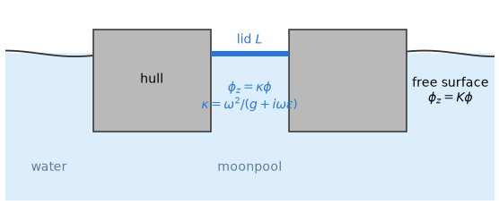
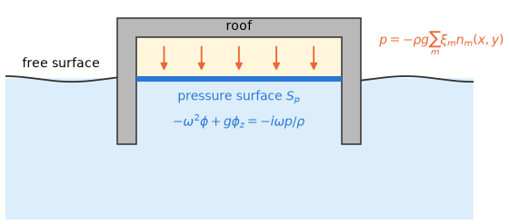
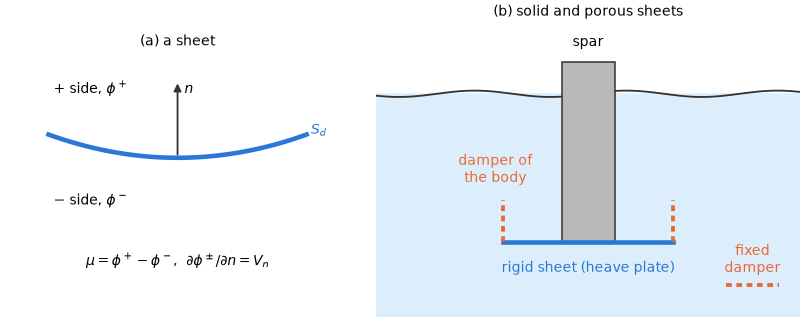
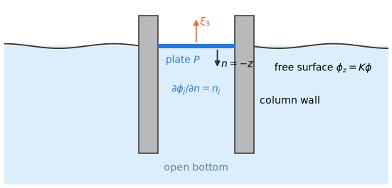

# 9. Special surfaces

The boundary-value problem of §1 has two kinds of boundary: the free surface $z = 0$, where the
linearized free-surface condition holds, and the wetted surface of the bodies, where the normal
velocity of the water equals that of the body. Many structures need a third kind of surface,
which replaces or modifies one of these two conditions on a part of the boundary: the water
surface in a moonpool that should lose energy, the water under the air of a chamber, a heave
plate a few centimetres thick, a perforated skirt, or the light piston floating on the water
column of an oscillating water column.

This chapter describes four such surfaces: damping lids, prescribed-pressure surfaces, thin sheets
with their porous kind (the dipole dampers), and free-surface plates. Each one is a boundary condition of its own, enters
the integral equation of §6 and §7 in its own way, and has its own limits. Table 1 compares them;
the sections that follow take one surface at a time, first its physics and then its method.

*Table 1. The special surfaces: what each is, the condition it imposes, what it moves with and
whether it carries a force.*

| Surface | What it is | Condition | Moves with | Force |
|---|---|---|---|---|
| damping lid (§9.1, §9.2) | a part $L$ of the free surface whose waves are damped (a moonpool, a gap) | $\phi_z = \kappa\phi$, $\kappa = \omega^2/(g + i\omega\epsilon)$ | nothing (part of $z = 0$) | none |
| prescribed-pressure surface (§9.3, §9.4) | a horizontal water surface under a prescribed pressure (an air cushion, a chamber) | $-\omega^2\phi + g\phi_z = -i\omega p/\rho$ | placed with its body; driven by its pressure modes, coordinates of their own | on its pressure coordinates |
| thin sheet (§9.5, §9.6) | a solid surface of zero thickness (a heave plate, a skirt, a baffle) | $\partial\phi^\pm/\partial n = V_n$ on both faces, unknown jump $\mu$ | its body | on its body, by the jump |
| dipole damper (§9.5, §9.6) | a porous sheet | $\mu = -(i\epsilon/\omega)\,\psi_n$ | its body, or nothing (a fixed damper) | on its body; a fixed damper on none |
| free-surface plate (§9.7, §9.8) | a massless rigid plate in $z = 0$, water below only (a piston, a mat, a cover) | $\partial\phi_j/\partial n = n_j$ | every mode of its body | on its body |

The inputs that create these surfaces are in reference/inputs-bodies §2 (the surfaces of a body)
and reference/inputs-model-objects §1, §2 (lids and fixed dampers); which of them go together is
in reference/inputs-rules §2.

## 9.1 Physical damping lids

Linear potential flow has no dissipation. Where the water surface of a moonpool or a narrow gap
should lose energy, a damping lid replaces the free-surface condition on a part $L$ of $z = 0$ by a
condition that removes energy from the waves there (Figure 1).

*Figure 1. A damping lid $L$ on the water surface of a moonpool. Outside the hull the free-surface
condition holds; on the lid the dissipative condition (9.2).*

**The condition [C].** On the lid a damping pressure $\rho\epsilon\, \partial\eta/\partial t$ acts on the
surface, with the damping factor $\epsilon$ = `damping_factor` $\ge 0$ (m/s). The dynamic
condition then reads

$$
(g + i\omega\epsilon)\, \eta = -i\omega \phi \qquad \text{on } L. \tag{9.1}
$$

With the kinematic condition $\eta = \phi_z/(i\omega)$ this gives the condition of the lid,

$$
\phi_z = \kappa \phi, \qquad \kappa = \frac{\omega^2}{g + i\omega\epsilon} \qquad \text{on } L. \tag{9.2}
$$

It is a variant of the dissipative free-surface condition of Chen (2004, eq. 54), which damps the
potential with a rate $\mu$ (1/s), $\kappa = (\omega^2 - i\omega\mu)/g$ in this time factor. The two
agree to first order in the damping with $\mu = \omega^2\epsilon/g$.

The limit $\epsilon = 0$ is the ordinary free surface, not a rigid plate. (A rigid plate in the
free surface is the subject of §9.7.)

**Why it fits the integral equation.** Condition (9.2) stays of the Robin kind of the free
surface. With the Green function of the free surface, which satisfies the free-surface condition
on all of $z = 0$, a lid therefore enters the integral equation as the single term
$(K - \kappa) \int_L \phi\, G \,\mathrm{d}S$ (§5.2); §9.2 gives its place in the equation. Two
properties follow. At $\epsilon = 0$ the term vanishes and the system reduces exactly to that of
the open free surface. And reciprocity keeps $A$ and $B$ symmetric, with $B \ge 0$.

**The elevation of the lid.** The kinematic condition $\eta = \phi_z/(i\omega)$ with (9.2) gives

$$
\eta = \frac{\kappa \phi}{i\omega} \qquad \text{on } L, \tag{9.3}
$$

which for $\epsilon = 0$ is the open-water $\eta = -(i\omega/g)\, \phi$. It is reported at the lid
panel centroids, per unit displacement for radiation and total (incident + scattered) for
diffraction ([reference/results.md](../reference/results.md)).

**Forces.** Lids carry no forces; only wetted body panels do.

## 9.2 Damping lids: the method

This section places the lid of §9.1 in the discretized integral equation.

**The equation.** Green's theorem with $G$ satisfying $\partial G/\partial\zeta = KG$ on all of
$z = 0$, and the lid condition $\phi_z = \kappa\phi$ (9.2), leaves on each lid $L_l$ one column
with the lid potential as unknown, in every row:

$$
c\, \phi(x) + \int_S \phi \frac{\partial G}{\partial n} \,\mathrm{d}S - \sum_l (K - \kappa_l) \int_{L_l} \phi\, G \,\mathrm{d}S = \int_S G \frac{\partial\phi}{\partial n} \,\mathrm{d}S. \tag{9.4}
$$

Lid rows have the free term $c = +4\pi$. The column carries no normal, so a lid takes either
orientation as it is.

**Properties.**

- $\epsilon = 0$ gives $\kappa = K$: the term vanishes and the system reduces exactly to the open
  free surface (tested).
- Reciprocity keeps $A$ and $B$ symmetric.
- At $\omega = 0$ and $\infty$ a lid is the free surface.
- Several lids may have different $\epsilon$.
- Lid panels are placed exactly in $z = 0$ and use the in-plane integrals of §6.2.

**The scattered potential (low order).** The scattered potential $\phi_S = \phi - \phi_I$
satisfies on the lid, from (9.2) and $\phi_{Iz} = K\phi_I$,

$$
\phi_{Sz} - \kappa\phi_S = (\kappa - K)\phi_I \qquad \text{on } L. \tag{9.5}
$$

So the lid keeps its column and carries the boundary value $(K - \kappa)\phi_I$ along the normal
into the fluid ($-z$), as the body carries $-\partial\phi_I/\partial n$. The lid elevation and the
field take the total potential $\phi_S + \phi_I$ on the lid. The higher order solves lids in the
total formulation.

**Not available.** The momentum drift and the potential QTF with damping lids
(reference/inputs-rules §2).

## 9.3 Prescribed-pressure surfaces (air cushions, chambers)

The water under an air cushion or inside the chamber of an oscillating water column is not a free
surface: the air above it presses on it with a pressure that the problem prescribes. A
prescribed-pressure surface $S_p$ is such a horizontal surface at the depth $z_p \le 0$, and the
pressure on it is described by *pressure modes* (Figure 2).

*Figure 2. A prescribed-pressure surface $S_p$ under the air of a chamber: the applied pressure
$p$ of the pressure modes acts on the water surface inside it.*

**The condition.** Each pressure mode $m$ has a shape $n_m(x, y)$ and is a generalized coordinate
$\xi_m$, measured in metres of pressure head. The applied pressure is

$$
p = -\rho g \sum_m \xi_m\, n_m(x, y). \tag{9.6}
$$

The dynamic and kinematic conditions with this pressure give, in the time factor $e^{i\omega t}$,

$$
-\omega^2 \phi + g \phi_z = -\frac{i\omega p}{\rho} \qquad \text{on } S_p. \tag{9.7}
$$

**The radiation problem of a pressure mode [C].** The pressure-mode radiation problem is

$$
L \phi_j = \phi_{jz} - K \phi_j = n_j \qquad \text{on } S_p, \tag{9.8}
$$

with $n_j = 0$ there for the rigid modes. It is posed in the applied pressure itself. The reason is
the coordinate: the pressure head of a mode is the coordinate the user prescribes (the uniform
pressure of an air cushion), while elevation modes would have to span an elevation that is not
uniform over the surface ([validation: constants](../validation/cases/constants.md)).

**Forces and coefficients [P].** Lee & Newman (2000) describe the surface by modes of its
elevation instead, with a Neumann condition and the dynamic condition in the equations of motion.
The forms of the generalized forces and coefficients carry over (their eqs. 20–21). On the
pressure coordinates they are

$$
A - \frac{i}{\omega} B = \rho\int n_k \phi_j \,\mathrm{d}S, \qquad X = -i\omega\rho\int n_k \phi_D \,\mathrm{d}S. \tag{9.9}
$$

The reported pressure-surface elevation is the physical elevation of the surface (upward
positive) per unit coordinate (radiation) or total (diffraction).

**Restoring.** The restoring of the pressure coordinates has two terms. The *roof coupling* is the
reciprocal coupling of a chamber with the rigid modes,

$$
C_{3k} = C_{k3} = \rho g\int n_k \,\mathrm{d}S, \qquad C_{4k} = C_{k4} = \rho g\int n_k y \,\mathrm{d}S, \qquad C_{5k} = C_{k5} = -\rho g\int n_k x \,\mathrm{d}S \tag{9.10}
$$

(Lee & Newman 2000, eq. 22) **[P]**. The *overlap stiffness* couples the pressure coordinates
among themselves,

$$
C_{kl} = -\rho g\int n_k n_l \,\mathrm{d}S, \tag{9.11}
$$

derived here for pressure coordinates (for elevation coordinates eq. 22 gives
$+\rho g\int \zeta_k \zeta_l \,\mathrm{d}S$). Two conventions combine these terms (Table 2).

*Table 2. The restoring of the pressure coordinates in the two conventions.*

| Convention | Overlap term | Roof coupling (with `chamber_coupling=True`) |
|---|---|---|
| `variational` | (9.11) | (9.10), reciprocal ($C_{3k} = C_{k3}$, ...) |
| `numeric_compatibility` | (9.11) with the opposite sign | only in the rigid-mode rows ($C_{3k}$, $C_{4k}$, $C_{5k}$; one-way) |

`numeric_compatibility` is the sign convention of the restoring in WAMIT-format `.hst` files
**[B]**; $A$, $B$ and $X$ do not depend on the convention. The roof coupling, in either
convention, is included only with `chamber_coupling=True`; by default (`False`) it is omitted and
the restoring of the pressure coordinates is the overlap term.

**Mode stiffness and damping.** `PressureMode.additional_stiffness` and `.additional_damping` are
added on the diagonal of the pressure coordinates (N/m, N s/m).

The inputs are in reference/inputs-bodies §2.3; the method follows in §9.4.

## 9.4 Pressure surfaces: the method

This section discretizes the pressure surface of §9.3. Where the surface lies decides its free
term, its column and whether the limit $\omega = \infty$ exists (Table 3). A surface within 1e-6 of
the panel diameter of $z = 0$ is placed exactly there.

*Table 3. A pressure surface in the integral equation.*

| Position | Free term | Column | $\omega = \infty$ |
|---|---|---|---|
| in $z = 0$ | $4\pi$ | none ($\partial G/\partial\zeta = KG$) | $\phi = 0$ |
| submerged | $2\pi$ | $-\int \phi\, (\partial G/\partial n + KG) \,\mathrm{d}S$ | not available |

**The right-hand side.** On its surface, pressure mode $k$ has the boundary value $u = -n_k(x, y)$.
For the scattered diffraction potential the boundary value there is
$u = L\phi_I = \partial\phi_I/\partial z - K\phi_I$, which is non-zero only below $z = 0$ in finite
depth.

**Elevations.** Per unit coordinate the elevation of radiation mode $j$, and that of diffraction,
are

$$
\zeta_j = K\phi_j + n_j, \qquad \zeta_D = \frac{K\phi_D}{i\omega}. \tag{9.12}
$$

**Motions and restoring.** The motion system with the pressure coordinates is solved as a saddle
system without fictitious mass (§9.3, §3.1). The restoring and damping of the pressure
coordinates are integrated by the panel or inner rule (exact for flat panels).

**Haskind.** The Haskind relation includes the pressure-surface term, derived here from the
radiation problem (9.8).

## 9.5 Thin (dipole) sheets

### Why thin bodies need their own formulation

Heave plates, skirts, baffles and the walls of a moonpool are often only centimetres thick, while
the panels that describe them are metres wide. Modelling such a plate as an ordinary closed body,
with a panel on each face, puts two almost coincident surfaces into the integral equation. Their
rows become nearly equal and the system loses its accuracy as the thickness goes to zero.

HydroBEM instead treats the plate as a surface $S_d$ of zero thickness, a *sheet*. Its two faces
are told apart by a normal $n$. The face it points away from is the $+$ side and the other face
is the $-$ side (Figure 3a).

*Figure 3. (a) A sheet $S_d$ with its normal $n$, the potentials $\phi^+$ and $\phi^-$ on its two
faces and the jump $\mu$. (b) A spar with a rigid sheet (a heave plate), a porous damper of the
body (a skirt) and a fixed damper at rest.*

### The unknown: the jump of the potential

On a sheet the potential is not continuous: the water on one face moves differently from the
water on the other. The unknown is the jump

$$
\mu = \phi^+ - \phi^- \qquad \text{on } S_d. \tag{9.13}
$$

The normal velocity, by contrast, is continuous. On both faces it equals the normal velocity of
the solid sheet, the body condition:

$$
\frac{\partial \phi^+}{\partial n} = \frac{\partial \phi^-}{\partial n} = V_n \qquad \text{on } S_d. \tag{9.14}
$$

In Green's identity the sheet then appears as a distribution of dipoles of strength $\mu$.
Imposing (9.14) on it gives an equation for $\mu$ whose kernel is hypersingular. It is understood
as a Hadamard finite part and is solved together with the equation of the body surface
**[P]** (Lee & Newman 2005, §2.6, eqs. 23–24). How it is discretized is in §9.6.

### Forces on a sheet

The pressure acts on both faces, so a sheet feels the pressure difference
$p^+ - p^- = -i\omega\rho\,\mu$. Integrated over the sheet, the exciting force and the added mass
and damping are

$$
X_i = i\omega\rho \int_{S_d} n_i\, \mu_D \,\mathrm{d}S, \tag{9.15}
$$

$$
A_{ij} - \frac{i}{\omega} B_{ij} = -\rho \int_{S_d} n_i\, \mu_j \,\mathrm{d}S, \tag{9.16}
$$

where $\mu_D$ is the jump of the diffraction problem, $\mu_j$ that of radiation mode $j$, and $n$
the normal on the $+$ side. There is no Froude–Krylov term: the incident wave is continuous across
the sheet, so its jump is zero.

Which face is called $+$ does not matter. Reversing the sheet's winding reverses both $\mu$ and
$n$, and the products in (9.15) and (9.16) stay the same.

### Porous sheets (dipole dampers)

A perforated plate lets some water through. Following the porous-sheet condition of Chwang (1983)
**[P]**, the pressure jump across it is taken proportional to the flow through it. In terms of
the jump of the potential: the jump is proportional to the relative normal velocity through the
sheet,

$$
\mu = -\frac{i\epsilon}{\omega}\, \psi_n, \qquad \psi_n = \frac{\partial \phi}{\partial n} - v_n, \tag{9.17}
$$

where $v_n$ is the normal velocity of whatever carries the sheet and $\epsilon \ge 0$ (in m/s)
measures the resistance of the perforation. The sign, that of the jump convention (9.13), is
chosen so that the sheet dissipates energy.

The two limits of $\epsilon$ recover familiar cases:

- $\epsilon = 0$: no jump, so the sheet is invisible to the flow (no sheet);
- $\epsilon \to \infty$: $\partial\phi/\partial n \to v_n$, which is the rigid sheet of (9.14).

A porous sheet can belong to a body or stand still (Table 4, Figure 3b).

*Table 4. The two kinds of dipole damper.*

| | moves with | $v_n$ | in the forces of |
|---|---|---|---|
| damper of a body | its body | the body's normal velocity | its body |
| fixed damper | nothing (at rest) | 0, so $\psi_n = \partial\phi/\partial n$ | no body |

Both kinds give symmetric added mass and damping and a damping $B \ge 0$.

### What is not available

Some results are not defined with dipole dampers; a rigid sheet has none of these limits. Each
has its own reason:

- the limits $\omega = 0$ and $\omega = \infty$: the jump (9.17) carries the factor $1/\omega$
  and has no limit at either;
- the mean drift by momentum conservation: the dampers absorb energy;
- with a fixed damper anywhere in the model, the Haskind relation for the exciting force of every
  body: the relation needs a jump that moves with the body.

Sheets of either kind are further excluded from some combinations of the drifts, the velocities
and the potential QTF (reference/inputs-rules §2). The inputs that create sheets and dampers are in
reference/inputs-bodies §2.1 and reference/inputs-model-objects §2.

## 9.6 Thin sheets: the method

This section discretizes the sheets of §9.5: the rows of a sheet, the columns of the other
surfaces in them, the junction of a sheet with a surface of $z = 0$, and the integrals of the low
and the higher order.

### The rows of a sheet

A sheet carries the jump $\mu = \phi^+ - \phi^-$. In the body rows its columns are dipoles without
sources. Its own rows are the normal derivative of Green's identity at the sheet centroids $x_k$:

$$
\sum_n H(k, n)\, q_n = 4\pi u_k + \sum_{n \text{ off the sheets}} K'(k, n)\, u_n, \tag{9.18}
$$

with $n$ over every panel: $q_n = \mu_n$ on the sheet panels and $q_n = \phi_n$ (the potential
columns) on the wetted panels, both with the hypersingular kernel (a Hadamard finite part) and the
other kinds with the columns below,

$$
H(k, n) = \int_n \frac{\partial^2 G(x_k, \xi)}{\partial n_x\, \partial n_\xi} \,\mathrm{d}S_\xi, \qquad K'(k, n) = \int_n \frac{\partial G(x_k, \xi)}{\partial n_x} \,\mathrm{d}S_\xi. \tag{9.19}
$$

Here $n_x$ is the sheet normal at $x_k$, $n_\xi$ the normal of panel $n$, $u_n$ the boundary value
of panel $n$ and $u_k$ the normal velocity of the sheet (Lee & Newman 2005, §2.6, eqs. 23–24).

### The other surfaces in a sheet row

The columns of the other surfaces in a sheet row are the normal derivatives of their columns in
the body rows (Table 5). Their boundary values enter as those of the body, $\sum K' u$ (a pressure
mode, the scattered boundary value of a pressure surface or of a lid). So sheets combine with lids
and pressure surfaces in both methods (the low order in the scattered formulation).

*Table 5. The columns of the other surfaces in a sheet row.*

| Surface | Column in a sheet row |
|---|---|
| interior surface | $K K'$ |
| damping lid | $-(K - \kappa) K'$ |
| pressure surface, submerged | $H + K K'$ |
| pressure surface in $z = 0$ | none |
| free-surface plate | $-K\, \partial/\partial n_x \int G$ (§9.8) |

### A sheet meeting a surface of $z = 0$

A sheet may hang from a lid or a free-surface plate, its edge in $z = 0$ on them (the skirt of an
oscillating water column). The water on the two sides of the sheet is not the same, so the
potential of the lid or plate jumps by the sheet's $\mu$ across the junction line.

The single layer of the lid or plate, $-(K - \kappa) \int \phi G \,\mathrm{d}S$, then has a density
that jumps there. The horizontal derivative of a single layer in $z = 0$ whose density jumps by
$\Delta\sigma$ across a line grows as $4\Delta\sigma \ln(1/d)$ at the depth $d$ below the line (the
jump times the line integral of $2/r$). The sheet rows next to the junction see it, and an element
of the lid or plate that straddles the line (one constant $\phi$, or one smooth $\phi$ of a patch)
cannot represent it.

The error it leaves does not fall with the panels (about 1 % in the Haskind relation of a disc
with a skirt), while the elements ending on the sheet's edge converge as $h^2$. The rules therefore
require that the elements end on the sheet's edge (reference/inputs-rules §1 rule 3). The results
for a plate with a skirt are in §9.7.

### Low order: the Rankine parts

The Rankine parts are exact. With the Rankine source $S = \int \mathrm{d}S/\lvert x - \xi\rvert$
and dipole $\Omega = \int n \cdot (x - \xi)/\lvert x - \xi\rvert^3 \,\mathrm{d}S$ of §6.1, their
gradients in $x$ are

$$
\nabla S = -\sum_e m_e L_e - n\Omega, \qquad \nabla\Omega = -\sum_e \frac{(a \times b)(\lvert a\rvert + \lvert b\rvert)}{\lvert a\rvert\lvert b\rvert(\lvert a\rvert\lvert b\rvert + a \cdot b)}, \tag{9.20}
$$

the second being the vortex ring of the edges (Newman 1986), with the finite part on the panel
itself. In (9.20)

$$
L_e = \log\frac{R_a + R_b + s_e}{R_a + R_b - s_e}, \tag{9.21}
$$

and:

- $m_e$ is the outward in-plane unit normal of edge $e$ (the edge vector $\times\, n$ over its
  length, vertices counter-clockwise about $n$);
- $R_a$, $R_b$ are the distances from $x$ to the ends of the edge and $s_e$ its length;
- $\Omega$ is the solid angle of the panel seen from $x$, positive when $x$ lies on the side of
  $n$;
- $a$ and $b$ are the edge ends relative to $x$.

The free-surface image is added in the same way. Beyond 12 radii a $3 \times 3$ Gauss rule
replaces the exact forms. The wave part takes the gradient and the mixed Hessian at the centroid,
with the derivatives of $\psi$ integrated adaptively for the pairs of §6.2.

### Higher order: dipole patches

The sheets of the higher order are planar dipole patches (straight or curved sides), their rows
computed by the patch quadrature. A closed side (a circle in one patch) is split by its length
like any other side.

**The regular part.** The regular part of a sheet integral is quadrisected where a cell lies
nearer to a target than 2.5 of its sizes, until no cell does; the singular part is subtracted.
Beyond that distance the $6 \times 6$ Gauss rule errs by about $\rho^{-12}$ with
$\rho = 2.5 + \sqrt{2.5^2 - 1} = 4.8$, 7e-9. A target at the distance $d$ needs about
$\log_2(2.5\,\text{size}/d)$ levels, at most 40 ($2^{-40}$ of the span, the rounding of the
parameters).

**The cell of the collocation point.** It is four rectangles with their corner at the point,
each two Duffy triangles of $10 \times 10$ points graded in $q$ as on the body patches (§7.1:
split at $1/\rho$, $2/\rho$, $4/\rho$, … for $\rho > 2$, $\rho$ the physical leg along $q$ over
the leg along $p$).

Both the subdivision and the grading matter next to a side where the profile of an analytic patch
has zero slope: the distance of a Gauss point from that side goes as the square of its parameter
(5e-5 of the patch at 16 spans), the rectangle towards the side is flat and the neighbouring spans
need some 12 levels.

**The side integrals.** They take a 16-point rule on pieces at most half the distance from the
point (an error of about $(4 + \sqrt{15})^{-32}$, below rounding). The pieces come from bisecting
the side: a piece is split while it is longer than half the smallest distance from the point to
its 16 nodes and its ends (at most 48 levels). A point a distance $\delta$ from the side so gets
about $\log_2(\text{length}/\delta)$ levels next to its foot and coarse pieces elsewhere.

The distance must be checked on every piece. A distance sampled once over the whole side (17
points) misses a point near the side between two samples, whose pieces then are far longer than
its distance: the outer Gauss points next to a side of spans graded towards it (an error of up to
0.6 of the term where the jump of the potential is finite).

### Tests

Plate and disc added mass converge to published values; winding reversal and a sheet given as
its own mesh leave the forces unchanged; a closed slab of decreasing thickness approaches the
sheet.

## 9.7 Rigid plates in the free surface

Some floating parts have no draft at all: the light piston on an oscillating water column, a
floating mat of zero draft, a cover. A *free-surface plate* $P$ is such a massless rigid plate
lying in $z = 0$ with the water below it only (Figure 4).

*Figure 4. A free-surface plate $P$: the light piston on the water column of an oscillating water
column, its normal $n = -z$ into the water.*

The plate moves with every mode of its body. On it the free-surface condition is replaced by the
kinematic condition of the plate, the condition of a wetted element:

$$
\frac{\partial\phi_j}{\partial n} = n_j \qquad \text{on } P, \tag{9.22}
$$

with $n = -z$ into the water and $n_j$ of §1.1 and §10.1 (for heave $n_3 = -1$, $\phi_z = 1$).

### The orientation [C]

The normal enters the plate's condition (9.22) and its forces. (A damping lid, whose column
$-(K - \kappa) S$ has none, takes either orientation as it is.) The plate's elements are therefore
turned to $n = -z$ when given the other way.

The plate is plane, so the turn is a relabelling of the same surface and changes no result:

- a low-order panel and a flat patch by their vertex order reversed;
- a B-spline or analytic patch $x(u, v)$ by its parameter $u$ reversed, $x(-u, v)$ (B-spline:
  the $u$ knots reflected about the middle of their range and the coefficients reversed along
  $u$; analytic: the azimuths $\theta_0$ and $\theta_1$ exchanged), which negates $x_u$ and with
  it $x_u \times x_v$, and maps the uniform spans of the potential onto themselves.

The pressure and the interior surfaces, also plane, are turned in the same way
(reference/inputs-bodies §2.4).

### The equation [C]

Written in the form of the free-surface condition, (9.22) reads
$\phi_z - K\phi = -n_j - K\phi$. Green's identity with the free-surface Green function then leaves
on the plate the single-layer term $-K \int_P \phi\, G \,\mathrm{d}S$ beside the body's source term
($\partial G/\partial n = -\partial G/\partial\zeta = -KG$ on $\zeta = 0$):

$$
c\, \phi(x) + \int_S \phi \frac{\partial G}{\partial n} \,\mathrm{d}S - K \int_P \phi\, G \,\mathrm{d}S = \int_{S+P} G \frac{\partial\phi}{\partial n} \,\mathrm{d}S, \tag{9.23}
$$

with $c = 4\pi$ at a point of the plate (a point of the free surface, its source and image
coinciding) and $2\pi$ on the wetted surface $S$.

Equation (9.23) is the damping lid of $\kappa = 0$ (§9.1, the rigid lid; compare (9.4)) with the
plate's normal velocity on the right-hand side. At $K = 0$ ($\omega = 0$) the plate is a moving part
of the rigid lid $z = 0$ and its unknowns stay in use, so the equation is regular at every $K$. A
wetted element in $z = 0$ is not: its source and dipole columns coincide with their images there.

The diffraction problem takes either formulation. The scattered potential has the boundary value
$-\partial\phi_I/\partial n$ of a wetted element (equal to $K\phi_I$, since $\phi_{Iz} = K\phi_I$ on
$z = 0$); the total potential has $\partial\phi_D/\partial n = 0$.

### The choice of the formulation [C]

A plate shields the water below it from the incident wave. On the light piston of a deep
oscillating water column (inner radius 2 m, outer 3 m, draft 10 m, deep water) the total potential
on the plate is the wave that reaches the column's open bottom,
$\lvert\phi_D\rvert \approx 0.21, 0.081, 0.017\, \lvert\phi_I\rvert$ at $\omega = 1.1, 1.4, 1.8$
rad/s ($KH = 1.2, 2.0, 3.3$). The scattered potential there is nearly $-\phi_I$, and incident and
scattered cancel to that small remainder.

Both formulations converge as $h^2$ to the same force (that of the Haskind relation and of the
higher order), and double-precision matrices change nothing: the loss is not rounding but the
discretization error, which in the low order follows the unknown and its variation along the
walls. The scattered unknown carries the incident wave's variation $e^{Kz}$ down the column's inner
wall; the total one is small and nearly uniform there. Table 6 shows the effect on the piston's
exciting force.

*Table 6. The error of the piston's exciting force in the two formulations (low order). The base
mesh has 16 panels around, 20 down the outer wall, 18 down the inner one and 6 rings on the plate;
the finer meshes have twice and four times the panels each way.*

| Mesh | Scattered, $\omega = 1.1, 1.4, 1.8$ | Total, $\omega = 1.1, 1.4, 1.8$ |
|---|---|---|
| base | 7 %, 35 %, 250 % | 1.5 %, 10 %, 55 % |
| twice | 1.8 %, 10 %, 70 % | 0.3 %, 2.6 %, 17 % |
| four times | 0.4 %, 2.6 %, 18 % | 0.05 %, 0.6 %, 4 % |

The total formulation is as accurate as the scattered one on twice the panels. Refining the inner
wall alone is what reduces the scattered error; the plate's panels, and with them its boundary
value $K\phi_I$, do not matter. With a plate the default `"auto"` therefore solves the total
potential (low-order thin sheets keep the scattered one, which they need, §9.6).

Elsewhere the choice matters less:

- On a shallow column (draft 0.5 m or 2 m) the formulations differ by less than their own error.
- The higher order agrees in both formulations (within 1.2 % at $\omega = 1.8$, 1e-3 at
  $\omega = 1.4$, on the patches of the example).
- A prescribed-pressure surface (§9.3) on a column is left to the scattered default: on a chamber
  of draft 5 m in 15 m depth the scattered formulation's exciting flow was the closer to the
  Haskind relation at $ka \le 2.5$ and the farther at $ka = 3$, both converging.

### Forces

The pressure $-i\omega\rho\phi$ acts on the plate as on the wetted surface:

$$
A - \frac{i}{\omega} B = -\rho \int_{S+P} n_i \phi_j \,\mathrm{d}S, \tag{9.24}
$$

and $X$ follows by the pressure and by the Haskind relation of §2.1 over $S + P$. The plate is part
of the body's boundary in Green's second identity; the rest of $z = 0$ is the free surface of both
potentials. $A$ and $B$ are symmetric with $B \ge 0$.

### Hydrostatics

The plate has no volume ($V_x = V_y = V_z = 0$ on it) and its area belongs to the body's
waterplane (§3.2: $\int_W f \,\mathrm{d}A = -\int f n_z \,\mathrm{d}S$ with $n_z = -1$). A body of a
plate only therefore has $C_{33} = \rho g \cdot \text{area}$ and the moments of the plate's area.
The generalized-mode restoring of §10.1, $\rho g \int n_j w_i \,\mathrm{d}S$, includes the plate
($\rho g \cdot \text{area}$ for a uniform heave of the plate).

`mode_restoring` keeps the convention of §10.1. A generalized mode $i$ moving the plate as a piston
($w_i = 1$ on it) has $c_{i3} = c_{ii} = \rho g \cdot \text{area}$ in its row; the rigid heave row
keeps §3.2 ($c_{3i} = 0$), and the coupling of the heave row to the piston
($\rho g \cdot \text{area}$ for a uniform piston) belongs to `mode_stiffness`.

The plate has no mass of its own: its inertia is the body's `mass` and inertia and, for
generalized modes, `mode_mass`, each of which may be zero (§3.1: a massless piston or lid, its
inertia the added mass). The cover of a moonpool of radius 1 m as a body of its own in heave and
pitch, radii of gyration 0.3 m, of mass 1 kg and 1e-3 kg moves as the massless cover to 1.5e-2 and
1.6e-5 of the motions' peak.

### The other surfaces of $z = 0$

A point of $z = 0$ has one condition, so a plate overlaps no other plate, lid, interior surface or
pressure surface in $z = 0$ (their elements may touch along edges).

A thin sheet hanging from a plate (the skirt of an oscillating water column) meets it along the
edges of the plate's elements, for the reason of §9.6: the plate's potential jumps across the
junction, which an element of constant potential (or of one smooth potential, higher order) cannot
hold inside it. With the plate's elements ending on the sheet, the Haskind relation and the energy
of the radiated wave of a disc with a skirt hold to 2e-5 and converge as $h^2$ (both methods); an
element straddling the skirt leaves an error of about 1 % that does not fall with the panels, so
the rules refuse it (reference/inputs-rules §1 rule 3). The same holds for a sheet meeting a
damping lid (§9.1).

### Outputs

The plate has no output of its own: its elevation is its displacement. The body outputs include
its panels (pressure $p/(\rho g) = -(i\omega/g)\phi$, velocity); the vertical velocity there is
that of its boundary condition.

### Limits

- $\omega = 0$ as above; in finite depth a mode moving water through the plate is refused as in
  §1.3.
- $\omega = \infty$ **[C]**: the free surface is $\phi = 0$ (1.18) and the plate keeps its
  condition (9.22). Extend $\phi$ oddly about $z = 0$, $\phi(x, y, -z) = -\phi(x, y, z)$: the
  extension is harmonic in all space outside the bodies, their images and the plate, vanishes on
  the free surface by its oddness, and its vertical velocity is even, so (9.22) holds on both faces
  of the plate while the potential jumps across it by twice its value on the water side. The plate
  is then a rigid thin sheet (§9.5) in unbounded fluid, with the Green function
  $G_\infty = 1/r - 1/r'$ of the limit. Its image coincides with it: on $\zeta = 0$, with
  $n = -z$, $\partial G_\infty/\partial n_\xi = 2\, \partial(1/r)/\partial n_\xi$ and the
  hypersingular kernel doubles likewise, while $G_\infty = 0$ there, so the plate's velocity enters
  only through its own rows, the sheet rows of §9.6. The unknown stays the potential on the water
  side and the forces stay (9.24); the two-face force of the sheet (9.16) is twice it. A heaving
  disc of radius $a$ thus has half of the disc in unbounded fluid, $(4/3)\rho a^3$, and in pitch
  $(8/45)\rho a^5$. A thin sheet hanging from a plate would meet its own image and the plate in one
  line, a junction of three sheets that the sheet rows have no rule for: refused at $\omega = \infty$
  (reference/inputs-rules §2).

### Channels, tanks and the mean drift [C]

- **A channel** (§1.2) changes the Green function only: the plate's column $-K \int_P \phi\, G$
  takes the channel's $G$ with the images of the walls as every column does. A channel is of finite
  depth, so a plate heaving at $\omega = 0$ is refused as in open finite depth.
- **A body with internal tanks** (§10.2): the tank problems are separate from the sea's and take
  the tank walls only, so a plate of the sea changes no tank result, and a tank no result of the
  sea problem. A plate of a tank's own free surface is a plate of the tank problem (§10.2).
- **A trimmed body** (reference/inputs-bodies §1.2): the physics of its plate is that of any plate,
  but a plate given in hull coordinates leaves $z = 0$ under any angle, so the plate is generated
  from the trimmed waterline, the water inside the loop around a point the user gives, its edges
  on the waterline (§14); a plate body over another body's loop (the piston of a trimmed tube) is
  generated from that body's waterline. A trimmed body of plates only would leave $z = 0$: refused.
- **The mean drift by momentum conservation** (§11.1) holds with plates: the plate is part of its
  body's boundary and enters the Kochin function with its column, $-K$ times its source integral;
  the far field needs no value at the plate's edges. Newman's approximation (§12.13) follows from it.
- **The mean drift by pressure integration and its quadratic QTFs** (§11.2, §12.3) hold for a
  plate whose every edge lies on a wall, of its own body (a cover) or of one it slides along (a
  piston in its tube), or between plate elements: the plate joins the body's surface with
  $P^{(0)} = 0$, and the band of the wall's waterline under it takes the plate's pressure at its
  top (§11.2). Where an edge borders the free surface, the vertical velocity jumps from the plate's
  to the free surface's, the velocity across the edge is logarithmically singular, and the
  expansion of §11.2 has no finite line term there without a model of the edge: refused. An edge
  against a plate of another body is the same: the vertical velocity jumps from one plate's motion
  to the other's, and it is refused as a free edge.
- **The potential QTF** (§12.7, §12.8) holds for the same plates, those whose edges lie on walls:
  the plate is part of the body in its integrals, the free surface ends at the plates, and the line
  integral of a wall's waterline under a plate takes the plate's sliding along the wall. At an edge
  bordered by free surface its free-surface forcing is not integrable: refused for good.
- **The control-surface drift and its QTFs** (§11.3) hold for the plates of the body inside its
  own control surface under the same rule of the edges: the plate is part of the body, the free
  surface inside the control surface ends at the outer waterline of hull and plates, the waterline
  under a plate has no line term, and the plate's area joins the waterplane of the hydrostatic
  part. A plate body inside another body's control surface is refused as any second body there.

### Grounds of the verification

At $\omega = 0$ a plate in $z = 0$ heaving on deep water is a piston in the rigid plane. The
potential of its velocity follows by the image in the plane, and

$$
A_{33}(0) = \frac{\rho}{2\pi} \int_P \int_P \frac{\mathrm{d}S \,\mathrm{d}S'}{\lvert x - x' \rvert}. \tag{9.25}
$$

The references against which the plate is checked:

- a disc of radius $a$: $(8/3)\rho a^3$ (Rayleigh's piston, the end correction $8a/(3\pi)$ of the
  area $\pi a^2$), reached to 6e-5 on 16 rings a quadrant;
- a square of side $s$: $(2/\pi)(\ln(1 + \sqrt{2}) + (1 - \sqrt{2})/3)\rho s^3$, reached to 8e-5
  by the higher order;
- the disc in finite depth against the eigenfunction matching of the truncated cylinder with zero
  draft (`scripts/gen_cylinder_reference.py`; the dock): $A$ to 1e-4 and $B$ to 2e-3 on 16 rings,
  both falling as $h^2$;
- the identities above (Haskind, the energy of the radiated wave, reciprocity, a plate of a body
  against the same plate as a body of its own, the mirror image of a wall);
- a wetted disc of draft $d \to 0$ tends to the plate as $d$.

At $\omega = \infty$:

- the disc against half of the disc in unbounded fluid, $(4/3)\rho a^3$ in heave and $(8/45)\rho a^5$
  in pitch (the disc in unbounded fluid, $(8/3)\rho a^3$ and $(16/45)\rho a^5$: the limits $2/\pi$ and
  $2/(3\pi)$ of the oblate spheroid's coefficients of Newman 1977, figure 4.8): the higher order to 1e-5 on 6 radial spans graded
  to the edge, the low order as $h$ (the square-root edge of a sheet's jump, as the submerged sheet
  of §9.6), 2 % on 32 rings and 1e-3 extrapolated;
- the same disc as a sheet ten radii deep, the mean of its $A(0)$ and $A(\infty)$ (its images
  cancel to $O((a/d)^6)$), is twice the plate on the same elements to float32 in both methods;
- the square of side $s$ in both methods, extrapolated: $0.2274\,\rho s^3$, agreeing to 4e-4;
- the identities of the ordinary frequencies (the plate of a body against the plate as a body of
  its own, a generalized piston mode, the mirror image of a wall, symmetric $A$; a channel without
  reflection is the open sea), and $A(\omega)$ of the dock by eigenfunction matching approaching
  $A(\infty)$ from below as $\omega$ grows (8.2 %, 6.3 %, 4.2 % at $Ka = 16, 32, 64$).

## 9.8 Free-surface plates: the method

This section discretizes the plate of §9.7 **[C]**.

**The column.** The plate takes the column of the lid of $\kappa = 0$, $-K \int_P \phi G \,\mathrm{d}S$
of (9.23): the dipole column replaced by $-K$ times the source column, in both methods
($\partial G/\partial n = -KG$ on $\zeta = 0$ for the normal $-z$). Its rows have the free term
$+4\pi$.

**The right-hand side.** It is that of a wetted element, $-\int G n_j \,\mathrm{d}S$ of the plate's
normal velocity in each mode of its body (rigid, and generalized where the pieces name its
elements). For diffraction it is $-\partial\phi_I/\partial n$ for the scattered potential and
$4\pi\phi_I$ for the total (`"auto"` takes the total one with plates: the scattered potential
under a plate nearly cancels the incident one and carries its variation along the walls, §9.7).

**The two formulations agree on the plate.** The plate's rows cancel out of the difference of the
two formulations: the scattered system differs from the total one by the discrete identity of
$\phi_I$ over the wetted panels,

$$
\int_S \left(\phi_I \frac{\partial G}{\partial n} - G \frac{\partial\phi_I}{\partial n}\right) \mathrm{d}S = (4\pi - c)\,\phi_I, \tag{9.26}
$$

with centroid values, the plate's $-K \int \phi_I G$ and $\int G (K\phi_I)$ cancelling exactly.

**Panels and limits.** Plate panels are placed exactly in $z = 0$ (low order) and use the in-plane
log integrals of §6.2 as lid panels do. At $\omega = 0$ the column vanishes but the unknowns stay
(the plate rows give its potential, the force needs it), unlike the lids and the interior surface.

**The other rows.** The sheet rows (§9.6) take the normal derivative of the plate column,
$-K \,\partial/\partial n_x \int G$. The source formulation of the velocities (§4.2) takes on a
plate panel the row $-4\pi\sigma - K\int G\sigma = n_j$ (the limit from below of
$\partial\phi/\partial n = -\phi_z$) and its vertical velocity from its boundary condition.

**At $\omega = \infty$ the plate is a sheet [C].** Its elements change role (§9.7, limits): the
columns and rows of a sheet (§9.6) with the Green function $1/r - 1/r'$ of the limit, its unknown
the potential on the water side. Low order: the plate's column is its dipole integral with the
image, $2\Omega$ of the Rankine dipole for a panel in $z = 0$, its source column zero; its rows are
sheet rows at its centroids, where the image terms of the gradients (9.20), evaluated at the image
of the centroid, equal the direct ones, the finite part included; the log corrections of §6.2 are
not used ($K = 0$). Higher order: the plate's outer points take the collocation rows of the dipole
patches, the own patch's closed forms and subtracted direct term counted twice and its free-surface
image left out (the image coinciding with the patch), the image of every other patch integrated as
before; its mode columns (the source integrals of its normal velocity) are zero. The elements of a
plate need nothing else: those of every other kind keep their rules of the limit.

**The far field.** The Kochin function (§11.1) takes the plate's column as the field points do:
$-K$ times the far-field source integral of a plate panel (low order at its centroid, higher order
at its inner Gauss points), and in the scattered formulation the total potential on the plate. A
channel's image sums enter the plate's rows and columns as those of any panel.

**Everything else as wetted panels.** Forces, Haskind, the body outputs, the field points and the
restoring treat the plate panels as wetted ones; the hydrostatics adds their area to the
waterplane (§3.2).
