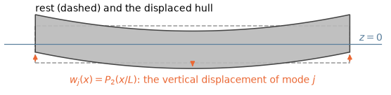
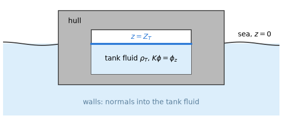

# 10. Generalized modes, internal tanks and wavemakers

The six rigid modes of §2 and §3 describe a body that moves as a whole. Three extensions of that
picture share one idea: a radiation problem driven by a prescribed normal velocity that is not a
rigid motion of the hull, or posed in a fluid domain of its own.

- A *generalized mode* (§10.1) lets the body surface deform: a hull that bends, two pontoons
  joined by a hinge, a piston in a moonpool.
- An *internal tank* (§10.2) is a second fluid domain inside a body, whose sloshing water adds to
  the body's added mass and damping.
- A *wavemaker in a wall* (§10.3) prescribes the normal velocity of a part of a wall plane and
  radiates waves into the fluid.

## 10.1 Generalized modes

A ship's hull or a large floating structure also deforms in waves, and some devices have moving
parts that no rigid mode describes. A generalized mode adds such a motion as a coordinate of its
own, with its own radiation problem and its own row in the equations of motion (Figure 1).

*Figure 1. A generalized mode of a barge: the vertical displacement $w_j$ of a bending shape, here
a Legendre polynomial along the hull. The dashed outline is the body at rest.*

**The mode.** A generalized mode $j$ of a body has a displacement field $(u_j, v_j, w_j)$ given on
the body surface. Its normal velocity is

$$
n_j = u_j n_x + v_j n_y + w_j n_z. \tag{10.1}
$$

The fields are polynomials in the body-local coordinates on ranges of elements of the body mesh,
which covers bending (Legendre, Jacobi), hinged and piecewise modes.

**Its hydrodynamics.** With this $n_j$, the radiation problem of the mode, its added mass, damping,
exciting force (pressure and Haskind) and its share of the motions follow §2.1 unchanged.

**Restoring.** The restoring of the generalized rows is

$$
c_{ij} = \rho g \int_S n_j w_i \,\mathrm{d}S \tag{10.2}
$$

(normals into the body), for the rows $i$ of the generalized modes ($w_i$ their vertical
displacement) and every column $j$ of the body. The rigid rows keep the restoring of §3.2, so their
entries in the generalized columns are zero and the matrix is not symmetric.

Equation (10.2) is the hydrostatic term of Newman (1994) **[P]**,

$$
\rho g \int n_j (w_i + z D_i) \,\mathrm{d}S, \qquad D_i = \frac{\partial u_i}{\partial x} + \frac{\partial v_i}{\partial y} + \frac{\partial w_i}{\partial z}, \tag{10.3}
$$

without the divergence term $z D_i$ and with the rigid rows of §3.2. What it leaves out goes into
`mode_stiffness`, given by the user:

- the rigid rows' coupling to a mode that changes the volume (for heave
  $\rho g \int n_j \,\mathrm{d}S$);
- the divergence term $z D_i$;
- the gravity of the internal mass;
- any other coupling.

**Inertia.** A generalized mode may be massless (§3.1: a free-surface mode of a moonpool, a
free-surface plate of §9.7 moved by a mode); its inertia is then its added mass.

**Drift and second-order loads.** The momentum drift includes the generalized motions. The
pressure-integration drift (§11.2) and the second-order loads take the displacement of the modes
superposed on the rigid motion, its gradient in the turned and stretched surface element, and give
the generalized force of each mode (low order;
[§12.15](12-second-order-loads.md#1215-generalized-modes)).

The inputs are in reference/inputs-bodies §2.5.

## 10.2 Internal tanks

A body that carries liquid in its tanks feels the sloshing of that liquid. A tank is a fluid
domain inside a body, with no influence between it and the sea: its own radiation problem, driven
by the motion of its walls, gives the tank's share of the added mass and damping (Figure 2).

*Figure 2. An internal tank in a hull: its walls (normals into the tank fluid), its fluid of
density $\rho_T$ and its free surface $z = Z_T$, apart from the sea outside.*

**The problem.** The tank is bounded by its walls (elements of the body mesh, normals into the tank
fluid) and its free surface $z = Z_T$. Its radiation potentials have the body's normal velocities
on the walls and the free-surface condition on its free surface,

$$
K\phi = \phi_z \qquad \text{on } z = Z_T. \tag{10.4}
$$

They give a tank added mass and damping $\rho_T \int n_i \phi_j$, added to the body's.

**Damping.** A closed tank radiates no waves. The damping of the discretized tank problem is small
away from the sloshing modes and carries the response near them, and it is kept. On a barge with
two tanks near a sloshing mode the tank damping is the whole of $B_{55}$, and without it the RAO
changes by 85 %; $A$ and $B$ then come from one solution of the tank problem.

**The limit $\omega = 0$.** The free surface of the tank is then rigid and the tank a closed
domain. A mode with a net volume flux through the walls (heave; roll and pitch of a tank off the
axes) has no potential, and its row and column of the zero-frequency added mass are not defined
(NaN, with a warning). The heave added mass

$$
A_{33} = \rho_T \left(V_T - \frac{g A_T}{\omega^2}\right) \tag{10.5}
$$

diverges as $\omega \to 0$, while $-\omega^2 A_{33} + C_{33}$ stays finite.

**The limit $\omega = \infty$.** The free surface of the tank is a node ($\phi = 0$). In heave the
fluid moves with the walls, $A_{33} = \rho_T V_T$ (its potential $z - Z_T$ vanishes on the free
surface); in the other modes part of it stays at rest, and the added mass is less than that of the
rigid fluid.

**Restoring and mass.** The restoring of the tank is the hydrostatic matrix of §3.2 over the walls
with $z - Z_T$ and the density $\rho_T$. It reduces $C_{33}$ by $\rho_T g A_T$ and adds the
free-surface inertia and the weight moments of the tank fluid. The mass `"displaced"` of the body
is $\rho V_x$ less the tank fluid.

**What a tank does not receive.** A tank receives no exciting force. At a field point inside a
tank the potential is that of the tank's radiation problem, $\sum \xi_j \phi_j^T$, with no
incident or diffracted wave.

**Drift.** The pressure-integration drift (§11.2) adds the same terms over the tank walls with
$\rho_T$, $z - Z_T$ and the tank waterline.

**Plates of the tank's free surface.** A massless rigid plate in $z = Z_T$ (a deck over part of the
tank, a full cover) is a free-surface plate of §9.7 in the tank problem, whose free surface is
moved to $z = 0$: it moves with every mode of the body, its condition
$\partial\phi/\partial n = n_j$ on its elements and (10.4) on the rest of the free surface, at every frequency and at both
limits (at $\omega = \infty$ the thin sheet of the odd-image problem, §9.7). A fully covered tank
is a closed container full of liquid. Its potential of a translation is the translation itself, so
$A_{jj} = \rho_T V_T$ at every $\omega$ and $B = 0$; the net flux through the walls and the cover
is zero, and heave is defined at $\omega = 0$, unlike (10.5). At $\omega = 0$ a plate with no
normal velocity (surge, sway, yaw) changes nothing: the free surface is then rigid already. The
restoring takes the plate's elements with the walls (normal $-e_z$ into the tank fluid, at
$z - Z_T = 0$): they add no volume, and their area and moments leave the free-surface terms, so a
full cover removes $\rho_T g A_T$ from $C_{33}$ and the free-surface inertia from $C_{44}$ and
$C_{55}$, and the fluid restores as a solid of its weight. A plate of the sea or a body of its own
lying on a tank's fluid (a floating roof) would couple a body to another body's tank fluid and is
not available; nor is the pressure-integration drift of a tank with plates (its waterline terms
under a plate).

**The constant of a closed tank [C].** Where the tank fluid is bounded on every side by surfaces
of a Neumann condition, a constant potential solves the homogeneous problem: at $\omega = 0$ in
every tank (the rigid free surface), and at every frequency in a fully covered one (at
$\omega = \infty$ the constant of the odd extension, opposite in its image, §9.7). The potential is
then defined up to that constant. Over a closed boundary $\int n_i \,\mathrm{d}S = 0$, so the
constant changes no added mass or damping; at $\omega = 0$ in an open tank it would change only the
heave row, which is not defined there (10.5). The discrete equation of the low order is
correspondingly near-singular in the block of the fully symmetric unknowns, and its solution took
an arbitrary amount of the constant from round-off: the heave added mass of a covered tank moved
between 2 % and 11 % of $\rho_T V_T$ under a change of the geometry by $10^{-9}$, and differed
between processors. The solve therefore pins the constant: in that block every row of a wall or
plate unknown takes $4\pi \sum_k w_k \phi_k$ with $w_k$ the area of unknown $k$ over the area of
the walls and plates (not the jumps of sheets and dampers), so that the area-weighted mean of the
potential is zero. This makes the matrix regular and leaves every solution of the singular
equation that has that mean unchanged; the free term $4\pi$ is the size of the matrix's rows. A
tank is covered when its plates' area equals that of its free surface, $\int n_z \,\mathrm{d}S$
over the walls, to $10^{-6}$. With it the covered tank's heave converges as $h^{1.6}$ (3.4 %, 1.1 %,
0.33 % of $\rho_T V_T$ at $\omega = 0$ on 8, 16 and 32 panels along the tank) and its damping falls
to $10^{-4}$ of the peak, the noise it was. The higher order represents the rigid flow of a
covered box exactly and showed no such sensitivity.

The inputs are in reference/inputs-bodies §2.2.

## 10.3 Wavemakers in the walls

A wave basin makes its waves with paddles in its walls. A body lying in a wall plane is such a
wavemaker: its modes prescribe the normal velocity $u$ of its part of the wall.

Every element of the wavemaker coincides with its own wall image, so the potential needs no
integral equation. It is the known source integral over the wavemaker and all its images,

$$
4\pi \phi(x) = -\int G u \,\mathrm{d}S. \tag{10.6}
$$

The waves it radiates carry the work of its modes, $\tfrac{1}{2}\omega^2 B$ per unit amplitude.

A wavemaker is a body lying wholly in a wall plane, solved for the radiation of its modes only
(reference/inputs-model §1, reference/inputs-rules §2).
