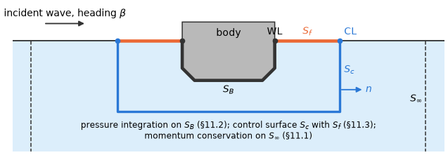

# 11. Mean drift

A body in regular waves feels, besides the force that oscillates with the wave, a small steady
force and moment. They are of second order in the wave amplitude: each is the time mean of a
product of two first-order quantities, such as a pressure and a displacement of the wetted surface,
or two velocities. This *mean drift* acts on a moored body as a steady load that its moorings must
hold. In waves of several frequencies the same products also oscillate at the differences and the
sums of the frequencies; those loads are the subject of chapter 12, and the mean drift is their
difference coefficient of a wave with itself (§12.1).

The mean drift needs no second-order solution: the first-order solution determines it. The same
mean force can be found on three surfaces around the body (Figure 1), and each gives one method:

- on a cylinder $S_\infty$ far away, from the mean momentum flux of the waves the bodies send out,
  expressed by their far-field amplitudes, the Kochin functions: *momentum conservation* (§11.1;
  Maruo 1960, Newman 1967);
- on the wetted surface $S_B$ itself, as the time mean of the pressure on the moving surface:
  *pressure integration* (§11.2; Pinkster 1980);
- on a control surface $S_c$ at a finite distance around the body, from the momentum flux through it
  and the free surface $S_f$ inside it: the *control surface* (§11.3; Chen 2007).

*Figure 1. A vertical section through a floating body: its mean wetted surface $S_B$ with the
waterline WL, a control surface $S_c$ (normal $n$ away from the body) with the free surface $S_f$
between WL and the line CL where $S_c$ meets $z = 0$, and the far cylinder $S_\infty$.*

The three methods rest on the same first-order solution, but they differ in what they return, in
what they need and in how fast they converge with the mesh (Table 1). How each is computed is in
§11.4.

*Table 1. The three methods of the mean drift.*

| | Momentum conservation (§11.1) | Pressure integration (§11.2) | Control surface (§11.3) |
|---|---|---|---|
| Input item | `drift_momentum_conservation` | `drift_pressure_integration` | `drift_control_surface` |
| Components | surge and sway force, yaw moment | all six; the generalized forces of generalized modes (§12.15) | all six |
| Of what | all bodies together, global axes, the moment about the global $z$ axis | each body, body axes, the moment about $R$ and about the moving $R$ | each body, as pressure integration |
| Needs | the Kochin functions, integrals over the body surfaces at $N$ angles | the velocity on the mean wetted surface and the potential on its waterline | a control surface about every body and the first-order fields at its points |
| Accuracy | limited in long waves by the float32 rounding, about 1e-10 of $\rho g A^2 L$ (§11.4) | needs the body velocity, which is not smooth on a body with corners | the fields away from the body are smooth: the horizontal force converges faster than by pressure integration on a body with corners |
| Cost | $N$ angles times the body points, per radiation column and heading | the body values of the solve, the velocities at the body points (§4.2) | the first-order field at the control-surface points, like field points (one point of every orbit of the reflection group) |
| Second order | Newman's approximation (§12.13) | quadratic QTFs (§12.3), Newman's approximation | quadratic QTFs (§11.3), Newman's approximation |
| Not available | walls, a channel, damping lids, dipole and fixed dampers; $\omega = 0$ and $\infty$ | thin sheets, dipole dampers, free-surface plates with an edge bordered by free surface; in the higher order generalized modes and tanks | generalized modes, dipole and fixed dampers, tanks, pressure surfaces, free-surface plates with an edge bordered by free surface; in the low order thin sheets |

Every per-body drift is in body axes with its moment about the body's rotation centre $R$, as the
first-order results (§1.1). The momentum drift is the far-field total of all bodies, which has no
single rotation centre: it stays in global axes, its moment about the global $z$ axis. The drifts
of a moving body need its first-order motions; the input items are in
[reference/inputs-orders §2](../reference/inputs-orders.md#2-second-order), the combinations
where each method is available in [reference/inputs-rules §2](../reference/inputs-rules.md#2-supported-combinations).

## 11.1 Mean drift force and moment (momentum conservation)

Far from the bodies their disturbance is a ring of outgoing waves. The mean momentum these waves
carry away, and their interference with the incident wave, balance a mean force on the bodies
(Maruo 1960, Newman 1967). The method gives the horizontal mean force and the yaw moment about the
global $z$ axis on all bodies together, in global axes: a total of all bodies has no single rotation
centre (§1.1). HydroBEM uses the general form without energy conservation, which is valid with
external damping.

**The far field of the bodies.** The waves the bodies send out are those of the disturbance
potential, the scattered potential plus the radiation of the motions $\xi$,

$$
\phi' = \phi_S + i\omega \sum_j \xi_j \phi_j, \tag{11.1}
$$

with $\phi_j$ per unit velocity; $\xi = 0$ without RAOs, the fixed body. It is not the total
diffraction potential $\phi_D$ of §1.2. Its Kochin function is an integral over the points
$x' = (x', y', z')$ of the surfaces,

$$
\begin{aligned}
H(\theta) &= \int_S \left[\phi' \frac{\partial}{\partial n} - \frac{\partial\phi'}{\partial n}\right] Z(z')\, e^{ik(x' \cos\theta + y' \sin\theta)} \,\mathrm{d}S, \\
Z(z') &= \cosh k(z' + h)/\cosh kh \quad (e^{kz'} \text{ in infinite depth}),
\end{aligned}
\tag{11.2}
$$

over the wetted and pressure surfaces and the free-surface plates, with the normals into the fluid
and in global coordinates. The integral is Green's identity with the far field of the wave Green
function, so the surface kinds enter as they do for field points (§4.2).

**Free-surface plates [C].** A plate (§9.7) is part of its body's boundary: the momentum balance
needs only that the fluid be bounded by bodies, free surface, bottom and the far cylinder, and it
gives the total force on all bodies with their plates. On a plate ($z' = 0$, normal $-z$ into the
water) the normal derivative of the far kernel is $-Z'(0) = -K$ times the kernel
($Z'(0) = k \tanh kh = K$), so the plate's term of (11.2) is

$$
-\int_P \left[K \phi' + \frac{\partial\phi'}{\partial n}\right] e^{ik(x' \cos\theta + y' \sin\theta)} \,\mathrm{d}S,
$$

the dipole integral replaced by $-K$ times the source integral, as in the plate's column (§9.8). The
far field needs no value at the plate's edge, so every edge is allowed, whether it lies on a wall
or borders the free surface; the edge enters the drift only through the waves the plate sends out.
In the scattered formulation the total potential $\phi_S + \phi_I$ takes the dipole integral alone
on the plate, as on the wetted surface: on $z = 0$ the incident wave's own terms
$\phi_I\, \partial/\partial n - \partial\phi_I/\partial n$ of the far kernel cancel pointwise, both
being $-K\phi_I$ times it. Newman's approximation (§12.13) follows from this drift.

The propagating part of $G$ is $-iC\, Z(z) Z(\zeta) H_0^{(2)}(kr)$, $r$ the horizontal distance, with
$C = 2\pi K$ in infinite depth and $C = A_0 (1 + e^{-2kh})^2$ in finite depth ($A_0$ the coefficient
of the propagating mode, §8). Far away the disturbance is therefore an outgoing wave of amplitude
$b(\theta)$,

$$
\phi' \sim b(\theta)\, Z(z)\, \frac{e^{-ikr}}{\sqrt{r}}, \qquad b = -\frac{iC}{4\pi} \sqrt{\frac{2}{\pi k}}\, e^{i\pi/4} H. \tag{11.3}
$$

**The drift.** With

$$
K_e = 2k^2 \int Z^2 \,\mathrm{d}z = K + k^2 h \operatorname{sech}^2 kh \tag{11.4}
$$

($= K$ in infinite depth), the incident amplitude $a = i g A/\omega$ and the direction of the wave
$\hat{k} = (\cos\beta, \sin\beta)$, the mean force and yaw moment are

$$
\begin{aligned}
\bar{F}_{x,y} &= -\frac{\rho K_e}{4} \int \lvert b \rvert^2 (\cos\theta, \sin\theta) \,\mathrm{d}\theta - \frac{\rho K_e}{2} \sqrt{\frac{2\pi}{k}}\, \operatorname{Re}\left[a^* e^{-i\pi/4} b(\beta)\right] \hat{k}, \\
\bar{M}_z &= \frac{\rho K_e}{4k} \int \operatorname{Im}(b' b^*) \,\mathrm{d}\theta - \frac{\rho K_e}{2k} \sqrt{\frac{2\pi}{k}}\, \operatorname{Re}\left[i a^* e^{-i\pi/4} b'(\beta)\right],
\end{aligned}
\tag{11.5}
$$

the far-field limits of the mean momentum and angular-momentum fluxes (Maruo 1960; Newman 1967).
The first term of each is the flux of the disturbance alone, integrated over all directions; the
second is its interference with the incident wave, which only the direction of the wave $\beta$
contributes.

Three steps of the derivation shape (11.5):

- With $\int Z^2 \,\mathrm{d}z = K_e/(2k^2)$ the free-surface and dynamic-pressure terms of the
  quadratic flux cancel ($k^2\int Z^2 + \int Z_z^2 = K$).
- The cross terms of the incident wave and the disturbance concentrate at $\theta = \beta$ by
  stationary phase; the backward point cancels, and the moment needs the second-order
  stationary-phase term.
- No energy conservation is assumed, so external damping is allowed.

**What the engine computes [C].** The engine returns $H$ and $H' = \mathrm{d}H/\mathrm{d}\theta$ of
every radiation column and every diffraction heading on a uniform grid of $N$ angles,
$N = 8 \lceil (2 \lceil kR_b \rceil + 96)/8 \rceil$ for the largest $k$ and the radius $R_b$ of the
bodies about the origin (§11.4), and combines them with the motions of the solve in (11.5).

**Two wave headings.** For bidirectional waves $\bar{F}(\beta_1, \beta_2)$ is the sesquilinear form
of the same expressions: $b$ of the first wave, $b^*$ of the second, and the cross terms of incident
wave 2 with disturbance 1 at $\theta = \beta_2$ and of incident wave 1 with disturbance 2 at
$\theta = \beta_1$. The drift of the two waves together is then

$$
F = \lvert A_1 \rvert^2 \bar{F}(\beta_1, \beta_1) + \lvert A_2 \rvert^2 \bar{F}(\beta_2, \beta_2) + 2 \operatorname{Re}[A_1 A_2^* \bar{F}(\beta_1, \beta_2)]. \tag{11.6}
$$

**Not available.** Walls, a channel and lids are rejected; the limits $\omega = 0$ and $\infty$ have
no drift.

## 11.2 Mean drift force and moment (pressure integration)

The direct way to the mean force is to integrate the pressure over the wetted surface as it moves
with the body and the waves, and to average over a period (Pinkster 1980) **[P]**. It gives all six
mean components on each body, in the inertial axes of the mean body position, the moment about the
mean position of the rotation centre $R$ (and also about the moving $R$).

**The displaced surface.** The mean force is the time average of $-\int P \hat{N} \,\mathrm{d}S$ over
the exact wetted surface, $\hat{N}$ out of the body. A point $x$ of the mean surface moves to
$\hat{X}$, and its normal turns to $\hat{N}$:

$$
\hat{X} = x + \xi + \alpha \times x + H(x - R), \qquad \hat{N} = n + \alpha \times n + Hn, \tag{11.7}
$$

with $H$ the second-order part of the rotation, applied about $R$ (the second-order displacement of
$R$ zero; below). Its mean is

$$
\langle H \rangle = \begin{bmatrix} -\tfrac{1}{2}(\langle\alpha_2^2\rangle + \langle\alpha_3^2\rangle) & 0 & 0 \\ \langle\alpha_1\alpha_2\rangle & -\tfrac{1}{2}(\langle\alpha_1^2\rangle + \langle\alpha_3^2\rangle) & 0 \\ \langle\alpha_1\alpha_3\rangle & \langle\alpha_2\alpha_3\rangle & -\tfrac{1}{2}(\langle\alpha_1^2\rangle + \langle\alpha_2^2\rangle) \end{bmatrix}. \tag{11.8}
$$

**The expansion about the mean surface.** Expanding the pressure and the surface about the mean
surface to second order gives

$$
\begin{aligned}
\bar{F} = &-\int_{S_B} \left[\langle P^{(2)} \rangle n + \langle P^{(1)} (\alpha \times n) \rangle + P^{(0)} \langle H \rangle n\right] \mathrm{d}S - \tfrac{1}{2}\rho g \int_{\mathrm{WL}} \langle \zeta_r^2 \rangle \frac{n}{\sqrt{1 - n_z^2}} \,\mathrm{d}l, \\
\bar{M} = &-\int_{S_B} \left[\langle P^{(2)} \rangle (x \times n) + \langle P^{(1)} (\alpha \times (x \times n) + \xi \times n) \rangle \right. \\
&\left. + P^{(0)} \langle H(x \times n) - (HR) \times n + \xi \times (\alpha \times n) \rangle\right] \mathrm{d}S - \tfrac{1}{2}\rho g \int_{\mathrm{WL}} \langle \zeta_r^2 \rangle \frac{x \times n}{\sqrt{1 - n_z^2}} \,\mathrm{d}l,
\end{aligned}
\tag{11.9}
$$

with the pressures of zeroth, first and second order

$$
P^{(0)} = -\rho g z, \qquad P^{(1)} = -\rho(\Phi_t + g X_3), \qquad P^{(2)} = -\rho\left(\tfrac{1}{2}\lvert\nabla\Phi\rvert^2 + (\xi + \alpha \times x)\cdot\nabla\Phi_t + g\, (H(x - R))\cdot e_z\right), \tag{11.10}
$$

and

- $e_z = (0, 0, 1)$, $X_3 = \xi_3 + \alpha_1 y - \alpha_2 x$ the vertical first-order displacement;
- $\zeta_r = \zeta - X_3$ the relative elevation at the mean waterline;
- $\Phi$ the total first-order potential (incident, scattered and radiated by the motions);
- $\xi = \xi_R - \alpha \times R$ the translation of $O$;
- $\langle ab \rangle = \tfrac{1}{2} \operatorname{Re}(a b^*)$ the mean of a product;
- $x$ and the moments about $O$.

Read term by term, (11.9) is the mean second-order pressure on the mean surface, the first-order
pressure on the first-order turn of the normal, the hydrostatic pressure on the second-order turn of
the normal, and, in the line integral, the hydrostatic pressure in the band between the mean
waterline and the relative elevation $\zeta_r$.

**The moment about $R$ [C].** The moment about $R$ is

$$
\bar{M}_R = \bar{M} - R \times \bar{F}. \tag{11.11}
$$

The arm $(\hat{X} - R) \times \hat{N}$, with
$\hat{X} - R = (x - R) + \xi_R + \alpha \times (x - R) + H(x - R)$, differs from
$\hat{X} \times \hat{N}$ by $-R \times \hat{N}$ alone, term by term in the products of the motions.
The transfer (11.11) therefore holds for the drift and for every pair of the QTFs.

**The second-order rotation about $R$ [C].** The second-order rotation $H$ is applied about $R$.
The second-order motions are left out, and the drift (and every QTF) is the load with the
second-order displacement of $R$ zero. The motions, the added mass, the damping and the restoring
are about $R$ too, so the drift is the right-hand side of the second-order motion equation of $R$.

Exactly, $\hat{X} = R + \xi_R + \mathcal{R}(x - R)$ with $\mathcal{R} = I + A + H$ the rotation and
$A x = \alpha \times x$; its second-order part is $H(x - R)$. Its terms are those of $H x$ ($H$ about
$O$) and of the rigid second-order translation $\delta = -HR$ of the body. The translation adds the
pressure $-\rho g\, \delta_z$ to $P^{(2)}$, and $-P^{(0)} \delta \times n$ to the moment, through the
cross product

$$
H(x - R) \times n + x \times Hn + (A x) \times (A n) = H(x \times n) - (HR) \times n. \tag{11.12}
$$

Over the body closed by the water plane the divergence theorem gives $\int n \,\mathrm{d}S = -A_{wp} e_z$,
$\int x \times n \,\mathrm{d}S = (-A_{wp} y_f, A_{wp} x_f, 0)$ and $\int z n \,\mathrm{d}S = V e_z$
($x_f$, $y_f$ about $O$). The load of the translation is then the hydrostatic load of the translated
body,

$$
\Delta F = -\rho g A_{wp} \delta_z e_z, \qquad \Delta M = \rho g \left[\delta_z (-A_{wp} y_f, A_{wp} x_f, 0) + V (\delta_y, -\delta_x, 0)\right] \quad \text{(about } O\text{)}: \tag{11.13}
$$

the restoring $-C \delta$ of the translation, and the moment $\delta \times \rho g V e_z$ of the
buoyancy about the fixed point (which the weight of a body in equilibrium balances in the motion
equation). It leaves the horizontal force and the yaw moment unchanged. With the closed forms (below)
it is added in the form (11.13), $V$ of the wetted and pressure surfaces; for $R = 0$ it is zero.

**The hydrostatic part.** The hydrostatic parts are integrated directly over $S_B$. A body with
pressure surfaces, and the control-surface drift (§11.3), use their closed forms instead: the means
of quadratic products of the motions times the water-plane area, its first and second moments and
the volume moments. These equal the direct integrals by the divergence theorem when the surface is
closed by the water plane. With pressure surfaces the closed forms take the water plane of the
wetted surface and the volume and centre of buoyancy of the wetted and pressure surfaces together,
and the surface terms take the wetted surface only (a warning is issued).

**The moment about the moving $R$.** The moment about the moving $R$ is

$$
\bar{M}_R - \langle \xi_R \times F^{(1)} \rangle, \tag{11.14}
$$

with $F^{(1)}$ the first-order force. It is the transfer of the moment about the moving $O$,
$\bar{M} - \langle \xi \times F^{(1)} \rangle$, less $\langle (\alpha \times R) \times F^{(1)} \rangle$,
since the two points move apart by $\alpha \times R$.

**Free-surface plates [C].** A plate (§9.7) is part of its body's mean surface and is wetted at
every instant: its points join the surface integrals of (11.9) with $P^{(0)} = 0$ on $z = 0$, so
that only its second-order pressure and its first-order pressure on its tilt act on it
($\alpha \times n = (-\alpha_2, \alpha_1, 0)$ for $n = -e_z$, the only source of its horizontal
force), and it has no line term of its own. The line term changes at a wall's waterline under a
plate whose edge lies on that wall. The band between the wall's displaced waterline and the top of
the water is bordered there by the plate, not by free surface: at the height $s$ above the wall's
displaced waterline the pressure is $P^{(1)}_w - \rho g s$, with
$P^{(1)}_w = -\rho(\Phi_t + g X_3)$ at the wall's mean waterline, up to the plate edge's
displacement $X_3^P$. Integrated over the band,

$$
-\int_{\mathrm{WL}} \left\langle P^{(1)}_w \zeta_r - \tfrac{1}{2}\rho g \zeta_r^2 \right\rangle \frac{n}{\sqrt{1 - n_z^2}} \,\mathrm{d}l, \qquad \zeta_r = X_3^P - X_3,
$$

and likewise for the moment with $x \times n$; a generalized mode adds its virtual work against the
wall's mode shape, as in (11.9). Under a free surface the top is the elevation $\zeta$,
$P^{(1)}_w = \rho g \zeta_r$, and the term is the line integral of (11.9). Under a plate moving with
the wall (a cover whose edge lies on a wall of its own body) $X_3^P = X_3$ and the term vanishes.
Under a plate sliding along the wall (a piston in its tube: a body of its own, or the plate's
elements moved by a generalized mode of their own) it is the band of the relative motion, with the
plate's pressure at its top.

A plate edge bordered by free surface (a mat, a dock, a disc) has no finite line term in this
expansion: linear theory leaves the elevation of the free surface beside the edge different from
the plate's, the velocity across the edge is logarithmically singular, and the coefficient
$n/\sqrt{1 - n_z^2}$ of a horizontal surface is infinite. The pressure drift of a plate with such
an edge would need a model of the edge and is refused (its momentum drift, §11.1, is available).
The edges are classified from the geometry: an edge of a plate element lies on a wall when its
midpoint is within a tenth of the plate edge's length of a waterline edge of a wetted element (of
any body) or on a wall of the domain, between plate elements when the point a tenth of its length
outside it lies on another plate element of the same body, and is free otherwise. The tenth is
the bound of the chords of two meshes of one curve of radius $R$: a chord of length $l$ lies up to
$l^2/8R$ inside the curve, a tenth of $l$ for a chord angle $l/R$ up to 0.8 (8 chords a circle), so
a plate edge whose ends lie on the curve is within it of a wall meshed as finely or more finely;
the wall's own edge length is no part of it (a long straight wall edge has no sag, and a mat
floating beside it has free edges). Beside a plate of another body the vertical velocity jumps
from one plate's motion to the other's, as beside free surface: such an edge is free. A waterline
element of a wall is under a plate when the point a twentieth of its length into the water lies on
a plate element (within a fortieth of its length, or a tenth of the plate element's longest side:
the chords of two meshes of one curve).

The checks: the horizontal pressure drift against the momentum drift (§11.1) on a fixed moonpool
hull with its cover and with the cover a piston body (low order 5.4e-2, 3.7e-2, 2.9e-2 and 7.2e-2,
5.1e-2, 3.7e-2 of the peak on 8, 16, 32 panels a quadrant, the hull's own discretization at its
sharp edges as for an ordinary body), and the change from the cover to the piston, which the band
under the plate carries, to 2.6e-2, 1.9e-2, 1.1e-2 (without the band it would miss by up to 6e-2;
the higher order on the moonpool barge 1.0e-2, 8.1e-3); the piston of a deep water column to 3.7e-2;
a generalized piston mode of a restrained hull against the same piston as a body of its own, and
a cover of the hull against the cover as a body of its own, to rounding (reference/inputs-rules
§2 for the combinations).

**The velocity on the body.** Higher order: the gradient is the surface gradient of the B-spline
potential plus the normal velocity. Low order (§4.2): the velocity at the panel centroids comes from
the source formulation

$$
\phi(x) = \int \sigma(\xi)\, G(x, \xi) \,\mathrm{d}S_\xi, \qquad \frac{\partial\phi}{\partial n_x} = -2\pi\sigma(x) + \int \sigma(\xi)\, \frac{\partial G(x, \xi)}{\partial n_x} \,\mathrm{d}S_\xi \tag{11.15}
$$

(the derivative at the field point $x$, along its normal into the fluid; $G$ of §8), solved for the
radiation and scattered potentials; the potential comes from Green's identity, and the waterline is
the panel edges in $z = 0$ with the potential of their panels.

## 11.3 Mean drift force and moment (control surface)

Pressure integration needs the velocity on the body surface, which is not smooth on a body with
corners. The control surface takes the balance away from the body. The mean force on a body equals
the mean momentum flux through a surface $S_c$ around it and through the free surface $S_f$ inside,
with the body's waterline and hydrostatic terms (Figure 1). This is the mean momentum balance of the
fluid between the body and $S_c$, as in the far-field derivation of Maruo (1960) and Newman (1967),
here on a surface at a finite distance: the middle-field formulation of Chen (2007, eqs. 37–38):

$$
F = -\rho \int_{S_c} \left[\nabla\phi \frac{\partial\phi}{\partial n} - \tfrac{1}{2} n \lvert\nabla\phi\rvert^2\right] - \tfrac{1}{2}\rho g \int_{CL} n' \zeta^2 + \rho e_z \int_{S_f} \left(\zeta \frac{\partial\phi_t}{\partial z} + \tfrac{1}{2}\lvert\nabla\phi\rvert^2\right) + (\text{the waterline terms}) + F_S, \tag{11.16}
$$

with $e_z = (0, 0, 1)$ the unit vertical vector and $n$ away from the body; on the line $CL$ too,
$n'$ the horizontal normal of $S_c$, away from the body. The products are means of products of the
complex amplitudes, and $\phi$ is the total potential of the incident, scattered and radiated waves
with the motions. Away from the body the field velocities are smooth, so the horizontal force
converges faster than by pressure integration on a body with corners.

**Why corners matter.** At a right-angled edge, such as the bottom rim of a truncated cylinder, the
fluid fills a sector of $3\pi/2$ and the potential behaves as $r^{2/3}$ in the distance $r$ from the
edge. The velocity terms of pressure integration then behave as $r^{-2/3}$ and $r^{-1/3}$: they are
integrable, but neither constant panels nor B-splines represent them, and the panels next to the
edge miss a part of order $h^{1/3}$ in their size $h$. The pressure drift therefore converges as
$h^{1/3}$ (a fourfold refinement of the panels at the edge reduces its error by
$4^{-1/3} \approx 0.63$), in both methods. The singular part is strong when the body moves vertically against the
fluid, so the error is large near the heave and pitch resonances of a floating body (for a floating
truncated cylinder of draft $a/2$ between them, several times the drift itself on practical
meshes) and small for a fixed body (within 1 % for the same cylinder). The drifts by momentum
conservation and by the control surface need no body velocity and agree with each other (to four
digits in the higher order on the same cylinder): for floating bodies with sharp edges and large
motions they are the drifts to use (Table 1).

**The line and free-surface terms.** They come from the exact free surface $z = \zeta$, on which
$p = 0$. On $S_c$ between $z = 0$ and $\zeta$ the pressure is $\rho g(\zeta - z)$, whose integral
gives the $CL$ term. On $S_f$ the condition $p = -\rho(\phi_t + \tfrac{1}{2}\lvert\nabla\phi\rvert^2 + gz) = 0$
at $z = \zeta$, expanded about $z = 0$ to second order, gives the mean elevation

$$
g\langle\zeta^{(2)}\rangle = -\langle\zeta\, \partial\phi_t/\partial z\rangle - \tfrac{1}{2}\langle\lvert\nabla\phi\rvert^2\rangle, \tag{11.17}
$$

and the weight $\rho g \int_{S_f} \langle\zeta^{(2)}\rangle \,\mathrm{d}S$ that it adds to the fluid
inside $S_c$ enters the balance with the opposite sign: the $S_f$ term.

**The waterline terms.** They are

$$
-\rho g\, e_z \int_{\mathrm{WL}} \zeta\, (\xi + \alpha \times x)\cdot n' \,\mathrm{d}l + \tfrac{1}{2}\rho g\, e_z \int_{\mathrm{WL}} \frac{n_z}{\sqrt{1 - n_z^2}}\, (\zeta - \zeta_b)^2 \,\mathrm{d}l, \tag{11.18}
$$

with $n'$ and $n_z$ of the normal into the body and $\zeta_b$ the vertical displacement of the body
at the waterline; $F_S$ is the hydrostatic part in the closed forms of §11.2. These are the terms of
Chen (2007, the term $\Xi$ below eq. 28) but for one: his $\Xi$ has $\eta^2 - 2\eta\zeta_b$, and the
$\zeta_b^2$ of $(\zeta - \zeta_b)^2$ in (11.18), which depends on the motions only (like his separate
hydrostatic term), is the part of the relative elevation of §11.2 that goes with $F_S$ as the closed
form of §11.2.

**The moment.** The moment follows with $x \times$ in every term, about $O$, then about $R$ as in
§11.2: every term is a moment of a force density on body-fixed or fixed surfaces, so
$M_R = M_O - R \times F$. The moment about the moving $R$ uses the first-order force on the body as
in §11.2.

**Two forms of the squared-elevation line term.** On the plane free-surface part $S_f$,
$\iint_{S_f} \nabla'(\zeta^2/2) \,\mathrm{d}S = \oint (\zeta^2/2)\, m \,\mathrm{d}l$, with $m$ the
outward normal of $S_f$ in its plane, so

$$
-\tfrac{1}{2}\rho g \int_{CL} n' \langle\zeta^2\rangle \,\mathrm{d}l = \tfrac{1}{2}\rho g \int_{\mathrm{WL}} n' \langle\zeta^2\rangle \,\mathrm{d}l - \rho g \iint_{S_f} \langle\zeta\, \nabla'\zeta\rangle \,\mathrm{d}S, \tag{11.19}
$$

with $n'$ into the body on $\mathrm{WL}$ and $\nabla'\zeta = -(i\omega/g)(v_x, v_y)$. The second form
suits a control surface close to the body. The two agree only with the normals directed as stated.
The body's `control_surface_waterline_term` chooses the form
([reference/inputs-bodies §2.7](../reference/inputs-bodies.md#27-control-surface)). The fields at
the control-surface points: §11.4.

**Several bodies.** Each body has its own $S_c$, which holds that body alone: the balance gives the
force on everything inside it, so a surface reaching another body, or holding a damping lid in
$S_f$, is refused. The fields are those of the whole problem (every body's scattering and
radiation). The bodies' horizontal drifts then sum to the far-field momentum drift.

**Free-surface plates [C].** A plate of the body (§9.7) is part of its surface $S_B$, where the
body condition holds and the flux of (11.16) vanishes, so the balance needs nothing on the plate.
The free surface $S_f$ ends at the outer boundary of hull and plates: a wall's waterline under a
plate whose edge lies on it (a cover on its own body's moonpool wall) borders no free surface and
has no waterline term (11.18) and no line term of the second form (11.19), and a covered moonpool
has no $S_f$ inside. The hydrostatic part $F_S$ takes the plate's area in the water plane: with
the hydrostatic pressure on the displaced surfaces, the divergence theorem over the hull's solid
closed by its top gives the load of a body of the hull's volume whose water plane is the disc of
the outer waterline, the hull's annulus and the plate together, which is the direct integral over
hull and plate of §11.2 ($P^{(0)} = 0$ on the plate). The hull term (11.20) of the QTFs includes
the plate (its normal displacement moves water), (11.21) is over $S_f$ without it. The automatic
control surface leaves the waterline under the body's plates out. A plate edge bordered by free
surface is refused as in §11.2; a plate body inside the control surface of another body (a piston
in its hull's tube) is a second body there and refused; generalized modes are not available with
the control surface. The checks: the horizontal drift of a fixed moonpool hull with its cover
against the momentum drift (§11.1) 5.6e-3, 2.8e-3 of the peak on 8, 16 panels a quadrant (the
pressure drift 4.7e-2, 3.3e-2), the radius of the cylinder changing it by 2e-4; floating, through
its pitch resonance, 3.8e-2, 2.5e-2 (the pressure drift misses by a factor 1.6); every component
against the moonpool plugged by a wetted disc at $z = -d$ (an ordinary body), the drift and the
difference QTF of the floating hull tending to the cover's as $d$ (1.5e-2 at $d = 0.0125$); in the
higher order the moonpool barge's horizontal drift to 1e-6 of the momentum drift.

**Quadratic QTFs by the control surface.** The balance (11.16) holds at every instant (Chen 2007,
eqs. 35, 36), with two more terms that vanish in the mean, both time derivatives. Over the hull it is

$$
\rho\, \frac{\partial}{\partial t} \int_{S_B} \nabla\Phi\, ((\xi + \alpha \times x)\cdot n) \,\mathrm{d}S \tag{11.20}
$$

($n$ into the fluid; zero for a fixed body), and over $S_f$

$$
\frac{\rho}{g}\, \frac{\partial}{\partial t} \int_{S_f} \Phi_t \nabla\Phi \,\mathrm{d}S, \tag{11.21}
$$

into which the free-surface conditions $\Phi_t = -g\zeta$, $\Phi_{tt} = -g\Phi_z$ turn
$-\rho \int_{S_f} (\Phi_z \nabla\Phi + \zeta \nabla\Phi_t)$; their moments follow with $x \times$. The
quadratic QTFs of the control surface are the terms above with each mean replaced by the pair
coefficient of §12.1 and $\partial/\partial t$ by $i\Omega$, $\Omega = \omega_a - \omega_b$
(difference) or $\omega_a + \omega_b$ (sum); the hydrostatic part is that of §11.2. Their difference
diagonal is the drift above.

## 11.4 The numerical methods of the drifts

**Momentum drift.** The Kochin functions $H(\theta)$ and $H'(\theta)$ of every radiation column and
diffraction heading are evaluated by Green's identity with the far-field kernel
$Z(\zeta) e^{ik(\xi \cos\theta + \eta \sin\theta)}$, with the surface rules of the field points (low
order at the centroids, higher order at the inner Gauss points). They are combined with the motions of
the solve and evaluated by the formulas of §11.1; $H(\beta)$ and $H'(\beta)$ at the headings come from
the trigonometric interpolant of the samples.

**The angle count [C].** With `drift_momentum_conservation_angles` "auto" the count is
$N = 8\lceil(2\lceil kR_b\rceil + 96)/8\rceil$ for the largest $k$, $R_b$ the largest horizontal distance
of a mesh vertex or spline coefficient from the origin. The Kochin function of a body within $R_b$
has the Fourier modes $\lvert m\rvert \lesssim kR_b + c(kR_b)^{1/3}$, and $\lvert H\rvert^2$ twice
that bandwidth. The measured need for 1e-6 is $N \ge 2kR_b + \text{about } 10(kR_b)^{1/3}$, so the
margin 96 holds up to $kR_b \approx 900$.

In long waves the diffraction and radiation far fields of a floating body nearly cancel in $b$, and
the incident–disturbance term is much larger than the drift. The float32 rounding then limits the
drift force to about 1e-10 of $\rho g A^2 L$ (at frequencies where the drift is below 1e-7 of its
peak), independent of $N$.

**Pressure drift.** Low order at the panel centroids, with the velocities and the waterline of §4.2;
the potential of a waterline side is that of its panel expanded from the centroid $c$ to the side's
midpoint $x$, $\phi(c) + (x - c) \cdot \nabla\phi(c)$ (the centroid value alone differs from it by
the fraction $K z_c$, of first order in the panel height).
Higher order at the inner Gauss points of the wetted patches, the waterline the sides of wetted
patches in $z = 0$ with 6 Gauss points per panel: exact to degree 11, the product of two potential
traces of order up to 6 on a flat side; from 4 points the drift no longer changes
([validation: constants](../validation/cases/constants.md)).

**Control-surface drift.** A low-order control surface is integrated at its panel centroids. A patch
control surface is integrated by its $n_u \times n_v$ panels with $q_o \times q_o$ Gauss points each
(3 from a control-surface file); a patch wholly in the free surface is part of $S_f$, and the sides
of the others in $z = 0$ form the line CL ($q_o$ points per panel side). The fields are computed for
one point of every orbit of the reflection group: low order by the source formulation, higher order
by Green's identity and the differences of §4.2.
