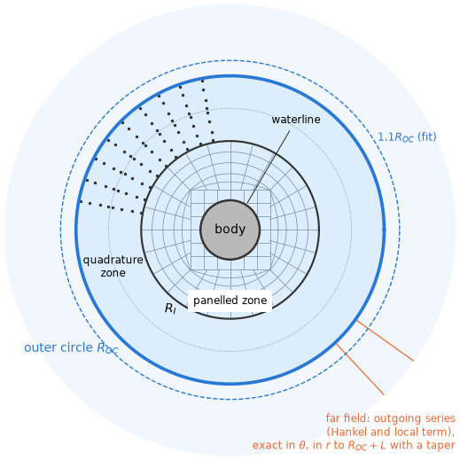
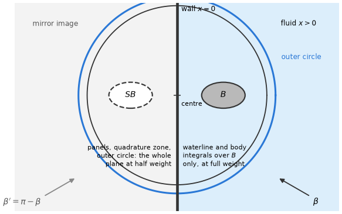

# 12. Second-order loads

In waves of several frequencies the force on a body has, at second order in the wave amplitudes,
components at the difference and at the sum of every two frequencies. The difference-frequency
loads vary slowly and the sum-frequency loads fast, so both act outside the band of frequencies of
the waves themselves, where the first-order force acts. This chapter gives what
HydroBEM computes of these loads, the equations they rest on, their derivation, the numerical
methods and what is known of their accuracy.

**Bichromatic waves and the QTF.** Two regular waves, of frequencies $\omega_a$, $\omega_b$ and
headings $\beta_a$, $\beta_b$, hold the whole structure. A product of two first-order quantities
then oscillates at the difference $\Omega^- = \omega_a - \omega_b$ and at the sum
$\Omega^+ = \omega_a + \omega_b$ (12.1), and so does the second-order force: $A_a A_b^* F^-_{ab}$ at
the difference and $A_a A_b F^+_{ab}$ at the sum frequency (12.3). The coefficients $F^\mp_{ab}$ are
the quadratic transfer functions, the QTFs. An irregular sea is a sum of such components, and the
QTFs of every pair of its frequencies and headings give its second-order force. The difference
coefficient of a wave with itself, $F^-_{aa}$, is the mean drift of chapter 11.

**Two parts.** The second-order force of a pair has two parts that HydroBEM computes (§12.1):

- the *quadratic part*, the products of the first-order solution: the terms of the mean drift by
  pressure integration (§11.2) or by the control surface (§11.3), each mean replaced by the
  coefficient of the pair (§12.3);
- the *force of the second-order potential*, the potential that the quadratic terms of the
  free-surface and body conditions force at the pair frequency (§12.4).

A third part, the force of the second-order motions themselves, is not computed.

**Indirect and direct methods.** The potential part can be found without solving for the
second-order potential: Green's identity with the radiation potential at the pair frequency turns
its unknown body integral into integrals of known quantities over the body and the free surface
(Molin 1979; Lee 1995), the *indirect* method (§12.5). The *direct* method solves the second-order
potential itself (§12.6). Both integrate a forcing over the whole free surface outside the bodies
(§12.8, §12.9), which is most of the work; they differ in the discretization only, so their
difference checks both.

**Newman's approximation.** At the difference of two close frequencies the QTF is close to the mean
drift. Newman (1974) approximates the whole difference-frequency QTF from the drifts alone (§12.13),
with no second-order computation.

Table 1 maps what HydroBEM computes and how the parts rest on each other; one wall (§12.14) and
generalized modes (§12.15) extend every part, and the accuracy and the cost are in §12.12. The
total second-order force is a quadratic part plus a potential part. The input items are in
[reference/inputs-orders §2](../reference/inputs-orders.md#2-second-order) and, for the free surface
of the potential part, [§3](../reference/inputs-orders.md#3-free-surface-of-the-potential-qtf-items-of-second_order)
there; `qtf_difference`, `qtf_sum` and `qtf_bidirectional` choose the frequencies and headings of
every QTF.

*Table 1. The second-order loads HydroBEM computes.*

| Result | Item | Method | Rests on | Sections |
|---|---|---|---|---|
| quadratic part, pressure integration | `qtf_quadratic_pressure_integration` | the terms of the pressure drift with the pair coefficients | the first-order values on the mean wetted surface and its waterline, the motions | §12.3, §11.2 |
| quadratic part, control surface | `qtf_quadratic_control_surface` | the terms of the control-surface drift with the pair coefficients, and two time derivatives | the fields on the control surface; the hull values of the pressure integration | §12.3, §11.3 |
| potential part, indirect | `qtf_potential_indirect` | Green's identity with the radiation potentials $\psi_j$ at the pair frequency | the first-order fields on the free surface and the radiation at the pair frequencies (the sub-problems) | §12.4, §12.5, §12.7–§12.10 |
| potential part, direct | `qtf_potential_direct` | the second-order potential solved as extra right-hand sides of the radiation problem at the pair frequency | the same sub-problems, without $\psi_j$ | §12.4, §12.6–§12.10 |
| Newman's approximation | `qtf_newman`, `qtf_newman_average` | the off-diagonal coefficients from the diagonal | every drift switched on | §12.13 |

**Axes and the reference point.** Every per-body load is in body axes with its moment about the
body's rotation centre $R$, as the first-order results (§1.1). The second-order rotation $H$ of the
body is applied about $R$, so a QTF is the load with the second-order displacement of $R$ zero.
Moving $R$ changes a QTF by the rigid transfer of the moment and by the load of a rigid
second-order translation $\delta = -HR$ (§12.2). The momentum drift, from which Newman's
approximation can also be made, stays in global axes about the global $z$ axis.

**Scope.** The low-order method; rigid bodies and bodies with generalized modes (§12.15) in the open
sea or by one wall (§12.14), fixed or freely floating, one or several; the difference and the sum
frequency of every pair of frequencies, of equal headings or of every pair of headings; bodies with
free-surface plates whose edges lie on walls (§12.7, §12.8). Not
computed: the force of the second-order motions themselves (it is that of the radiation at the pair
frequency times the second-order motion), the second-order potential with pressure surfaces or
tanks, thin sheets or dipole dampers of a body, damping lids or fixed dampers, or a free-surface
plate with an edge bordered by free surface, and the higher-order
method's potential load and its quadratic loads with generalized modes.

The first-order problem, its notation and its discretization are those of the earlier chapters
([README.md](README.md)). The tests are listed in [test-plan](../validation/test-plan.md) (A for
independent mathematics, B for identities). **[P]** marks a result taken from the literature
([references.md](../references.md)), **[C]** a numerical choice of HydroBEM.

## 12.1 The quadratic loads and the force of the second-order potential

The second-order force of a pair of waves is the quadratic part, plus the force of the second-order
potential, plus for a moving body the force of the second-order motions (not computed). This
section defines the first two.

**Quadratic second-order loads (QTFs).** Every term of the mean drift (§11.2, §11.3) is the mean of a
product of two first-order quantities $x(t)\, y(t)$ ($\langle H \rangle$ too, of the rotations). In a
wave of several components $A_a e^{i(\omega_a t - k_a \cdot x)}$ the same product has, besides its
mean, components at the differences and the sums of their frequencies (Pinkster 1980) **[P]**. With
$x(t) = \operatorname{Re} \sum_a A_a x_a e^{i\omega_a t}$,

$$
\begin{aligned}
x y &= \operatorname{Re} \sum_a \sum_b \left[A_a A_b^* Q^-_{ab} e^{i(\omega_a - \omega_b)t} + A_a A_b Q^+_{ab} e^{i(\omega_a + \omega_b)t}\right], \\
Q^-_{ab} &= \tfrac{1}{4} (x_a y_b^* + x_b^* y_a), \qquad Q^+_{ab} = \tfrac{1}{4} (x_a y_b + x_b y_a),
\end{aligned}
\tag{12.1}
$$

over every ordered pair $(a, b)$, each wave of its own frequency and heading. The quadratic QTFs
$F^-_{ab}$, $F^+_{ab}$ of the force and moment are the terms of $\bar{F}$ and $\bar{M}$ with each mean
$\langle x y \rangle$ replaced by $Q^-_{ab}$ or $Q^+_{ab}$, $x_a$ and $y_a$ the first-order quantities
of wave $a$ (the factors $i\omega$ of its own frequency). Then $F^-_{ab} = (F^-_{ba})^*$,
$F^+_{ab} = F^+_{ba}$, and $F^-_{aa} = \bar{F}$: the difference coefficient of a wave with itself is
the mean drift. The quadratic QTFs are the part of the second-order force that the first-order
solution gives. Their moment is about $R$ ($M_R = M_O - R \times F$ for each pair); the moment about
the moving $R$ is not formed for the pairs. The details are in §12.3.

**The force of the second-order potential.** The second-order potential

$$
\Phi^{(2)} = \operatorname{Re} \sum_a \sum_b \left[A_a A_b^* \phi^-_{ab} e^{i\Omega^- t} + A_a A_b \phi^+_{ab} e^{i\Omega^+ t}\right], \qquad \Omega^\mp = \omega_a \mp \omega_b, \tag{12.2}
$$

satisfies on $z = 0$ the free-surface condition $-\Omega^2\phi + g\phi_z = F$, $F$ the forcing of the
products of the first-order potentials (Lee 1995, eqs. 3.8–3.9; §12.4), and on the mean body surface
a Neumann condition $\phi_n = Q_B$ with the terms of the first-order motions (Lee 1995,
eqs. 3.11–3.15; §12.7). Its incident part (the incident waves alone) is a plane wave of
$\kappa = k_a \mp k_b$ (Lee 1995, eqs. 3.24–3.27); the rest, $\phi_S^{(2)}$, satisfies the forcing
$F_S$ of the disturbances.

Green's identity between $\phi_S^{(2)}$ and the radiation potential $\psi_j$ of mode $j$ at $\Omega$
gives the force without $\phi_S^{(2)}$ (Molin 1979): the formula (12.8) of §12.5, an integral over
the body and one over the whole free surface $F$ outside the body. Here $\psi_n = n_j$ are the rigid
normals of §1.1 about $R$, so the moments are about $R$. The force is zero at equal frequencies
($\Omega = 0$).

Its body condition takes the second-order rotation about $R$ as the quadratic part does (§12.2). The
forcing, the body condition, the transform of its second derivatives and the integration of the free
surface are in [§12.4–§12.10](#124-the-second-order-potential).

## 12.2 Pairs and coefficients

The second-order force has the form of the products (12.1),

$$
F^{(2)}(t) = \operatorname{Re} \sum_a \sum_b \left[A_a A_b^* F^-_{ab} e^{i\Omega^- t} + A_a A_b F^+_{ab} e^{i\Omega^+ t}\right], \qquad \Omega^\mp = \omega_a \mp \omega_b; \tag{12.3}
$$

the coefficients $F^\mp_{ab}$ are the quadratic transfer functions (QTFs). Their symmetries
$F^-_{ab} = (F^-_{ba})^*$, $F^+_{ab} = F^+_{ba}$ hold for each part below and are used to compute
the pairs $a \le b$ only. The total is the quadratic part (§12.3) plus the force of the second-order
potential (§12.4–§12.10).

**Axes and moments.** Every per-body load is in body axes with its moment about the body's rotation
centre $R$, as the first-order results ([§1.1](01-boundary-value-problem.md#11-coordinates-and-conventions)).
The quadratic part is formed about the body origin $O$ and turned to $R$ by $M_R = M_O - R \times F$,
exact for every pair (§11.2). The potential part is about $R$ by its radiation potentials $\psi_j$,
whose rotation normals are $(x - R) \times n$.

**The second-order rotation about $R$.** Both parts apply the second-order rotation $H$ of the body
about $R$, $H(x - R)$: the quadratic part in the pressure and in the moment arm, the potential part in
its body condition, $\tfrac{\mathrm{d}}{\mathrm{d}t}\big(H(x - R)\big) \cdot n$ (§12.7). The two
parts of one QTF thus assume the same second-order displacement, $R$ at rest. Every QTF is therefore
the second-order load with the second-order displacement of $R$ zero, the right-hand side of the
second-order motion equation about $R$, as the motions and the coefficients of the first order.

**What moving $R$ does.** Against $H$ applied about $O$, a QTF about $R$ holds the load of the rigid
second-order translation $\delta = -H R$ of the pair ($H$ of the pair coefficients):

- in the quadratic part the hydrostatic load of the translated body (§11.2, (11.13));
- in the potential part the rigid normal velocity $i\Omega\, \delta \cdot n$ in the body condition,
  whose load is the radiation load $(\Omega^2 A(\Omega) - i\Omega B(\Omega))\,\delta$, by the
  reciprocity of the radiation potentials.

Moving $R$ away from $O$ thus changes a QTF in two ways: the moment by the rigid transfer, and the
force and moment by the load of $\delta$. The hydrostatic load leaves the horizontal force and the yaw
moment unchanged (§11.2). Table 2 collects the axes and the reference points of the second-order
results.

*Table 2. Axes and reference points of the mean drift and the QTFs.*

| Result | Axes | Moment about | Second-order rotation |
|---|---|---|---|
| drift by pressure integration or control surface | body axes | $R$, and the moving $R$ | $H$ about $R$ |
| momentum drift | global | the global $z$ axis | none (the far field) |
| quadratic QTFs | body axes | $R$ (not the moving $R$) | $H$ about $R$, in the pressure and the moment arm |
| potential QTFs | body axes | $R$, by the normals $(x - R) \times n$ of $\psi_j$ | $H$ about $R$, in the body condition |
| Newman's approximation | those of its drift | those of its drift | that of its drift |

## 12.3 The quadratic part

Every term of the mean drift by pressure integration (§11.2) is the mean $\langle x y\rangle$ of a
product of first-order quantities. The quadratic QTFs are the same terms with $\langle x y\rangle$
replaced by $Q^\mp_{ab}$ of (12.1), the first-order quantities of wave $a$ with the factors
$i\omega$ of its own frequency (Pinkster 1980; Lee 1995, §4) **[P]**. $F^-_{aa}$ is the mean drift.
A free-surface plate whose edges lie on walls (§11.2) adds its points to the body's surface and the
band under it to the waterline, $\langle P^{(1)}_w \zeta_r - \tfrac{1}{2}\rho g \zeta_r^2\rangle$ replaced
by its pair coefficient (the plate edge's displacement kept per frequency with the waterline values)
**[C]**.

The control-surface form (§11.3, Chen 2007) **[P]** gives the same coefficients from the fields on a
surface about the body and the hull term. With the free-surface plates of the body inside its
control surface (§11.3) the waterline terms are those of the waterline bordered by free surface,
the closed forms take the plate's area in the water plane and the hull term includes the plate's
points **[C]**. The numerical side is that of the drift (§11.4): the
values of every frequency at the points of the mean wetted surface, its waterline and the six
motions are kept, and every pair is integrated after the last frequency with the same points and
weights (§12.11).

## 12.4 The second-order potential

The second-order potential (12.2) satisfies Laplace's equation, the bottom condition, a radiation
condition at the pair frequency and on $z = 0$ the inhomogeneous free-surface condition

$$
-\Omega^2 \phi + g \phi_z = F. \tag{12.4}
$$

Its forcing is the quadratic product of the first-order potentials $\phi_a$, $\phi_b$ (total:
incident, scattered and radiated by the first-order motions) (Lee 1995, eqs. 3.8–3.9) **[P]**:

$$
\begin{aligned}
F^- &= -\frac{i\Omega}{2} \nabla\phi_a\cdot\nabla\phi_b^* + \frac{1}{4g}\left[i\omega_a \phi_a \gamma_b^* - i\omega_b \phi_b^* \gamma_a\right],\\
F^+ &= -\frac{i\Omega}{2} \nabla\phi_a\cdot\nabla\phi_b + \frac{1}{4g}\left[i\omega_a \phi_a \gamma_b + i\omega_b \phi_b \gamma_a\right],\\
\gamma &= -\omega^2 \frac{\partial\phi}{\partial z} + g \frac{\partial^2\phi}{\partial z^2} = -\omega^2 K \phi - g \nabla_h^2 \phi \quad \text{on } z = 0,
\end{aligned}
\tag{12.5}
$$

the last form from Laplace's equation and the first-order free-surface condition $\phi_z = K\phi$,
$K = \omega^2/g$.

**The second-order incident wave.** The forcing of the incident waves alone is a plane wave of wave
vector $\kappa = k_a \mp k_b$. Its potential is (Lee 1995, eqs. 3.24–3.27) **[P]**

$$
\phi_I^{(2)} = \frac{F_I}{-\Omega^2 + g\lvert\kappa\rvert \tanh\lvert\kappa\rvert h}\, \frac{\cosh\lvert\kappa\rvert(z + h)}{\cosh\lvert\kappa\rvert h} \; e^{-i\kappa\cdot x}, \tag{12.6}
$$

zero in deep water for equal headings.

**The disturbance.** The rest, $\phi_S^{(2)} = \phi^{(2)} - \phi_I^{(2)}$, satisfies the forcing $F_S$ of
the disturbances: $F$ minus the purely incident products, that is every product with at least one
scattered or radiated factor (the disturbance of a wave is its scattered potential and, for a
floating body, the radiation of its first-order motions). On the mean body surface it satisfies the
Neumann condition $\partial\phi_S^{(2)}/\partial n = Q_B$ (§12.7).

## 12.5 The indirect method

The force needs $\int_B \phi_S^{(2)} n_j \,\mathrm{d}S$, the unknown part of the force of the
second-order pressure $-\rho\, \partial\Phi^{(2)}/\partial t$. The indirect method finds it without
solving for $\phi_S^{(2)}$.

Green's second identity between $\phi_S^{(2)}$ and the radiation potential $\psi_j$ of mode $j$ at
the pair frequency $\Omega$ (unit velocity: $\partial\psi_j/\partial n = n_j$ on the body, and the
homogeneous free-surface condition $-\Omega^2\psi + g\psi_z = 0$) over the fluid, bounded by the body
$B$, the free surface $F$, the bottom and a vertical cylinder $S_\infty$ far away, reads

$$
\int_{B+F+S_\infty} \left(\psi_j \frac{\partial\phi_S^{(2)}}{\partial n} - \phi_S^{(2)} \frac{\partial\psi_j}{\partial n}\right) \mathrm{d}S = 0. \tag{12.7}
$$

Each boundary contributes one term:

- On $F$, $\partial/\partial n = \partial/\partial z$ and $g\phi_z - \Omega^2\phi = F_S$,
  $g\psi_z - \Omega^2\psi = 0$, so the integrand is $\psi_j F_S/g$.
- On $S_\infty$ both potentials are outgoing waves of the same wavenumber and the integral vanishes.
- On $B$, $\partial\psi_j/\partial n = n_j$ and $\partial\phi_S^{(2)}/\partial n = Q_B$.

So $\int_B \phi_S^{(2)} n_j \,\mathrm{d}S$ equals
$\int_B \psi_j Q_B \,\mathrm{d}S - (1/g) \int_F \psi_j F_S \,\mathrm{d}S$ (Molin 1979; Lee 1995, §3)
**[P]**, and the force of the second-order potential is

$$
F_j = i\rho\Omega \left[\int_B \phi_I^{(2)} n_j \,\mathrm{d}S + \int_B \psi_j Q_B \,\mathrm{d}S - \frac{1}{g} \int_F \psi_j F_S \,\mathrm{d}S\right]. \tag{12.8}
$$

The force is zero at $\Omega = 0$.

The free-surface integral runs over the whole free surface outside the bodies. Its integrand does
not decay fast: a product of two outgoing first-order waves and $\psi_j$ decays as $r^{-3/2}$ and
oscillates, a product with an incident factor as $r^{-1}$. The integral exists as the limit of the
radius (the oscillation), and §12.9 integrates it beyond a radius analytically in $\theta$ and
numerically in $r$ to a large radius with a taper.

## 12.6 The direct method

The direct method solves $\phi_S^{(2)}$ itself (`qtf_potential_direct`). In Green's identity for
$\phi_S^{(2)}$ the free surface is part of the boundary: on $z = 0$, with the normal into the fluid
($-z$), $\partial G/\partial\zeta = KG$ and $\phi_\zeta = K\phi + F_S/g$, it contributes
$(1/g)\int_F G F_S \,\mathrm{d}S$. At a collocation point $x_k$ of the body

$$
2\pi\phi_k - \int_B \phi \frac{\partial G}{\partial n} \,\mathrm{d}S = -\int_B G Q_B \,\mathrm{d}S + \frac{1}{g} \int_F G(x_k, \xi) F_S(\xi) \,\mathrm{d}S_\xi, \tag{12.9}
$$

the matrix that of the radiation problem at $\Omega$ (the rows of an interior surface likewise, with
their free term), and the force is

$$
F_j = i\rho\Omega \int_B (\phi_I^{(2)} + \phi_S^{(2)}) n_j \,\mathrm{d}S. \tag{12.10}
$$

Green's identity with $\psi_j$ turns it into the indirect formula (12.8); the two methods differ in
the discretization only, which makes their difference a check of both.

**The free-surface term [C].** $E_k = \int_F G(x_k, \xi) F_S \,\mathrm{d}S$ is the integral of
§12.8–§12.9 with $G(x_k, \cdot)$ in place of $\psi_j$: the same points, weights, divergence theorem
and line integrals.

- At a free-surface point, $G(x_k, \xi_q)$ is taken as $S_{qk}/A_k$, the source integral over panel
  $k$ at the point divided by the panel's area (accurate next to the body, where the point value of
  $G$ is not). Its gradient is taken by the same central differences of the stencil copies, or (next
  to a waterline) as the gradient of the source integral; the waterline line integral at the
  segments' midpoints.
- Beyond the panelled zone $G(x_k, \cdot)$ is an outgoing field of $k_\Omega$ with its local part like
  $\psi_j$, represented by its values on the circles of §12.9. That representation is linear in the
  circle values, so the free surface beyond the panelled zone is a set of weights on them. Beyond
  $R_{\mathrm{OC}}$ it is $\sum_m (a_m M^H_m + b_m M^L_m)$ with the moments
  $M^H_m = \iint_{r>R_{\mathrm{OC}}} H^{(2)}_m(k_\Omega r) e^{im\theta} F_S \,\mathrm{d}S$ and $M^L_m$ of
  the forcing ($a_m$, $b_m$ linear in the coefficients of the fit's two circles); in the quadrature
  zone and on the outer circle it is the moments of its weights on $G$ and $\nabla_h G$ against the
  functions of each circle's coefficients (§12.9: the Lagrange polynomial of the circle and its share
  of the wave through the divided difference).

The terms of every pair of a pair frequency are extra right-hand sides of that sub-problem, which the
direct method solves once (its weights need no $\psi_j$, the sub-problem's radiation potentials,
which it does not use). Its factors are kept after the radiation columns; the sums
$\sum_q w_q S_{qk}$ are formed in the same pass over the field points as their potentials (the same
rows of $S$, which are the costly part); and the extra columns are solved with the kept factors after
that pass. The direct method then costs as much as the indirect one.

**A floating body [C].** Its $Q_B$ holds the second derivatives of $\phi$ (§12.7). Stokes's theorem
moves them as for the indirect method, with $G(x_k, \cdot)$ in place of $\psi_j$ (Lee 1995, eq. 3.30,
is written with $G$):

$$
\begin{aligned}
\int_B G\, n\cdot[(X\cdot\nabla)\nabla\phi] \,\mathrm{d}S &= \int_B [G\, n\cdot(\alpha \times \nabla\phi) + \nabla_\xi G\cdot T] \,\mathrm{d}S + \oint_{\mathrm{WL}} G (\nabla\phi \times X)\cdot\mathrm{d}l,\\
T &= n \times (\nabla\phi \times X) = (n\cdot X)\nabla\phi - (n\cdot\nabla\phi)X,
\end{aligned}
\tag{12.11}
$$

$T$ tangential ($n\cdot T = 0$), so that only the tangential gradient of $G$ enters, finite on the
panel of $x_k$ itself. The terms without derivatives of $G$ join the body condition ($-\int G u$, the
matrix $S$). The gradient $\nabla_\xi G(x_k, \xi_q)$ at a body point is taken as $V_{qk}/A_k$, the
gradient of the source integral over panel $k$ at the point $q$ over the panel's area (the body
velocities of the source formulation at $\Omega$, their own panel's principal value; the same
transposition as for $G$ at the free-surface points); the line term on the waterline field points.
The indirect method uses $\nabla\psi_j$ at the same points, so the two discretizations correspond.
Integrating $\nabla_\xi G$ exactly over the panel $q$ next to $x_k$ instead moved the direct method
away from the indirect one (a floating cylinder of 12 panels a quadrant, the pitch from 9 % to 80 %).

**Accuracy.** A fixed truncated cylinder (radius 1, draft 0.5, depth 3, $R_I = 4$, cells of 0.15,
three frequencies 1.2–2.0 rad/s) was computed by both methods (Table 3).

*Table 3. The direct against the indirect method on a truncated cylinder in depth 3: their
difference per component (from heave to pitch), of the largest coefficient.*

| Body, panels a quadrant | difference frequencies | sum frequencies |
|---|---|---|
| fixed, 12 | 4e-5 (heave) to 8e-3 (pitch) | 6e-3 (heave) to 5e-2 (pitch) |
| fixed, 24 | 1.3e-5 to 3e-3 | 1.6e-3 to 1.3e-2 |
| floating, 12 | 9e-4 (heave) to 9 % (pitch) | 1.1 % to 9 % |
| floating, 24 | 1.3e-4 to 5 % | 0.8 % to 7 % |

For the fixed body the differences fall three to four times for half the panel size: the two methods
converge to each other. In deep water on 12 panels they differ by 2-8 % (the small pitch
coefficients the most). The floating pitch is not converged in the panels by either method (the
indirect one changes by 50 % between the two meshes), and the two methods differ by less than that.

## 12.7 The body condition of a floating body

On a fixed body $Q_B = -\partial\phi_I^{(2)}/\partial n$. A floating body adds the terms of its
first-order motions, the second-order Taylor expansion of the exact body condition about the mean
surface (Lee 1995, eqs. 3.11–3.15) **[P]**. With $X = \xi + \alpha \times x$ the first-order
displacement, $\phi$ the total first-order potential and the pair coefficients (12.1) for each
product,

$$
Q_B = -\frac{\partial\phi_I^{(2)}}{\partial n} + \dot{X}^{(2)}\cdot n + (\alpha \times n)\cdot(\dot{X} - \nabla\phi) - n\cdot[(X\cdot\nabla)\nabla\phi], \tag{12.12}
$$

$\dot{X}^{(2)} = \tfrac{\mathrm{d}}{\mathrm{d}t}\big(H(x - R)\big)$ the second-order displacement of
the rotations about the rotation centre $R$ (§12.2), with

$$
H = \frac{1}{2}\begin{bmatrix} -(\alpha_2^2 + \alpha_3^2) & 0 & 0 \\ 2\alpha_1\alpha_2 & -(\alpha_1^2 + \alpha_3^2) & 0 \\ 2\alpha_1\alpha_3 & 2\alpha_2\alpha_3 & -(\alpha_1^2 + \alpha_2^2) \end{bmatrix} \tag{12.13}
$$

(the second-order motions themselves are left out, as stated in the scope).

**Moving the second derivatives to the waterline.** The last term of (12.12) holds second
derivatives of $\phi$, which a low-order solution does not give accurately on the body. With
$\nabla\cdot\nabla\phi = 0$ and $\nabla\cdot X = 0$ (a rigid displacement),

$$
(X\cdot\nabla)\nabla\phi = \nabla \times (\nabla\phi \times X) + \alpha \times \nabla\phi, \tag{12.14}
$$

and Stokes's theorem on the open surface $B$, bounded by the waterline WL, moves the curl to a line
integral (Lee 1995, eq. 3.30, with $\psi_j$ in place of the Green function) **[P]**:

$$
\int_B \psi\, n\cdot[(X\cdot\nabla)\nabla\phi] \,\mathrm{d}S = \int_B [(n\cdot X)(\nabla\phi\cdot\nabla\psi) + \psi\, n\cdot(\alpha \times \nabla\phi) - (n\cdot\nabla\phi)(X\cdot\nabla\psi)] \,\mathrm{d}S + \oint_{\mathrm{WL}} \psi (\nabla\phi \times X)\cdot\mathrm{d}l, \tag{12.15}
$$

$\mathrm{d}l$ with the hull on its left seen along $n$. The derivation:
$n\cdot\nabla \times (\psi \nabla\phi \times X) = \psi\, n\cdot\nabla \times (\nabla\phi \times X) + n\cdot(\nabla\psi \times (\nabla\phi \times X))$,
and the second term expands to $(n\cdot\nabla\phi)(X\cdot\nabla\psi) - (n\cdot X)(\nabla\phi\cdot\nabla\psi)$
by the triple product.

**Numerically [C].** The surface terms are taken at the panel centroids; the waterline on the panel
sides in $z = 0$, with $\psi$ and $\nabla\phi$ at a side's midpoint extrapolated linearly from the
panel next to it and the next one away from it along the ray from the waterline. The panel values
alone lose an order, since the surface and the line parts of the transform nearly cancel: on a
hemisphere of 96 rows 3e-2 against 7e-4 with the extrapolation.

**Free-surface plates [C].** A plate (§9.7) is part of the body's mean surface $B$: its points join
every body integral of (12.8) to (12.10) (the incident wave's force, $Q_B$ with $n = -e_z$, the
surface terms of the transform), its velocity that of the source formulation with the vertical
component of its condition. The plate's edges must lie on walls (of its own body: a cover; of
another body or moved apart by a generalized mode: a piston sliding in its tube) or between plate
elements. There the fluid has a right-angled corner with Neumann conditions on both faces, and its
field is regular, so Stokes's theorem holds on the wall and on the plate as two open surfaces: the
line integral of the wall's waterline and that of the plate's edge run along the same edge in
opposite directions (each with its surface on the left seen along its normal), with the same
$\psi$ and $\nabla\phi$. Together they are the line integral of the wall's side with the jump of
the displacement,

$$
\oint \psi\, (\nabla\phi \times (X_{\mathrm{wall}} - X_{\mathrm{plate}}))\cdot\mathrm{d}l,
$$

zero for a plate moving with its wall (a cover) and the plate's sliding for a piston; $\psi$ and
$\nabla\phi$ are extrapolated from the wetted panels as above (the plate's elements, whose edge lies
on the side too, are not taken). A body that does not move but has a moving plate of another body
over its waterline takes this line integral alone. The direct method takes $G$ at such a side from
the same panels (the line factor added to the scalar part of their body condition, over their
areas): no free surface borders the side, so it has no field point (§12.8). A plate edge bordered by
free surface is refused: there the vertical velocity jumps from the plate's to the free surface's,
the forcing $\gamma$ beside the edge and $\phi_{zz}$ on the plate grow as the inverse distance, the
free-surface and the body integrals each diverge logarithmically, and their divergences cancel
only where the relative elevation at the edge vanishes.

## 12.8 The free surface inside the inner radius

The free-surface integral of (12.8) and (12.9) runs over the whole plane outside the bodies. HydroBEM
splits it into zones (Figure 1): a panelled zone from the waterlines to the inner radius $R_I$,
integrated with the first-order fields at its points (this section), and beyond $R_I$ an optional
quadrature zone to the outer circle $R_{\mathrm{OC}}$ and the far field, both from the fields on a
few circles (§12.9).

*Figure 1. The free surface of the potential QTF seen from above: the panelled zone (generated panels:
a square grid about the waterline, layers blended to a circle, rings) to the inner radius $R_I$, the
quadrature zone with its Gauss nodes (drawn in one sector) to the outer circle $R_{OC}$, the second
circle $1.1 R_{OC}$ of the far-field fit, and the far field beyond, integrated by the outgoing series.*

**Points [C].** The free surface between the waterlines and the circle $r = R_I$ about the body
origin (several bodies: about the mean of their origins) is integrated with the points and weights of
the free-surface part of an automatic control surface of radius $R_I$ and cell size $s$
(`second_order.free_surface_inner_radius` and `free_surface_panel_size`, given or chosen as in
§12.12). Several bodies: about each body the free-surface part of an automatic control surface to a
rectangle, the box of its waterline in its axes widened on every side by 0.45 of the narrowest gap to
another body's box; the rest of the disk by Gauss points ($4 \times 4$ per cell of size $s$) in $r$,
the cells broken at the radii of the rectangles' corners and of the feet on their sides, and along
the arcs of each circle outside the rectangles. Rectangles rather than a circle per body: the circles
about bodies close together overlap (an elongated body half a metre from a cylinder), while boxes
about their waterlines still fit between them. The factor 0.45 keeps the boxes apart (below 0.5)
and each close to its waterline: from 0.3 to 0.49 the coefficients change by at most 3e-4 of the
largest ([validation: constants](../validation/cases/constants.md)).

**Generated panels [C].** By default (`second_order.free_surface_method` "panels"; "cells": the cells
above) the engine makes panels of about the size $s$ = `panel_size` to $R_I$, each integrated by its
centroid with its area. With $r_c$ the largest distance of a waterline side's middle from the centre,
the layout is:

- a square of half-width $b = \sqrt{2}\, r_c$ with a uniform grid of

  $$
  n = \max\left(\lceil b/\min(\sqrt{s s_w}, s)\rceil,\ 2,\ \lfloor 1.1 b/(b - v)\rfloor + 1\right) \tag{12.16}
  $$

  steps from the centre ($s_w$ the mean waterline side, $v$ the largest
  $\max(\lvert x\rvert, \lvert y\rvert)$ of a waterline corner about the centre: every waterline lies
  at least a tenth of a step inside the grid's last line; a waterline so coarse that this needs more
  than 50 steps is refused);
- its cells clear of the waterlines as panels, and the water between the other cells and the
  waterlines triangulated with the waterlines as holes (bridges, ear clipping, Delaunay flips: §14);
- its outermost row triangles between the grid's last line and the square's nodes on the spokes;
- $n_q$ spokes a quadrant (the quarter circumference at the mean radius over $s$, rounded down to
  tens above ten, even) through $\lceil (r_0 - b)/s\rceil$ layers blended linearly from the square to
  the circle $r_0 = 2 r_c$ (the square's corners on it);
- then $\lceil (R_I - r_0)/s\rceil$ rings to $R_I$. $R_I$ must exceed $r_0$.

The panels tile the free surface exactly. They are the default because they need one point per panel
against $4 \times 4$ per cell, and the first-order field evaluation at the points is the dominant
cost (§12.12); on a fixed truncated cylinder ($R_I = 4$, $s = 0.1$) the panels and the cells agree
within 1e-2 of the largest coefficient. The layout (the square, $r_0$, the spokes) is one
discretization of the same integral: the cells, an independent layout, agree with it to the
discretization error at every panel size ([validation: cylinder](../validation/cases/cylinder.md),
[validation: constants](../validation/cases/constants.md)).

**Given panels.** With `free_surface_method` "mesh" (`second_order.free_surface_mesh`,
`free_surface_ranges`) the free surface inside $R_I$ is a mesh of panels in $z = 0$ instead:
$n \times n$ Gauss points of each panel's bilinear map ($n = 1$: its centroid and area), the circle
about the global origin through the farthest vertex the radius $R_I$. The rest of the method (the
waterline and circle line integrals, the far field beyond $R_I$) is the same.

**Plates [C].** The free surface ends at the free-surface plates (§9.7, §12.7). A waterline side
under a plate (the point a twentieth of its length from its midpoint into the water within a
fortieth of that length, or a tenth of the plate element's longest side, of a plate element) borders
no free surface: it is no waterline of the generated panels and has no line integral of (12.17). A
covered moonpool, or a tube with its piston, then has one outer waterline, and the panels cover the
water outside it. A given mesh must not cover a plate (refused); the cells are not available with
plates (the free surface of an automatic control surface does not end at them).

**The divergence theorem [C].** $\gamma$ of the disturbances holds $-g\nabla_h^2\phi$, a second
derivative. Collect the $\nabla_h^2$ parts of the forcing of the disturbances into
$L = -(i/4)[\omega_a A \nabla_h^2 B' + s\, \omega_b B \nabla_h^2 A']$, with $A$, $B$ the total
first-order potentials of the pair ($B$ conjugated for a difference), $A'$, $B'$ their disturbances,
$s = +1$ for a sum and $-1$ for a difference (the incident parts keep their analytic $\gamma$).
Green's first identity in the plane,
$\int_D u \nabla^2 v \,\mathrm{d}S = -\int_D \nabla u\cdot\nabla v \,\mathrm{d}S + \oint_{\partial D} u\, \partial_\nu v \,\mathrm{d}l$,
with $u = \psi A$ or $\psi B$ and $v = B'$ or $A'$ gives

$$
\begin{aligned}
\int_D \psi L \,\mathrm{d}S &= \frac{i}{4} \int_D [\omega_a \nabla_h(\psi A)\cdot\nabla_h B' + s\, \omega_b \nabla_h(\psi B)\cdot\nabla_h A'] \,\mathrm{d}S\\
&\quad - \frac{i}{4} \oint_{\partial D} \psi [\omega_a A\, \partial_\nu B' + s\, \omega_b B\, \partial_\nu A'] \,\mathrm{d}l,
\end{aligned}
\tag{12.17}
$$

$\nu$ the horizontal normal out of $D$: first derivatives only. $\partial D$ is the outer circle (the
trapezoidal rule on the $4M_f + 8$ points of §12.9, the gradient that of the far-field series) and
every waterline (the panel sides in $z = 0$, $\nu$ into the body). This is the transform the
panelled free-surface zones of Lee (1995) use. It was checked on an annulus with analytic outgoing
Hankel modes and incident waves: the area and line integrals equal the direct integral of $\psi L$ to
2.7e-14.

**Gradients [C].** The disturbances' potential at the points is that of the first-order solution at
field points (Green's identity, §4.2). Their horizontal gradient, and that of $\psi_j$, come from
central differences of the field potential at $x \pm \delta e_x$, $y \pm \delta e_y$,
$\delta = \min(0.02/k_s, 10^{-3} R_I)$ ($k_s$ the largest wavenumber of the first-order and the pair
frequencies), and $\partial_z\phi = K\phi$ (the free-surface condition). The field potential
converges with the square of the panel size, the field velocity of the source formulation only
linearly (a truncated cylinder at $r = 5$ on $z = 0$, against the higher-order method: the potential
off by 1.3 % and 0.3 % with 12 and 24 panels a quadrant, the velocity by 5 % and 2.8 %); with the
field velocity on the circle the inner and the outer integrals did not join and the sums oscillated
with $R_I$ by 1–3 %. Within three steps of a waterline the field velocity is used. The step: from 0.03
to 3 times both factors the coefficients change by at most 4.5e-4 of the largest (the rounding of the
single-precision fields), at 10 times by 3e-3 (the truncation of the differences)
([validation: constants](../validation/cases/constants.md)).

**The waterline values [C].** On a waterline the derivative along $\nu$ of the total first-order
potential follows from the body and the free-surface conditions instead of a velocity. With $n$ the
body normal into the fluid, $n_h$ its horizontal part and $\nu = -n_h/\lvert n_h\rvert$, the body
condition $\nabla\phi\cdot n = i\omega \sum_k \xi_k n_k$ and $\partial_z\phi = K\phi$ give

$$
\partial_\nu\phi = -\frac{i\omega \sum_k \xi_k n_k - n_z K\phi}{\lvert n_h\rvert}; \tag{12.18}
$$

$\phi$ is extrapolated from the panels as in §12.7. The boundary conditions are exact there, while the
field velocity of the source formulation converges only linearly with the panel size (above). The
direct method takes its waterline values at points $10^{-6} R_I$ off the midpoints of the waterline
sides, into the water: the offset moves them by $O(\text{offset})$, 8.2e-6 of the largest coefficient
at $10^{-6} R_I$ and below, 7.4e-5 at $10^{-5} R_I$
([validation: constants](../validation/cases/constants.md)).

## 12.9 The far field beyond the inner radius

Beyond $R_I$ the first-order fields are no longer evaluated point by point. They are represented by
series fitted to their values on a few circles, which carry them across an optional quadrature zone
and to infinity (Figure 1).

**Zones [C].** Following Lee (1995, §3 and App. 2) the free surface beyond the inner zone of §12.8 may
have a quadrature zone before the far field (the inner, intermediate and outer regions of Choi,
Hong & Choi 2001 **[P]**): `second_order.quadrature_annuli` annuli of `quadrature_radius_step`
(auto: two of the shortest wavelengths) from $R_I$ to the outer radius $R_{\mathrm{OC}}$, in each
Gauss-Legendre nodes across (`_radial_nodes`, default 12) by equally spaced nodes in $\theta$ at each
radius (`_azimuthal_nodes`; the first half a spacing from $\theta = 0$), weights
$r\,\mathrm{d}r\,\mathrm{d}\theta$. The fields at these nodes come from their values on the circles of
the zone below (no field points of their own). The circle line integral of §12.8 then lies on
$r = R_{\mathrm{OC}}$, at the middles of `outer_circle_segments` equal segments (auto: $4M_f + 8$
equally spaced points), the potential and its gradient from the series; the series below start at
$R_{\mathrm{OC}}$. The azimuthal nodes and the segments count the full circle, or a half circle or a
quadrant where every body's mesh is symmetric about one or two planes through its origin. Without
annuli $R_{\mathrm{OC}} = R_I$.

**Series [C].** Beyond $R_{\mathrm{OC}}$ every disturbance and every $\psi_j$ is expanded as
(Kim & Yue 1989 for the outgoing part) **[P]**

$$
\phi(r, \theta) = \sum_{\lvert m\rvert\le M} \left[a_m H^{(2)}_m(kr) + b_m L_m(r)\right] e^{im\theta}, \qquad M = \lceil k R_{\mathrm{OC}}\rceil + 15, \tag{12.19}
$$

$M$, the expansion order, given by `expansion_order` or as above ($k$ the largest wavenumber of the
frequencies and the pair frequencies; at most 160): the truncation beyond $R_{\mathrm{OC}}$. The
margin 15: the coefficients do not change from $\lceil kR_{\mathrm{OC}}\rceil - 8$ on, and the orders
above $kR_{\mathrm{OC}}$ of disturbances from within a radius $a$ reach $R_{\mathrm{OC}}$ with about
$(a/R_{\mathrm{OC}})^{\lvert m\rvert - kR_{\mathrm{OC}}}$, $4^{-15} \approx 10^{-9}$ at
$R_{\mathrm{OC}} = 4a$. The cap 160 is the highest order to which the Bessel recurrences are tested
(test-plan A9: against mpmath to order 150, by the Wronskian to 160)
([validation: cylinder](../validation/cases/cylinder.md), [validation: constants](../validation/cases/constants.md)).
The fit and the zone below take $M_f = \max(M, \lceil k R_{\mathrm{OC}}\rceil + 15)$ orders (more than
$M$ only when a smaller $M$ is given), the outgoing waves and one local (non-propagating) term per
order. Both satisfy the first-order free-surface condition, so $\partial_z\phi = K\phi$, and their
$\gamma$ is exact: $g(k^2 - K^2) a_m H_m$ for the waves (from
$\nabla_h^2 H_m e^{im\theta} = -k^2 H_m e^{im\theta}$), $-g(\nabla_h^2 L_m + K^2 L_m) b_m$ for the
local term.

**Why the local term.** The propagating series alone takes the local field at $R_{\mathrm{OC}}$ into
the outgoing coefficients. On $z = 0$ the wave part of the infinite-depth Green function behaves for
large $Kr$ ($r$ the horizontal distance) as $-\pi(H_0 + Y_0)(Kr) = -2\pi Y_0(Kr) - 2/(Kr) + O((Kr)^{-3})$
(Newman 1985) **[P]**; with the Rankine part $2/r$ the non-oscillating terms cancel to $2/(K^2r^3)$. A
source distribution of radius $a$ carries this local part, its order $m$ smaller by
$(a/r)^{\lvert m\rvert}$. At high frequency the radiated waves are small ($e^{-KT}$ for a draft $T$)
and the local part is not: the heave radiation of a truncated cylinder (radius 1, draft 0.5, deep
water) at $\Omega = 6$ rad/s, minus its fitted outgoing wave, decays as $r^{-3}$ (a factor 8 for every
doubling of $r$ from 6 to 40), real, as $e^{Kz}$ in depth, 2.5 % of the field at $r = 6$. Without the
local term the integral of an annulus $6 < r < 8$ differed by 8 % between the field values (§12.8)
and the series, and the sums drifted with $R_I$ as $R_I^{-2}$.

**The local basis [C].** $L_m(R_{\mathrm{OC}}) = 1$ and

- in finite depth with $k_1 R_{\mathrm{OC}} \ge 2$, the first evanescent mode,
  $L_m = K_m(k_1 r)/K_m(k_1 R_{\mathrm{OC}})$, $k_1 \tan k_1 h = -K$ (the slowest of the decaying
  modes; $\nabla_h^2 L_m = k_1^2 L_m$);
- otherwise (deep water, or a depth large against $R_{\mathrm{OC}}$), the leading term of the
  expansion in $1/r$, $L_m = (R_{\mathrm{OC}}/r)^{3+\lvert m\rvert}$
  ($\nabla_h^2 L_m = ((3 + \lvert m\rvert)^2 - m^2)/r^2\, L_m$).

On the annulus above the two integrals (field values and series) agree to 2e-4 in deep water (the
field against the model 2e-4); in depth 3 the power law leaves 1.2 % and the evanescent mode 1e-4 (the
field against the model 5e-5). $K_m(x)e^x$ for $m = 0, 1$ is computed by the trapezoidal rule of
$\int_0^\infty e^{-x \cosh t} \cosh(mt) \,\mathrm{d}t$ (step 0.05; an even analytic integrand, so the
error falls exponentially with 1/step) and the forward recurrence $K_{m+1} = K_{m-1} + (2m/x)K_m$.

**The fit [C].** $a_m$ and $b_m$ come from the discrete Fourier coefficients ($\lvert m\rvert \le M_f$)
of the field potential on $4M_f + 8$ points of each of the circles $R_{\mathrm{OC}}$ and
$1.1 R_{\mathrm{OC}}$: the $2 \times 2$ system of each order. $b_m = 0$ for $\lvert m\rvert > 30$ and
where the two radial functions are nearly dependent between the circles
($\lvert H_m(kR_{\mathrm{OC}}) L_m(1.1R_{\mathrm{OC}}) - H_m(1.1kR_{\mathrm{OC}})\rvert \le 0.05 (\lvert H_m(kR_{\mathrm{OC}}) L_m(1.1R_{\mathrm{OC}})\rvert + \lvert H_m(1.1kR_{\mathrm{OC}})\rvert)$);
there is no term for an order whose Hankel function overflows on a circle (a high order at a small
wavenumber). The potential and the gradient on the circle (the line integral of §12.8) are those of
the series. Grounds of the constants: the second circle at $1.05 R_{\mathrm{OC}}$ to
$1.4 R_{\mathrm{OC}}$ changes the coefficients by at most 9e-4 of the largest (at
$1.03 R_{\mathrm{OC}}$ by 6e-3, the $2 \times 2$ systems losing their conditioning); local terms
beyond order 5 change them by less than 1e-9 (none at all: 3 %), so 30 is ample; the cutoff 0.05
changes nothing between 0.005 and 0.1 ([validation: constants](../validation/cases/constants.md)).

**The quadrature zone from circles [C].** Between the inner radius $R_I$ and $R_{\mathrm{OC}}$ the
fields are field points only on $n$ circles
$\rho_0 = R_I < \rho_1 < \ldots < \rho_{n-1} = R_{\mathrm{OC}}$, the Chebyshev–Lobatto nodes in
$u = 1/r$, $n = 6 + \lceil 4 \log_2(R_{\mathrm{OC}}/R_I)\rceil$, each with the $4M_f + 8$ points of the
fit (the last circle is the fit's first, $1.1 R_{\mathrm{OC}}$ its second). Per order $m$, with $c_i$
the discrete Fourier coefficients on circle $i$,

$$
\phi_m(r) = a_m H^{(2)}_m(kr) + p_m(1/r), \qquad a_m = \frac{c[u_0, \ldots, u_{n-1}]}{H_m[u_0, \ldots, u_{n-1}]}, \tag{12.20}
$$

the outgoing wave with its coefficient from the divided differences over the circles, so that the
remainder $c - a H$ interpolated through the circles is a polynomial $p_m$ of degree $n - 2$ in $1/r$;
$\partial_r \phi_m$ from the same, $\partial_\theta$ by the order ($im$), and the points of the zone
(any number in $\theta$) from the orders $\lvert m\rvert \le M_f$. The remainder is the local part,
smooth in $1/r$ outside the bodies (the evanescent modes, the non-oscillating part of the Green
function, the multipoles $r^{-1-\lvert m\rvert}$ of low $K$), which no single local term follows close
to the bodies.

The heave radiation and the diffraction of the truncated cylinder (radius 1, draft 0.5) were
compared with the field at 21 radii between the circles, per order ($m \le 4$), of the field's
largest value:

- the two-circle fit at $R_I$ (the wave and one local term): 1e-3 (depth 3, $R_I = 3$,
  $R_{\mathrm{OC}} = 5$) to 0.16 (deep water, $\omega = 0.6$ rad/s, $R_{\mathrm{OC}} = 18$);
- the circles: 1e-8 to 2e-7 ($n = 9$, 13 and 17 for $R_{\mathrm{OC}}/R_I = 5/3$, 3 and 6: the rounding
  of the single-precision fields), 2e-6 with the bodies near $R_I$ ($R_I = 1.5$, $\omega = 4.4$ rad/s).

With the wave of the outer fit in place of $a_m$ an order above $k R_I$ with the bodies near $R_I$ (a
wave in the outer part of the zone only) was 4e-3 off, with the divided difference 6e-9. The zone
needs the series' convergence: $R_I$ must exceed the radius of the bodies' wetted meshes about the
centre (refused otherwise). Its field points are $n(4M_f + 8)$ instead of five for every quadrature
point. Against panels to the same radius (the test cylinder, $\omega = 2$ and 3 rad/s, panels of
0.07 m) a zone from 3 m with three annuli to 6 m is within 0.3 % of the largest sum coefficient and
0.15 % of the largest difference, the panels' own discretization (from 2 m with two annuli 0.6 %),
converged in the radial nodes from six to eight ([validation: cylinder](../validation/cases/cylinder.md)).

**The outer integral [C].** The incident factors are band-limited by their Bessel series
$e^{\mp ix \cos(\theta-\beta)} = \sum_{\lvert n\rvert\le 2M+1} (\mp i)^n J_n(x) e^{in(\theta-\beta)}$,
so that the products are trigonometric polynomials and the trapezoidal rule on $4M + 8$ points in
$\theta$ is exact for them (with $M$ given, the series to $\lvert n\rvert \le M$, every series
truncated at the same order as in Lee 1995, App. 2). The radial integral is taken by 6-point Gauss
panels of width $\tfrac{1}{4} \cdot 2\pi/(3 k_s)$ ($k_s$ as in §12.8), from $R_{\mathrm{OC}}$ to
$R_{\mathrm{OC}} + L$, $L$ four times the longest first-order wavelength (at least $10 R_{\mathrm{OC}}$),
with a $\cos^2$ taper over the last 30 % (the integrand oscillates and decays slowly, §12.5), summed
over the radii in order (the same sum for any thread count). With the taper the sum converges to
about 1e-3 of the largest coefficient at this length (3 to 8 wavelengths within 9.5e-4;
$20 R_{\mathrm{OC}}$ against $10 R_{\mathrm{OC}}$ 2.8e-3 of the differences); tapers of 20 to 70 % agree within 1.8e-3 (5 %: a truncation, 3 %);
the panel width is far below need (a quarter to four times it within 1.5e-7)
([validation: constants](../validation/cases/constants.md)). $J_n$ is computed by Miller's backward
recurrence, $Y_n$ by the forward one.

## 12.10 The sub-problems

After the model's own solve the engine solves two first-order problems with the free-surface points
as field points: the points of §12.8, the circles of the fit of §12.9, the four stencil copies of the
points of §12.8 and, for the direct method, its waterline points and their copies for the velocities
(the quadrature zone and the outer circle have none, §12.9).

- The diffraction at the model's frequencies (for a floating body also the radiation, the motions and
  the body velocities).
- The radiation of the rigid and generalized modes of every body at the distinct pair frequencies
  $\Omega$, with the body pressures and velocities; $\nabla\psi_j = v_j/(i\Omega)$ on the body.
  Without a pair frequency this problem is not solved.

The sub-problems take the body panels (not the model's body points or its other outputs), are checked
by the model rules and report no progress of their own. Both methods share the zones, the first
sub-problem, the fits and the outer integral, and differ only in the radiation at $\Omega$ (solved
for $\psi_j$, and again with the direct method's columns). A body's interior surface (§5.1) and its
free-surface plates (§9.7) are kept in both. With an interior surface the velocities of the source formulation take on the interior free
surface the vertical velocity $K\phi$ of the exterior flow at the waterline (§5.2;
Lee, Newman & Zhu 1996) **[P]**. A rigid lid there makes the source strength logarithmically
singular at the waterline and the velocities of the panels next to it off by a few per cent, which
every quantity of §12.7 and §12.8 at the waterline inherits.

## 12.11 The quadratic QTFs and the potential force in the solve

**Quadratic QTFs (§12.1).** Each frequency keeps, for every heading, the values the pressure drift
integrates (the total potential and velocity at the points of the mean wetted surface and of its
waterline, the six motions of each body; the tank walls likewise) and their geometry once. After the
last frequency every pair $a \le b$ of frequencies (and of headings) is integrated with the same
points and weights, the pair $b > a$ by the symmetries. The memory is that of these values,
$F H (4 N_w + N_{\mathrm{wl}} + 6 B)$ complex numbers, and of the coefficients, $F^2 H^2 \, 6 B$ for
each of the two ($F^2 H \, 6 B$ for equal headings only). The control-surface QTFs keep the values of
the control-surface drift likewise (its points, the body waterline, the six motions) and take the
hull term from the values of the pressure drift (the same wetted points and weights).

**The force of the second-order potential (§12.1).** It is computed after the model's own solve by the
indirect (§12.5) or the direct method (§12.6), from the sub-problems of §12.10, with the free surface
integrated by points to $R_I$ (§12.8) and beyond $R_I$ from the field values on circles (§12.9), and
the motion terms of a floating body by Stokes's theorem (§12.7); the parameters and the accuracy are
in [§12.5–§12.12](#125-the-indirect-method).

## 12.12 Accuracy and cost

What is known comes from the tests (test-plan A and B) and from convergence studies. The one
independent reference of the potential part is the fixed bottom-mounted cylinder of Kim & Yue
(1990); floating bodies, deep water, several bodies, one wall (§12.14) and generalized modes (§12.15)
rest on identities, the agreement of the two methods and convergence
([validation: not verified](../validation/not_verified.md)).

**The semi-analytic solution.** A bottom-mounted vertical cylinder ($h/a = 1$) against the
semi-analytic solution of Kim & Yue (1990, table 3), $\lvert f_p\rvert/(\rho g a A_j A_l)$ at
$\nu a = \omega^2 a/g$ = (1.0, 2.0) and (1.4, 1.6), 12 panels a quadrant in each direction,
$R_I = 4a$, the default free surface (generated panels), Table 4.

*Table 4. The force of the second-order potential on the bottom-mounted cylinder,
$\lvert f_p\rvert/(\rho g a A_j A_l)$, at the pairs $\nu a$ = (1.0, 2.0) and (1.4, 1.6): Kim & Yue
(1990) and the indirect and the direct method (their difference from Kim & Yue in brackets).*

| | difference (1.0, 2.0) | difference (1.4, 1.6) | sum (1.0, 2.0) | sum (1.4, 1.6) |
|---|---|---|---|---|
| Kim & Yue | 1.936 | 0.435 | 2.656 | 2.875 |
| indirect | 1.943 (+0.4 %) | 0.432 ($-0.6$ %) | 2.666 (+0.4 %) | 2.881 (+0.2 %) |
| direct | 1.940 (+0.2 %) | 0.432 ($-0.7$ %) | 2.635 ($-0.8$ %) | 2.856 ($-0.7$ %) |

On 8 and 16 panels a quadrant every value is within 2.4 % and 1.1 %
([validation: second-order force](../validation/cases/second_order_bottom_cylinder.md)).

**The inner radius.** The coefficients do not depend on $R_I$ once $R_I$ is outside the bodies and
their near field. On a fixed truncated cylinder (radius 1, draft 0.5, 12 panels a quarter circle),
$\omega = 2$ and 3 rad/s, generated panels of 0.1 m, $\lvert f\rvert/(\rho g)$ of the heave of the sum
(3, 3) goes from 1.0606 to 1.0588 for $R_I = 4$ to 12 m in deep water, and from 1.0868 to 1.0847 in
depth 3 (0.2 %). Every sum and difference coefficient (surge, heave, pitch) is within 1 % of the
largest for $R_I = 3$ to 10 m against 12 m (0.77 % in deep water, 0.94 % in depth 3 m), not monotone:
the generated panels change with $R_I$ and their discretization (0.2–0.3 % between 0.1 and 0.07 m) is
of the same size ([validation: cylinder](../validation/cases/cylinder.md)). Before the local term of
§12.9 the sums drifted as $R_I^{-2}$ (4 % from $R_I = 4$ to 12 in depth 3).

**Panel size.** The free-surface integrand of the sums oscillates with the combined wavenumber
$2k + k_\Omega$, so the sums need the finer panels: on the same cylinder at the sum (3, 3) rad/s
panels of 0.3, 0.25 and 0.1 m leave 4.7 %, 2.9 % and 0.3 % against 0.07 m, the cells the same
([validation: cylinder](../validation/cases/cylinder.md)).

**Identities.** The symmetries of §12.2 hold to rounding; the force is zero at $\Omega = 0$; a
floating body held by a stiff spring has the fixed body's coefficients; two bodies mirror each other's
coefficients about the plane between them.

**Cost.** The free-surface points dominate: one point per generated panel ($4 \times 4$ Gauss points a
cell with `free_surface_method` "cells"), five copies for the stencil, and the first-order field
evaluation at every point is $O(\text{points} \times \text{panels})$ per frequency, with the static
influence rows of the field points stored (about 40 bytes per point and panel). The quadrature zone
costs only its circles (§12.9): two bodies with 2664 panelled points and a zone of four annuli (6 to
18 m, $10 \times 512$ nodes each), 23144 free-surface points, take 16414 field points (116454 with the
zone's points and their stencils as field points, nine times the time).

**The automatic radius and panel size.** By the studies above an $R_I$ of a few body radii and cells
of about a third of the shortest combined wavelength $2\pi/(2k + k_\Omega)$ keep the sums within a
few per cent and the differences within 1 %. The automatic choice is $R_I = 4a$ ($a$ the largest
distance from the centre to a waterline; at $3a$ a small difference frequency of Kim & Yue's
cylinder, $\nu a$ = (1.4, 1.6), was 1.5 % off, from $4a$ within 0.6 %) and that cell size, at most
$a/4$. On the test cylinder at the sum (3, 3) rad/s (combined wavelength 1.14 m, the automatic
0.25 m) it leaves 2.9 % in the sums and 0.6 % in the differences against 0.07 m, and 0.1 m leaves
0.3 % ([validation: cylinder](../validation/cases/cylinder.md)); a smaller `panel_size` is the remedy
where the sums matter.

**Threads.** Two parts of the cost do not depend on the points: the sub-problems run on the model's
frequency workers, with all its threads busy when they have fewer frequencies than workers, and the
field velocity, needed only next to the waterlines (§12.8), is computed only there. The phases of the
QTFs (potential and quadratic) run on the solve's `frequency_threads` $\times$ `inner_threads`
threads (the rows of the quadratic QTFs and the pair frequencies on its frequency workers), every sum
in a fixed order: the coefficients do not depend on the thread counts (§13.3).

**Limits.** The second-order motions' force is not included; the higher-order method refuses the
potential load (its waterline values from the Gauss points are not accurate enough for a floating
body); with the potential load thin sheets and dipole dampers of a body, damping lids and fixed
dampers are refused.

## 12.13 Newman's approximation

At the difference frequency of two near frequencies the QTF is close to the mean drift. Newman
(1974) **[P]** approximates the off-diagonal coefficients of equal headings from the diagonal, the
mean drift $T_{ii}$ (the quadratic part alone: the second-order potential gives no mean force):

$$
\begin{aligned}
T_{ij} &\approx \operatorname{sign}(T_{ii}) \sqrt{T_{ii} T_{jj}} \quad \text{where } T_{ii} T_{jj} > 0, \text{ else } 0 && \text{(geometric, the default)},\\
T_{ij} &\approx \frac{1}{2} (T_{ii} + T_{jj}) && \text{(arithmetic)},
\end{aligned}
\tag{12.21}
$$

real, the diagonal the drift itself.

`qtf_newman` makes it from every drift switched on (`drift_pressure_integration`,
`drift_control_surface`, `drift_momentum_conservation`: the latter surge, sway and yaw of all bodies,
global axes); with no drift on it is refused. Each is built from its drift as returned: the per-body
drifts with their moments about $R$, so off the diagonal the moment rows are those of the drifts about
$R$ (the geometric mean is not linear, and differs from the transfer of the approximation about $O$).
With free-surface plates (§9.7) it is made from the drifts available with them: the momentum drift
always, the pressure and control-surface drifts when no plate edge borders the free surface.

It stands for the whole difference-frequency QTF (quadratic and potential parts), never added to
them. It holds best where $\lvert\omega_i - \omega_j\rvert$ is small against the frequencies, and has
no phase.

## 12.14 One wall

A body by a vertical wall sees the wall's reflection of every wave. The image method of §1.2 turns
the problem into an open-sea problem of the body and its mirror image, and the second-order method of
the open sea then applies with a few changes (Figure 2).

*Figure 2. One wall seen from above: the body $B$ in the fluid $x > 0$, its mirror image $SB$, the
incident wave of heading $\beta$ and its image of heading $\beta' = \pi - \beta$, and the free surface
of the whole plane about the centre of the bodies projected onto the wall.*

**The mirror problem [C].** With one wall (`environment.domain` `"x_wall"`: the wall $x = 0$, the
fluid $x > 0$; `"y_wall"`: $y = 0$, $y > 0$; §1.2) let $S$ be the reflection in the wall plane. The
first-order problem of the domain is the open-sea problem of the bodies $B$ and their mirror images
$SB$ under the incident wave of heading $\beta$ and its mirror image of heading $\beta'$ ($\pi - \beta$
for $x = 0$, $-\beta$ for $y = 0$): the image method of §1.2, every first-order field even about the
wall, $\phi(Sx) = \phi(x)$, $\nabla\phi(Sx) = S\nabla\phi(x)$. The same holds at $\Omega$ for the
radiation potential $\psi_j$ of the wall domain, the radiation of mode $j$ of a body with its image
moving as its mirror image.

The second-order problem of the mirror problem (§12.4: the forcing $F_S$ of products of first-order
potentials and of scalar products of their gradients, the body conditions on $B$ and $SB$ mirror
images of each other) is even about the wall. By uniqueness its solution is even,
$\partial\phi^{(2)}/\partial n = 0$ on the wall, so it is the second-order potential of the wall
domain. The incident waves of the forcing are the domain's, $\phi_I(\beta) + \phi_I(\beta')$ (a wave
along the wall is its own image: doubled, as the first-order incident wave of the domain). The
second-order incident wave is the sum of the four plane waves of §12.4 of the pairs ($\beta$ or
$\beta'$ of wave $a$) $\times$ ($\beta$ or $\beta'$ of wave $b$), each pair's forcing a plane wave of
$\kappa = k_a e(\beta_p) \mp k_b e(\beta_q)$, their sum even about the wall.

**The integrals halved.** Every integrand of §12.5 and §12.6 is even about the wall: $\psi_j F_S$ on
the free surface (products of even scalars), $\psi_j Q_B$ on $B$ and on $SB$, and with the wall's
Green function $G_w(x, \xi) = G(x, \xi) + G(x, S\xi)$ also $G_w F_S$. Over the fluid half $F_+$ of the
free surface

$$
\int_{F_+} \psi_j F_S \,\mathrm{d}S = \frac{1}{2} \int_F \psi_j F_S \,\mathrm{d}S, \tag{12.22}
$$

$F$ the whole plane outside $B$ and $SB$. The transform of §12.8 on the whole plane has no line on the
wall; its line integrals are those around the outer circle and around the waterlines of $B$ and of
$SB$, and the integral around the image of a waterline equals that around the waterline (the integrand
even, $\nu$ mirrored with the boundary), so half of both is the body's own at full weight. The same
holds of the body integrals: half of those over $B$ and $SB$ is that over $B$. (Equivalently, the
whole-plane formula with the wall's $\psi_j$ gives the force of mode $j$ on $B$ plus that of its
mirror mode on $SB$, twice the force on $B$.) Hence the method of §12.5-§12.9 on the whole plane of the
mirror problem, with:

- the free surface generated (§12.8) about the centre of the bodies projected onto the wall, for the
  waterlines of the bodies and of their images: the panels cover the plane outside all of them, the
  quadrature zone and the outer circle as in §12.9;
- every field point beyond the wall (of the panels, the circles of the far-field fit and the gradient
  stencils; the quadrature zone and the outer circle take the even fields from the circles) evaluated
  at its mirror image (the field points of the domain lie in the fluid): the potentials equal, a field
  velocity mirrored back (its component normal to the wall changes sign), and in the direct method the
  weight on $\nabla G$ at such a point mirrored;
- the area integrals (inner, quadrature, beyond $R_I$ with the incident waves' band-limited series the
  sum of both headings' series) and the line integral around the outer circle at half weight; the
  waterline line integrals and the body integrals over the bodies only, at full weight;
- the motions those of the wall domain's first-order solution (the image moves as the mirror image).

**The direct method.** The body equation of the wall domain is solved for the part of the right-hand
side even about the wall (§1.2: the wall images are panels of the geometry, the characters even under
the wall reflection), the mean of each panel's value and its wall image's. The free-surface sums of
§12.6 evaluated at the points of the whole plane (or their mirror images) give, so averaged, the even
part of the whole-plane integral $\int_F G F_S$: they enter at full weight, not halved. The body terms
(the body condition $u$, the Stokes vectors of the motions and the waterline terms of §12.7) are given
on the bodies only, none on their images, and enter twice.

**Checks.** A body at a distance from a wall was compared with the open-sea problem of the body and its
mirror image (a second body), summed over the four bidirectional heading pairs ($\beta$ or $\beta'$)
$\times$ ($\beta$ or $\beta'$) (the QTF bilinear in the two waves). The image panels of the wall's
first-order solve are the second body's, and the free surface is generated for the same waterlines
about the same centre, so the wall's coefficients equal the even part $(A + S B)/2$ of the open-sea
problem's, $A$ the body's, $B$ its image's, $S$ the mirror image of a force and a moment, to the
float32 first-order fields (1.3e-6, both methods, fixed and floating). Against $A$ alone they differ
by half of $B$'s departure from $S A$, the generated triangles next to the waterlines not being mirror
images (2e-3).

**Validation.** These checks are identities of the method; no solution of a body by a wall is compared
with an independent one ([validation: not verified](../validation/not_verified.md)).

**Limits.** One wall only: two walls (`orthogonal_walls`) and a channel are refused, as are damping
lids and fixed dampers. With a wall the free surface is the generated panels (not the cells, not a
given mesh). The zones the solve integrates, as `m.panels(role="free_surface")` and
`m.free_surface_points()` show them, are those of the whole plane, points beyond the wall included
([reference/inputs-orders §3](../reference/inputs-orders.md#3-free-surface-of-the-potential-qtf-items-of-second_order)).

## 12.15 Generalized modes

A generalized mode $g$ of a body (§10.1) has the displacement $S_g(x)$, a polynomial in the body-local
coordinates on each range of elements of its pieces, so its gradient $B_g = \nabla S_g$
($B_{ik} = \partial S_i/\partial x_k$) is exact on every panel. The second-order loads of such a body
follow §12.3-§12.7 with the displacement field of the modes in place of the rigid one; the low order,
in the open sea and by one wall.

**The displacement [C].** A point $x$ of the mean surface (body axes) is at

$$
\hat{X} = x + \xi + (A + H) x + \sum_g \xi_g S_g(x), \tag{12.23}
$$

the rigid part that of §11.2 ($A x = \alpha \times x$, $H$ the second-order rotation) and the
generalized modes superposed in the mean body axes, linear in their amplitudes: the representation
$X = \sum_j \xi_j S_j$ of Newman (1994) **[P]** taken as the displacement itself. A mode defines its
displacement to first order only; a motion with a second-order part of its own (a part of the body
turning about a hinge) is represented by its first-order displacement. In particular a rigid rotation
given as a generalized mode, $S = e \times x$, is the linear map $x + \theta\, e \times x$, which
stretches the body at second order, not the rotation of §11.2 (below).

**The area element.** The surface element of the displaced surface is
$\hat{N} \,\mathrm{d}\hat{S} = \operatorname{cof}(F)\, n \,\mathrm{d}S$, $F = \partial\hat{X}/\partial x$
(Nanson's formula, Ogden 1984) **[P]**, and $\operatorname{cof}(F)(t_1 \times t_2) = F t_1 \times F t_2$
for the unit tangents $t_1$, $t_2$ ($t_1 \times t_2 = n$). With $F = I + A + H + E$,
$E = \sum_g \xi_g B_g$, to second order

$$
\begin{aligned}
N^{(1)} &= \alpha \times n + (\operatorname{tr} E)\, n - E^{\mathsf{T}} n,\\
N^{(2)} &= H n + E t_1 \times E t_2 + A t_1 \times E t_2 + E t_1 \times A t_2,
\end{aligned}
\tag{12.24}
$$

the rigid parts those of §11.2 ($\operatorname{cof}(R) = R$ for a rotation; the cross product of the
turned tangents is $H n$ to second order). Only the derivatives along the surface enter: the parts of
$E$ along $n$ cancel between $(\operatorname{tr} E)\, n$ and $E^{\mathsf{T}} n$, so the polynomial's
values off the surface do not matter.

**The quadratic part.** The pressure drift (§11.2) and its QTFs (§12.3) of such a body take
$X = \xi + \alpha \times x + \sum_g \xi_g S_g$ in $P^{(1)} = -\rho(\Phi_t + g X_3)$, in
$P^{(2)} = -\rho(\tfrac{1}{2}\lvert\nabla\Phi\rvert^2 + X\cdot\nabla\Phi_t + g (H(x - R))_3)$ and in
the relative elevation $\zeta_r = \zeta - X_3$ at the waterline, the normal
$\hat{N} = n + N^{(1)} + N^{(2)}$ and, for the moment, $\hat{X} \times \hat{N}$ to second order;
$\Phi$ includes the radiation of the generalized motions. Its six rigid rows are the force and the
moment about $R$ (formed about $O$ and turned, $H$ about $R$, §12.2) of the displaced body.

The row of mode $g$ is the generalized force, the work of the pressure on the exact surface against
the mode's displacement at the material point (the first-order generalized force
$-\int P^{(1)} n\cdot S_g \,\mathrm{d}S$ of Newman 1994 carried to the exact surface) **[C]**. It is
the Lagrangian generalized force of the coordinate $\xi_g$, the virtual work
$\int (-P \hat{N})\cdot\partial\hat{X}/\partial\xi_g \,\mathrm{d}\hat{S}$ with
$\partial\hat{X}/\partial\xi_g = S_g(x)$, since $\hat{X}$ is linear in $\xi_g$; its first-order part is
Newman's. To second order:

$$
F_g = -\int_{S_B} \left[\langle P^{(2)}\rangle S_g\cdot n + \langle P^{(1)} S_g\cdot N^{(1)}\rangle + P^{(0)} S_g\cdot\langle N^{(2)}\rangle\right] \mathrm{d}S - \frac{1}{2}\rho g \oint_{\mathrm{WL}} \langle\zeta_r^2\rangle \frac{S_g\cdot n}{\sqrt{1 - n_z^2}} \,\mathrm{d}l. \tag{12.25}
$$

The hydrostatic part is integrated directly over the mean surface (not by the closed forms of pressure
surfaces).

**The body condition.** On the exact surface $\nabla\Phi\cdot\hat{N} = \dot{\hat{X}}\cdot\hat{N}$ with
the unit normals; its second-order part about the mean surface is that of §12.7 with the turned unit
normal

$$
\delta n = \alpha \times n - (E^{\mathsf{T}} n - (n\cdot E^{\mathsf{T}} n)\, n) \tag{12.26}
$$

in place of $\alpha \times n$, $X$ the displacement above in the second derivatives and
$\dot{X}^{(2)} = \tfrac{\mathrm{d}}{\mathrm{d}t}\big(H(x - R)\big)$ of the rigid rotation only. $X$ is
no longer divergence-free: with $D = \nabla X = A + E$ the whole first-order displacement gradient and
$\nabla\cdot\nabla\phi = 0$,
$\nabla \times (\nabla\phi \times X) = (\nabla\cdot X)\nabla\phi + (X\cdot\nabla)\nabla\phi - D\nabla\phi$,
so

$$
(X\cdot\nabla)\nabla\phi = \nabla \times (\nabla\phi \times X) - (\nabla\cdot X)\nabla\phi + D\nabla\phi, \tag{12.27}
$$

and the transform of §12.7 keeps on the surface
$\psi\, [n\cdot(D\nabla\phi) - (\nabla\cdot X)(n\cdot\nabla\phi)]$ in place of
$\psi\, n\cdot(\alpha \times \nabla\phi)$ (for a rigid displacement $\nabla\cdot X = 0$,
$D\nabla\phi = \alpha \times \nabla\phi$); the normal derivatives of $X$ cancel between the two terms.
The same holds with $G$ in place of $\psi$ (the direct method). The force of the second-order
potential on mode $g$ is §12.5 with $\psi_g$, the radiation potential of mode $g$ at $\Omega$ (Green's
identity holds for any normal velocity $n_g = S_g\cdot n$), and in the direct method
$\int_B (\phi_I^{(2)} + \phi_S^{(2)}) n_g \,\mathrm{d}S$.

**Outputs.** The drift and the QTFs are on the coordinate axis: the six rigid rows of every body as for
a rigid body, the generalized forces $F_g$ on the coordinates of its generalized modes, in the same
quantities (`drift_pressure_integration`, `qtf_quadratic_pressure_integration_*`,
`qtf_potential_<method>_*`); NaN on the pressure coordinates. The numeric files hold the rigid rows
([reference/results](../reference/results.md)).

**Not available.** The higher order; a body with generalized modes and pressure surfaces or tanks (the
closed forms and the tank walls move rigidly); the control-surface drift (refused with generalized
modes, so also its QTFs); a mode whose pieces tear the wetted surface open (its displacement jumps
between two elements of different pieces at a shared vertex: there is no exact surface; a kink, a
hinge, is continuous and allowed, and so is a vertical jump between a free-surface plate's element
and a wetted one, the plate's edge sliding along the wall with the band of §11.2 under it).

**Checks.** The rigid modes given as generalized modes: a fixed body (held by a stiff spring), and a
floating body with its translations as generalized modes, have the rigid body's drift, quadratic QTFs
and potential QTFs (both methods): the same numbers to the rounding of the sums (a fixed body to the
motions the spring leaves). With every rigid mode as a generalized mode the terms of the second-order
rotation $H$ differ by definition (the linear map stretches the body, the rotation does not): the
drift's rigid rows differ by the hydrostatic terms
$\rho g\int[z(\langle\alpha\alpha^{\mathsf{T}}\rangle - \langle H\rangle)n - (\langle H\rangle x)_3\, n] \,\mathrm{d}S$
and their moment exactly (on a cylinder the vertical force alone; the horizontal force cancels on a
closed surface), the potential QTF by the velocity of $H x$ in the body condition; the rotations'
generalized rows of the quadratic part are the work at the material point, not the moment of the
displaced point. A cylinder with a bulging bottom and bending sides: the pressure drift converges to
the momentum drift (§11.1, which holds the generalized motions in the far field) with the panels as
for a rigid body (5 % of the largest on 32 panels a quadrant, while the modes change the drift by up
to a half); the generalized rows of the potential QTF by the two methods within 1 %. These are
identities and consistency checks; no published second-order load of a deformable body is compared
([validation: not verified](../validation/not_verified.md)).
