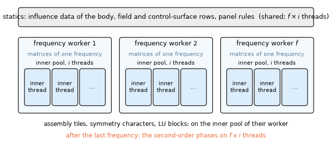

# 13. Linear algebra, threads, determinism and memory

Every frequency of a solve ends in dense linear systems: the discretized integral equations of §6
and §7, one per symmetry character. Their factorization is most of the time of a large problem,
and their matrices most of its memory. This chapter describes how the systems are solved (§13.1),
how accurate the complete results are and how that is measured (§13.2), and how the work is spread
over threads without changing a single bit of the results, together with the memory it needs and
how a solve that would not fit is refused before it starts (§13.3).

## 13.1 Linear algebra

### The factorization

The systems are solved by a dense LU with partial pivoting (the faer crate). Their precision
depends on the method (Table 1); there is one system per symmetry character.

*Table 1. The precision of the matrices and the LU.*

| Problem | Precision |
|---|---|
| low order | complex64 |
| higher order | complex128 |
| the diagnostic double-precision mode (§13.2) | complex128 |

The LU is blocked, right-looking (Golub & Van Loan 2013, §3.2.11, §3.6.1) and column-major. It
works on panels of columns and, for each column block, applies the factors of the panel to the
rest of the matrix (Table 2):

1. Each panel is factored by faer's LU.
2. Per column block: the row swaps, the block row $U_{12} = L_{11}^{-1}A_{12}$ and the trailing
   update $A_{22} \leftarrow A_{22} - L_{21}U_{12}$ (in row blocks) on the inner threads.
3. The next panel is updated and factored first (look-ahead).

The solve then proceeds in blocks of right-hand sides.

*Table 2. The block sizes of the LU and the solve.*

| Block | Size |
|---|---|
| panel (factored by faer's LU) | 128 columns |
| column block (row swaps, block row, trailing update) | 256 columns |
| row block of the trailing update | 512 rows |
| right-hand sides of the solve | 32 |

Every kernel is sequential inside its block, so the result does not depend on the thread count.
Progress and cancel requests are checked every panel.

### Checks

A non-finite matrix, a zero pivot ("singular system matrix (zero pivot k)") and a non-finite
solution raise `LinAlgError`. No condition estimate is made: the second-kind systems are well
conditioned (the grounds below) except near the irregular frequencies, where the interior surfaces
remove the near-singularity rather than report it
([validation: floating hemisphere](../validation/cases/floating_hemisphere.md),
[validation: constants](../validation/cases/constants.md)).

### Other kernels

The real LU of the projections and the matrix products $C = AB$ are faer's sequential kernels.

### Grounds

**Single precision in the low order.** The low order rounds its matrices to complex64. Its
second-kind systems are well conditioned (2-norm condition 3–6 for a wetted body, up to 1e2 with
lids and sheets), so the rounding moves the solution by about 1e-6, and the diagnostic
double-precision mode (§13.2) measures that the production results stay within 1e-5 of their peak.
The higher order keeps complex128 (§7, grounds of the precision).

**Why the engine blocks the LU itself.** The LU is blocked by the engine instead of one call of
faer's recursive LU of the whole matrix because the blocks bound each kernel call:

- the progress and a cancel request are checked every panel;
- the parallelism is the engine's own over blocks fixed by $n$, so the factors do not depend on the
  thread count (§13.3);
- the speed is that of the recursive LU within 5 % ($n$ = 2000–6000, one and four threads).

Without the row blocks of the trailing update the blocked LU was 8–22 % slower on four threads (the
last column blocks of a panel kept the other threads waiting).

**Why faer.** faer is a pure Rust library: the engine builds with the Rust toolchain alone and
ships no proprietary library, and it was as fast end to end as a vendor LAPACK on the benchmark
problems (time ratio 0.86–1.02, one engine thread).

## 13.2 Accuracy targets of complete results

The complete results are held to the thresholds of test-plan A and B. Whether the shortcuts of
the production path (the float32 tiers of the Rankine integrals, the kernel tables, the
single-precision matrices of the low order) stay within them is measured by solving the same
problem without them.

**The diagnostic double-precision mode.** The environment variable `HB_DIAG_DOUBLE`, read once,
switches the production path to the forms of Table 3.

*Table 3. The production path and the diagnostic double-precision mode.*

| | Production | Diagnostic double precision |
|---|---|---|
| Rankine integrals | the closed forms nearer than $2a$, float32 Gauss tiers beyond (§6.1) | the closed forms out to 1000 panel radii (beyond, the edge terms cancel to $\epsilon(r/a)^2$) and a $3 	imes 3$ rule farther; no float32 tiers |
| infinite-depth kernel | the direct tables (§8) | the identity form |
| matrices and LU | complex64 in the low order (Table 1) | double precision |

It gives the exact discrete solution of the same formulation (up to the 1e-9 log integrals and the
2e-10 kernel tables). The production path agrees with it to $\le$ 1e-5 of the peak (resonance peak
positions to 1.3e-7, heights to 4e-6).

The mode is recorded in the meta data of the results and a warning (code 9) of the solve.

## 13.3 Threads, determinism and memory

A solve has two kinds of parallel work: independent frequencies, and the work inside one
frequency. HydroBEM gives each its own thread count, and spreads the work so that the results are
the same, bit for bit, with any counts (Figure 1).

*Figure 1. The threads of a solve: $f$ frequency workers (`frequency_threads`), each holding the
matrices of one frequency and an inner pool of $i$ threads (`inner_threads`); the statics shared by
all; the second-order phases on $f \times i$ threads after the last frequency.*

### The two thread counts

- `frequency_threads` solve that many ordinary frequencies at a time (the limits first).
- `inner_threads` serve, inside a frequency, the low-order assembly (tile pairs of the panel
  loops), the symmetry characters ($\min(N_C, \text{inner})$ at once; their LUs run on the same
  inner pool and share its threads by work stealing) and the blocked LU.
- The statics use both counts multiplied.
- The second-order phases (the potential QTF's fits, outer integral and pairs, the pairs of the
  quadratic QTFs) run after the last frequency on `frequency_threads` $\times$ `inner_threads`
  threads.

### Determinism

Every parallel item writes disjoint data and every kernel is sequential inside its item. Sums over
characters are taken in a fixed order after all are solved; the sums of the second-order loads
(the outer integral over its radii, the pairs) likewise in a fixed order. Identical inputs give
byte-identical results on the same platform with any thread counts (tested, also for the QTFs).

### Grounds

**Two counts.** The two kinds of threads cost differently. Frequency threads scale almost linearly
but each holds the matrices of a frequency (8192 low-order panels without symmetry: 1.5 GiB per
frequency thread against 1.0 GiB of statics shared by all). Inner threads share one set of
matrices but scale less well (the same mesh, one frequency, measured when the blocked LU was
introduced: 16.4 s on one inner thread, 6.3 s on three, 4.2 s on six). The user chooses the split,
and the memory estimate below shows its cost.

**Byte identity.** Byte identity makes the thread counts a choice of speed only and lets every
change of the code be checked output by output, bit for bit. It rests on items with disjoint
outputs, partitions fixed by the problem (tiles of 48 panels, the LU blocks of §13.1) and
reductions in a fixed order.

### The memory estimate

The resident peak is statics (the influence data of the body, field and
control-surface rows, in the higher order with each row's own record, the field points and their
velocity stencils, and the panel rules) + `frequency_threads` $\times$ per frequency (the character
matrices, the copies of the characters solved at once, the incident wave, the potentials, the
source-formulation arrays; in the higher order the Galerkin system and its right-hand sides; the
outputs of the frequency, written into those of all when it is done; the
pages of faer's packing buffers that the blocked LU writes: per inner thread a row block of $L_{21}$
and the block of $U_{12}$ of a trailing update, $((\mathrm{ROWS} + 16) + (\mathrm{UPDATE} + 4)) \cdot \mathrm{PANEL}$ elements, and
per factorization running at once about $n \cdot \mathrm{PANEL}/2$ elements for its panels, with PANEL = 128,
UPDATE = 256, ROWS = 512, each at most the buffers) + outputs: the arrays of the solve's outputs,
which the results take over without a copy (one copy of the elements, which the Python and C
interfaces borrow), the quantities the results add (the drifts of the heading pairs, the Newman
QTFs, the rows of the tank points), and the largest array copied while its source is still held
(the Haskind excitation transposed, the loads placed on the coordinates, a field quantity with
tanks, the interpolated body points). The commit charge adds the rest of the packing buffers: each thread that runs
a product (the inner threads and the frequency thread) reserves two buffers of the L3 cache size
for its life, of which only the pages written by packing become resident. With
a potential QTF (`qtf_potential_direct`, `qtf_potential_indirect`) its two sub-problems
(§12.10) are
estimated as solves of their own, one after the other with the model's results held (and the
free surface's panels, points and field points, and the direct method's columns), and the steps between them (the fields of the fits, a batch of the
outer integral, the coefficients and columns of the pairs with one pair frequency and its work
items on each of the min(`frequency_threads`, pair frequencies) workers) with the fields they
read held: the peak and the commit are the largest of these and the model's own, the parts those
of the model's own solve. Not counted: the internal-tank sub-problems and fixed costs of a few
tens of MiB (the engine's code, the thread stacks, memory freed by an earlier step and kept by the
allocator).

### The memory check

The estimate guards the solve (`options.memory_check`, on by default). Before the first allocation
the resident peak is compared with the physical memory available at that moment (Windows
`GlobalMemoryStatusEx`, the available physical memory; elsewhere `MemAvailable` of
`/proc/meminfo`; no check where neither can be read), and a solve that needs more is refused with a
value error naming both and the remedies. Without it, an allocation that fails ends the process.

The peak, not the commit charge, is compared: the rest of the packing buffers is reserved but
mostly never touched, and the commit limit includes the page file. The check costs one estimate
(the geometry of the problem, no influence data).

The options are in reference/inputs-model §3, the estimate as a query in reference/queries.
