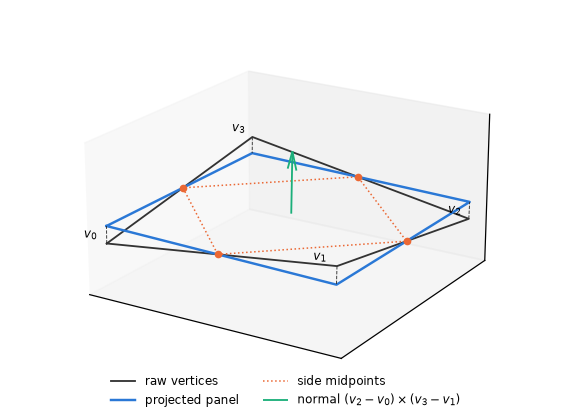
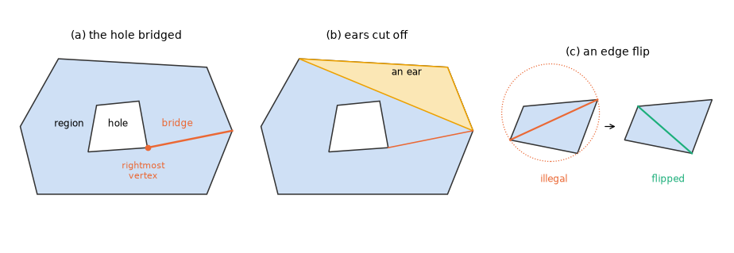
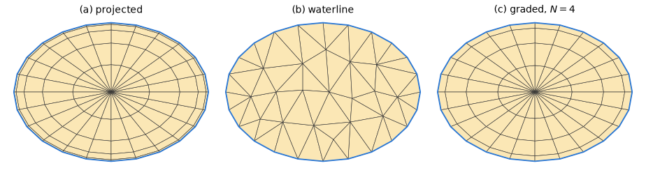
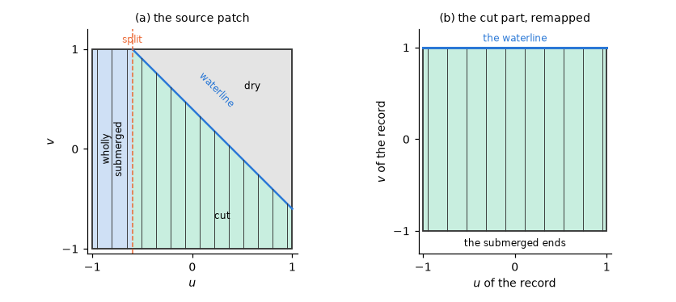
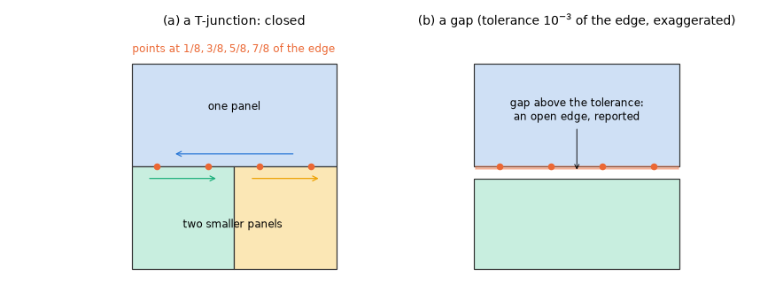

# 14. Geometry preprocessing and tolerances

Before any integral is evaluated, the geometry of the input is turned into the surfaces the two
methods actually integrate. Mesh files are imperfect: quadrilaterals are not quite planar,
coordinates carry only about seven significant digits, edges meet at T-junctions, and the
waterline may cut through panels and patches. Several surfaces are not in the input at all but
generated from the wetted surface: the interior surface that removes the irregular frequencies
(chapter 5), the interior surface of a trimmed higher-order body and the control surface of the
mean drift (chapter 11).

This chapter describes these steps and the tolerances that decide every geometric test: the
planar panels of the low order, the tolerances, the triangulation of regions with holes, the
generated interior surfaces, the trim at the waterline, the automatic control surface and the
check of the mesh quality. The inputs that select them are in reference/inputs-meshes and
reference/inputs-bodies.

## Planar panels of the low order

The constant-panel method needs planar panels (§6.1), but a quadrilateral of a mesh file is in
general skew. Every quadrilateral is therefore replaced by its orthogonal projection onto the plane
through its four side midpoints, the plane with the normal

$$
n = (v_2 - v_0) \times (v_3 - v_1) \tag{14.1}
$$

through the mean of its vertices (Figure 1); the raw vertices are kept. The midpoint plane is the
natural choice: the side midpoints of any quadrilateral are coplanar (they form a parallelogram),
and their plane is the least-squares plane of the sides of a skew quadrilateral.

*Figure 1. A skew quadrilateral (raw vertices $v_0$ to $v_3$), the plane through its side
midpoints with the normal (14.1), and the panel projected onto it (skew exaggerated).*

## Tolerances

Every geometric test compares a length with a tolerance set relative to a length of the geometry
(Table 1).

*Table 1. The tolerances of the geometry.*

| Test | Tolerance |
|---|---|
| coincident vertices | within 1e-6 of the panel diameter |
| strictly convex | the sine of every turning angle exceeds 1e-6 |
| zero area | at or below $10^{-6} \cdot \text{diameter}^2$ |
| flat patch | coplanar within 1e-6 of the diameter and strictly convex (four distinct vertices) |
| plane, waterline and coincidence tests on a length scale $L$ ($z = 0$, horizontal elements, waterplane selections) | $10^{-6} \cdot \max(L, 1\,\mathrm{m})$ |

The value 1e-6 comes from the data. Mesh files often carry about seven significant digits
(single-precision geometry), so features below 1e-6 of the panel size cannot be told from rounding:
a vertex on a straight edge within rounding is not strictly convex, and a repeated vertex within
rounding makes a triangle. Relative tolerances keep every rule independent of the unit of length.

## Triangulating a region with holes

Three generated surfaces are triangulations of a plane region that may contain holes: the
`waterline` interior surface, the interior surface of a trimmed higher-order body and the generated
panels of the free surface of the potential QTF (§12). All three use the same algorithm (Figure 2):

1. **Bridges.** Every hole is bridged from its rightmost vertex to the nearest vertex of the
   boundary that is visible past every hole, preferably to its right (after Eberly 2002). The
   bridged polygon is a single boundary without holes.
2. **Ears.** The bridged polygon is cut into ears, triangles at a corner of the polygon; corners
   whose sine is below 1e-12 are dropped.
3. **Edge flips.** Edges are then flipped to the constrained Delaunay triangulation: every inner
   edge is flipped until none is illegal. The polygon edges are never flipped.

*Figure 2. The triangulation of a region with a hole: (a) the hole bridged from its rightmost
vertex to a vertex of the boundary, (b) an ear cut off the bridged polygon, (c) an illegal edge
(the fourth corner inside the circumcircle) flipped.*

An edge is flipped where the in-circle determinant $D_{\mathrm{c}}$ (the fourth corner against the
circumcircle of a triangle on the edge) exceeds a small fraction of the square of that triangle's
orientation determinant $D_{\mathrm{o}}$,

$$
D_{\mathrm{c}} > 10^{-12} D_{\mathrm{o}}^2, \tag{14.2}
$$

a unit-free test. Both determinants scale with the fourth power of the length, so the threshold does
not depend on the unit; an absolute threshold flipped the same mesh differently in millimetres and
in metres. The rounding of the in-circle determinant, about $\epsilon L^4$, stays four orders below
the threshold.

## Generated interior surfaces

An interior surface in the waterplane removes the irregular frequencies (chapter 5). When the mesh
does not contain one, it can be generated from the wetted surface in three ways (Figure 3;
the option `interior_surface`, reference/inputs-bodies §2.6). Each is built in body-local
coordinates, in the stored symmetry form of the mesh, and expanded like the body.

*Figure 3. The three generated interior surfaces of an elliptic waterplane: (a) `projected`, the
wetted elements projected onto $z = 0$; (b) `waterline`, the triangulated waterplane refined to edges
of at most twice the mean waterline segment; (c) `graded`, a fan from the centroid with the rays
divided towards the waterline.*

**`projected`.** Every wetted stored element with $n_z < -10^{-6}$ is projected onto $z = 0$ with its
vertex order reversed. Vertical elements and elements in $z = 0$ are skipped. An element with
$n_z > 10^{-6}$ is rejected, since its projection would be multi-valued.

**`waterline`.** The wetted edges in $z = 0$ are oriented with the section on the left and joined
into chains, closed along the symmetry planes. A vertex with two successors, contours that cross or
touch, and open chains are rejected. Counter-clockwise loops are regions; clockwise loops are holes
of the smallest enclosing region. Each region is triangulated as above and then refined by Delaunay
refinement (Ruppert 1995; Shewchuk 2002): a triangle with an edge longer than twice the mean waterline
segment, or with an angle below 25 degrees, gets a new vertex at its circumcentre (the triangles whose
circumcircles hold it are made again); a waterline edge that this point would encroach upon (it lies
in the edge's diametral circle, or beyond the edge) is split at its midpoint instead. A waterline
edge is split only while it is longer than twice the mean segment or than 3/4 of the smaller of the
mean segment and the edge it came from, and angles are refined only on triangles whose shortest edge
is at least a quarter of the shortest waterline edge. The waterline stays the same, the mesh is
conforming, the angles are at least 25 degrees (except at a sharper corner of the waterline), and the
triangles grow from the size of the waterline segments to the interior size. Ear clipping and
flips alone give a fan of slivers across a smooth waterline; longest-edge bisection of those keeps
their angles (5.6 degrees on a circle of 64 segments) and needs two to four times as many panels. The
factor 2 halves the interior unknowns of the factor 1.25 with unchanged results. More than 200 000
generated panels are refused (a dense system of that size).

**`graded`.** Per region a fan from its area centroid to every waterline segment, the rays divided
at

$$
t_k = \sin\frac{\pi k}{2N}, \quad k = 0, \dots, N, \qquad N = \left\lceil \frac{\text{mean ray length}}{\text{mean waterline segment}} \right\rceil, \tag{14.3}
$$

so that the cells shrink towards the waterline (the half-cosine clustering of graded meshes). The
rule for $N$ makes the mean radial step at most the mean waterline segment, so the cells have an
aspect ratio of order one away from the waterline, and the fan covers the polygonal waterplane
exactly. Regions with an opening, or not star-shaped about the centroid, are rejected; `waterline`
covers both.

The three generators remove the irregular frequencies alike: on a hemisphere they agree within
1e-4 of the largest coefficient
([validation: floating hemisphere](../validation/cases/floating_hemisphere.md)).

## Trimmed waterline

A trimmed body, or a mesh that extends above the free surface, must be cut at the waterline.

- **Low order.** The elements are clipped at $z = 0$ (or at a tank's own free surface).
- **Higher order.** Patches the waterline cuts are remapped: every line of constant $u$, or of
  constant $v$, is mapped from its submerged end to the waterline. The patches are split where their
  lines change between wholly submerged, cut and dry (Figure 4). A patch whose lines cross the
  waterline twice in both directions is rejected.

The pieces of a cut element keep its number and are told apart by their part, 0, 1, ... in the
order of the cut (the `element` and `part` of the queries, reference/queries §3).

*Figure 4. A patch cut by the waterline, in its parameter square. (a) The lines of constant $u$:
wholly submerged to the left of the split, cut by the waterline to the right, the dry part above the
waterline left out. (b) The cut part as an element of its own, each of its lines running from its
submerged end to the waterline.*

## The interior surface of a trimmed higher-order body

The `waterline` interior surface of a trimmed higher-order body is made from the waterline of the
trimmed elements, traced as chords (16 per element side in $z = 0$).

1. **Loops.** The waterline chords are joined into closed loops. A chain that ends on a plane of
   the kept symmetry is closed along it: its ends, ordered along the boundary of the stored part,
   pair up first with second, third with fourth, and so on, through the corner $x = y = 0$ when a
   pair straddles it.
2. **One star-shaped loop.** A single loop star-shaped about its centre (the mean of the waterline
   points with their mirror copies; every chord turning counter-clockwise about it, sine > 1e-9)
   becomes a fan from the centre.
3. **Everything else.** Every other waterline (several loops, holes such as moonpools, a loop not
   star-shaped) is triangulated as a region with holes (above), after merging the vertices that lie
   within the length tolerance of the line through their neighbours (a straight run of chords).

Each triangle becomes a degenerate bilinear patch, the corner opposite its longest edge doubled,
with

$$
n_u = \operatorname{clamp}\!\left(\operatorname{round}\frac{\lvert ab\rvert}{2s}, 1, 8\right), \qquad n_v = \operatorname{clamp}\!\left(\operatorname{round}\frac{\max(\lvert ca\rvert, \lvert cb\rvert)}{2s}, 2, 8\right) \tag{14.4}
$$

spans along that edge $ab$ and towards the corner $c$, $s$ the longest chord. A triangle of a
flat-patch source is three flat quadrilaterals (corner, side midpoints, centroid). A chain ending
off the symmetry planes ("does not close") and loops that cross or touch are refused.

## Free-surface plates of a trimmed body

A free-surface plate (§9.7) given in hull coordinates leaves $z = 0$ under any pitch or roll, and
the waterline it must fit is known only after the cut, so the plate of a trimmed body is generated
from the trimmed waterline, as its interior surface is **[C]**. The user chooses a waterline loop
by a point inside it; the plate is the water of $z = 0$ that the loop encloses.

1. **The water's loops.** The waterline (the panel edges in $z = 0$ of the trimmed elements, low
   order; 16 chords per patch side, higher order) is joined into chains as above. The ends of the
   chains that end on a plane of the kept symmetry, ordered along the boundary of the stored part,
   alternate between water and waterplane: the waterplane lies between the first and the second
   end, the third and the fourth, ..., the water between the second and the third, the fourth and
   the fifth, ...; the first and the last end bound the open sea, which reaches infinity along
   the boundary and is no loop. Pairing the ends the second way closes the loops of the water
   (through the corner $x = y = 0$ where a pair straddles it); the closed chains are loops of both.
2. **The region.** The point, moved into the stored part (by its mirror image across a plane of the
   symmetry), must lie inside an even number of the waterplane's loops (in water, not in the hull's
   section) and inside at least one loop of the water (not in the open sea). The smallest loop of
   the water around it is the plate's outer boundary; the outermost loops inside that one are the
   waterlines of the hulls within it, the holes of the plate.
3. **The elements.** The region is triangulated as a region with holes (above), the vertices of
   straight runs merged: in the low order refined as the `waterline` interior surface (edges of at
   most twice the mean waterline segment, angles of at least 25 degrees), in the higher order as the
   interior surface of a trimmed patch mesh (degenerate bilinear patches with the spans (14.4), or
   three flat quadrilaterals per triangle of a flat-patch source), the normals down. The new
   vertices of the refinement on the boundary are midpoints of waterline edges, so the plate's
   boundary lies on the waterline and its area is the area the loop encloses.

A plate body of its own over another body's loop (the piston of a trimmed tube) is generated in the
same way from the other body's trimmed mesh, then moved into its own body axes (in the stored part
when the two bodies are placed alike, else whole). With the trim $[0, 0, 0]$ the generated plate and
the same elements given as a mesh are one problem, so the results agree to rounding; on a pitched
moonpool hull the plate agrees with a hand-made cover of the same waterline to the discretization of
the plate.

## Automatic control surface

The control surface of the mean drift (§11) can be generated around the body
(reference/inputs-bodies §2.7). It is a circular cylinder of the given radius about the body origin
(or vertical walls along a polygon, with a flat bottom) down to the given depth, together with the
free-surface patches between the traced body waterline (panel edges, or 16 chords per patch side)
and the outer boundary:

- for a waterline star-shaped about the origin, one segment-arc patch per waterline segment over the
  same azimuths;
- otherwise, with partitions or a polygon, each waterline chain has a centre, its chords are split
  at the rays to the corners of the boundary, and they are joined to it by bilinear or segment-arc
  patches.

A circular waterline of a revolved analytic patch is traced exactly.

## Mesh quality

The check of the mesh quality (the warnings of the model rules and the query `mesh_quality`,
reference/queries) asks whether the surface is closed. The wetted and pressure elements, with their
reflections and placed, form the surface that the waterline $z = 0$ (and the sea bed, a wall plane)
closes. Neither panels nor patches need meet at their vertices: one edge or side may border several
smaller ones, a T-junction (Figure 5a).

*Figure 5. (a) A T-junction: the points at $1/8$, $3/8$, $5/8$ and $7/8$ of the long edge each lie
on an edge of exactly one smaller panel, traversed in the opposite sense; the surface is closed.
(b) A gap above the tolerance (exaggerated): the points lie on no other edge, and the edge is
reported open.*

**Low order.** The vertices are merged on a grid of 1e-6 of the extent; vertices within it on two
sides of a cell boundary are followed as loose edges. An edge used by two panels must be traversed
in opposite senses. An edge used by one panel is followed at the points 1/8, 3/8, 5/8 and 7/8 of its
length, each of which must lie on such an edge of exactly one other panel.

**Patches.** A side is followed at the four points $s = \pm 1/4, \pm 3/4$ of its parameter, each
projected (by Newton's method from the nearest of 17 outline points) onto the sides of the other
patches near it.

**The tolerance.** A point must lie within 1e-3 of the edge length of exactly one other edge or
side **[C]**, traversed in the opposite sense. A gap of a thousandth of an edge lies far below the
discretization error of the panel and patch integrals, so surfaces that meet within it are closed,
and a larger gap is a defect worth reporting. A point at the common corner of neighbours, at the
end of each of their edges, is met; the sense is tested at the other points.

**The waterline.** A side whose points lie in $z = 0$ is waterline, and an end of a waterline side
must lie on another one.

**Cost.** Proportional to the number of elements, through a grid of the median edge length (about
60 µs per patch), once per check of the rules.

**Facing elements.** Two bodies in contact, each meshed across the contact (a float sliding on a
column, two hulls side by side), put the same surface into the integral equation twice, with
opposite normals and no fluid between. The equation is then nearly singular. On a float whose bore
lies on the column of a spar, the radiation coefficients broke the reciprocity
$A_{ij} = A_{ji}$ by 2 % of the peak of $A$ and 27 % of that of $B$, and the diffraction force
depended on the formulation (scattered or total) by up to 1.7 times its peak. With the contact
left out of both wetted surfaces the asymmetry fell to $2 \times 10^{-4}$ **[C]**. The check takes the
wetted elements of all bodies, placed and reflected (a patch: one quadrilateral per span of its
discretization), and asks of every element whether its centroid lies on another element whose
normal is within 26 degrees of opposite ($\mathbf{n}_1 \cdot \mathbf{n}_2 < -0.9$): within the outline of
that element and within 0.02 of the larger diameter from its plane **[C]**. Two meshes
of one circular surface with $N$ chords a circle lie apart by up to the sagitta, $\pi/4N$ of a
chord (0.011 at $N = 72$, 0.020 at 40), while a thin solid part lies above it (a plate 0.1 m
thick under elements of 1 to 1.6 m: 0.06 to 0.1). Elements found on another body, and those of
one body on itself (a surface meshed on both sides with almost no thickness), are reported per
pair of bodies with their number, area and first element. A grid of the median diameter makes the
search proportional to the number of elements.
