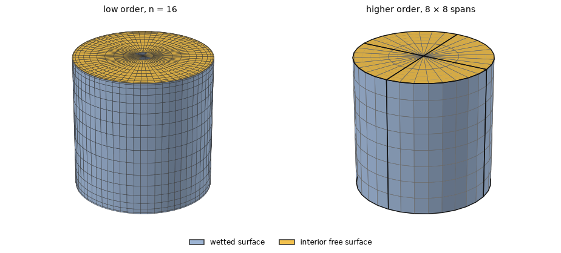
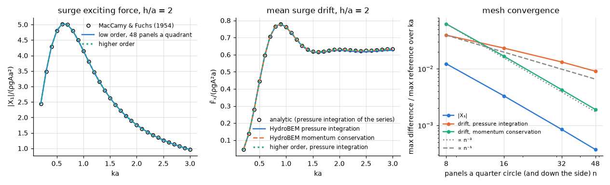

# Bottom-mounted cylinder

**Result.** The surge exciting force of a cylinder standing on the sea bed agrees with the closed
form of MacCamy & Fuchs (1954) within 0.037 % of its largest value in the low order ($n = 48$) and
$6.2 \times 10^{-6}$ in the higher order. The mean drift force agrees with the analytic drift within
0.19 % (low order, momentum conservation) and $3.4 \times 10^{-5}$ (higher order, both ways). The
low order's pressure drift converges more slowly (0.9 % at $n = 48$), because it needs the
velocities of constant panels on the wall.

## The problem

A vertical cylinder of radius $a = 1$ m stands fixed on the bottom of water of depth $h = 2a$ and
pierces the free surface. Waves come from ahead at 29 values $0.2 \le ka \le 3$. We compare the
surge exciting force $\lvert X_1 \rvert/(\rho g A a^2)$ and the mean surge drift force
$\bar{F}_x/(\rho g A^2 a)$.

The mean drift force is the steady force that remains when the second-order pressure is averaged
over a wave period. HydroBEM computes it in two independent ways: by pressure integration over the
hull and along the waterline, and by momentum conservation, from the flux of momentum the waves
carry to and from the body. Both are compared.

*Figure 1. The two meshes, expanded to the whole body and seen from above the free surface: the
wetted wall in blue, the interior surface in the waterplane in yellow. Left: low order, $n$ panels
per quarter circle and $n$ down the side, cosine-spaced (shown $n = 16$), with the graded interior
surface. Right: higher order, the analytic cylinder with the draft equal to the depth (patch edges
in black, span edges in grey), $8 \times 8$ spans on the wall per quadrant and the waterplane patch
($8 \times 2$) as interior surface, order 3, with the uniform mapping (the pressure drift is not
available with the nonuniform one).*

The interior surface removes the irregular frequencies: the integral equation of the exterior
problem fails at the eigenfrequencies of the water that would fill the inside of the column, the
first at $ka = j_{0,1} = 2.405$, where $J_0(ka) = 0$, and a lid over the waterplane inside the body
removes them. Without it the difference near $ka = 2.4$ exceeds the values of Table 1 many times.

## The reference

The force is the closed form of MacCamy & Fuchs (1954),

$$
\lvert X_1 \rvert = \frac{4\rho g A \tanh kh}{k^2 \lvert H_1^{(2)\prime}(ka) \rvert}.
$$

The mean drift is derived in `validation/bottom_cylinder.py` from the same analytic scattering
solution. On $r = a$ the total potential is $(gA/\omega) Z(z) S(\theta)$ with
$Z = \cosh k(z+h)/\cosh kh$ and

$$
S = \sum_m \epsilon_m (-i)^m \frac{-2i}{\pi ka H_m^{(2)\prime}(ka)} \cos m\theta,
$$

where the Wronskian of $J_m$ and $Y_m$ has simplified the series. The mean force of the fixed body
is

$$
\bar{F}_x = \frac{\rho}{4} \iint \lvert\nabla\phi\rvert^2 n_x \,\mathrm{d}S
- \frac{\rho g}{4} \oint \lvert\zeta\rvert^2 n_x \,\mathrm{d}l,
$$

with the depth integrals in closed form. In deep water this is eq. (36) of Havelock (1940); the
script checks the series against Havelock's closed sum, eq. (39), to 8.3e-16. The force formula is
MacCamy & Fuchs's, here derived from the same series (Havelock 1940, eq. (35), gives its deep-water
form). Both references are analytic, so the differences below are those of the panel method alone.

## Agreement with the reference

*Figure 2. Left: $\lvert X_1 \rvert$ against MacCamy & Fuchs. Middle: the drift by pressure
integration and by momentum conservation against the analytic drift. Right: the largest difference
over $ka$ of each against the low-order $n$.*

Table 1 gives the largest difference of each quantity on every mesh.

*Table 1. Largest difference from the reference over $0.2 \le ka \le 3$, relative to the largest
reference value of each quantity.*

| Method, mesh | $\lvert X_1 \rvert$ | drift, momentum conservation | drift, pressure integration |
|---|---|---|---|
| low, $n = 8$ | 1.2e-2 | 6.2e-2 | 3.9e-2 |
| low, $n = 16$ | 3.3e-3 | 1.7e-2 | 2.3e-2 |
| low, $n = 32$ | 8.4e-4 | 4.3e-3 | 1.3e-2 |
| low, $n = 48$ | 3.7e-4 | 1.9e-3 | 9.0e-3 |
| higher, $8 \times 8$ spans | 6.2e-6 | 3.4e-5 | 3.1e-5 |

## Does it converge?

The four low-order meshes of Table 1 show the rate of each quantity. The exciting force and the
momentum drift converge as $n^{-2}$. The pressure drift converges about as $n^{-1}$, most slowly at
the larger $ka$: it needs the velocity along the wall of constant panels, whose error falls only as
$n^{-1}$ where the panel heights change from one panel to the next (the cosine spacing). Its
waterline term takes the potential of each waterline panel expanded from the centroid to the
waterline; the centroid value alone, half a panel height below it, would add a difference of first
order in that height, larger than all the others here.

The higher order integrates the pressure over the patches and along their waterline sides, and its
pressure drift converges about as fast as its momentum drift.

## Reproducing this page

The example [`examples/bottom_mounted_cylinder`](../../../examples/bottom_mounted_cylinder) runs the
same body. This page, its figures and its numbers are written by `validation/bottom_cylinder.py`
through `validation/make_report.py`.
