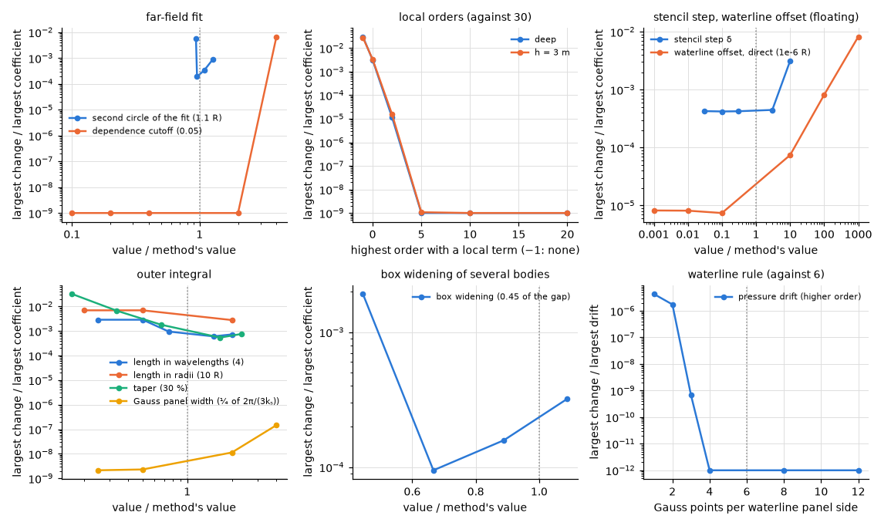
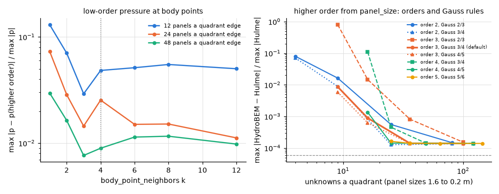

# Sensitivity of the fixed constants

**Result.** Each of the 12 fixed constants of Table 1 lies in a flat range of its sensitivity:
varied about its value, it changes the results little, and the change grows only away from the
chosen value. The default higher-order discretization reaches its best agreement with Hulme's tables
(1.4e-4) at 36 unknowns per quadrant. The constants that cannot be varied rest on an argument with a
measurement.

## What is checked

The constants of [theory](../../theory/README.md) and
[second-order](../../theory/12-second-order-loads.md) that are fixed by the method, with no input to
set them, are varied about their values. The measure is the largest change of the results relative
to their largest value. A constant is well chosen when it sits in a range where this change is flat
and small; the page shows that range for each.

## How the constants are varied

The constants of inputs are varied through the inputs. Those of the second-order free surface and of
the higher-order waterline rule have no input; they are varied through the engine's validation
hooks. The environment variable `HB_VALIDATE_<name>` sets a constant for the process when the engine
first reads it (`crates/hydrobem/src/env_hooks.rs`; `validation/constants.py` lists the names).
Without the variables every constant is the method's and the results are unchanged.

An unknown `HB_VALIDATE_` name or a value that does not parse refuses the solve; a set hook is a
warning and is listed in the meta data of the results. The hooks are for validation only and never
change a default: `VALIDATION_CONSTANTS` in that file lists every hooked constant with its value,
and a unit test holds each value to the theory documents.

Where a constant cannot be varied, its ground is an argument with a measurement (the last section).

## The second-order free surface and the waterline rule

*Figure 1. The truncated cylinder of radius 1 m and draft 0.5 m ([cylinder](cylinder.md); deep
water, the automatic $R = 4$ m and panel size; the stencil and the waterline offset on the floating
cylinder, the offset with the direct method; the length of the outer integral in radii at
$\omega = 3$ and 3.5 rad/s, where it governs; the box widening on two fixed cylinders 3.2 m apart,
cells of 0.25 m to $R = 5$ m, $\omega = 1.5$ and 2 rad/s): the largest change of the sum and
difference coefficients relative to the largest coefficient against each constant over its value.
Last panel: the higher-order pressure drift (surge, heave, pitch) of the floating spline cylinder (8
spans per quarter circle, $0.6 \le \omega \le 3$ rad/s) against the Gauss points per waterline panel
side. Changes below 1e-9 (in the last panel 1e-12), exact zeros among them, are drawn at that
floor.*

## The constants of inputs

*Figure 2. Left: the low-order diffraction pressure at 40 points on the wetted hemisphere (not
centroids; $Ka = 0.5$, 1, 2) as the inverse-distance mean of the $k$ nearest centroids, against the
higher-order pressure at the same points ($8 \times 8$ spans), on 12, 24, 48 panels per quadrant
edge. Right: the hemisphere ([floating hemisphere](floating_hemisphere.md)) in the higher order with
the spans of the `panel_size` rule ($n = \lfloor L/s + 10^{-5} \rfloor + 1$, $s = 1.6$ to 0.2 m),
each spline order and pair of Gauss orders, against Hulme (1982) at $Ka = 0.5$, 1, 2, over the
unknowns per quadrant (colour: the spline order; solid: Gauss orders $k/k + 1$, dotted: one higher,
dashed: one lower; the dashed line the rounding of the four-digit tables).*

## The sensitivity of each constant

Table 1 gives, for each constant, the range over which it was varied, the largest change it caused
and the reason for its value.

*Table 1. The constants without an input and their sensitivity.*

| Constant (where) | Value | Varied over | Largest change | Ground |
|---|---|---|---|---|
| second circle of the fit (theory §12.9) | $1.1 R$ | 1.03 to $1.4 R$ | 1.9e-4 to 9.1e-4 for 1.05 to $1.4 R$; 5.7e-3 at $1.03 R$ | the $2 \times 2$ fit of each order loses its conditioning as the circles close and the local term decays between them more slowly as they part; 1.1 lies in the flat range |
| orders with a local term (theory §12.9) | 30 | none, 0 to 20 | 3.0e-2 without, 2.5e-3 with order 0 only, 1.1e-5 to 2, about 1e-9 and below from 5 (deep water and depth 3 m alike) | the local part of order $m$ decays as $r^{-3-\lvert m \rvert}$: above a few orders it is below the float32 fields; 30 is ample |
| dependence cutoff of the fit (theory §12.9) | 0.05 | 0.005 to 0.2 | none up to 0.1; 6.7e-3 at 0.2 | it only drops the local term of orders whose two radial functions are nearly dependent between the circles; inactive here from 0.005 to 0.1 |
| stencil step $\delta$ (theory §12.8) | $\min(0.02/k_s, 10^{-3} R)$ | both factors $\times 0.03$ to $\times 10$ | $\le$ 4.5e-4 for $\times 0.03$ to $\times 3$; 3.1e-3 at $\times 10$ | central differences: the truncation $O(\delta^2)$ shows beyond $\times 3$; below, the rounding of the single-precision fields (the 4e-4 floor) |
| waterline offset of the direct method (theory §12.8) | $10^{-6} R$ | $10^{-9}$ to $10^{-3} R$ | $\le$ 8.2e-6 up to $10^{-6} R$; then linear, 7.4e-5 at $10^{-5} R$ | the offset moves the waterline values by $O(\text{offset})$: at $10^{-6} R$ it is below the other errors and still clear of the body |
| length of the outer integral (theory §12.9) | 4 longest wavelengths, $\ge 10 R$ | 1 to 8 wavelengths; 2 to $20 R$ (where it governs) | 9.5e-4 for 3 to 8 wavelengths, 2.9e-3 for 1–2; 2.8e-3 (sums 7.6e-4) at $20 R$, 6.9e-3 at 2–$5 R$ | the integrand decays slowly and oscillates; with the taper the sum converges, to about 1e-3 at the method's length |
| taper of the outer integral (theory §12.9) | $\cos^2$ over 30 % | 5 % to 70 % | $\le$ 1.8e-3 for 20–70 %; 3.2e-2 at 5 % | a taper of a few per cent is a truncation; from 20 % on the length decides |
| Gauss panel width of the outer integral (theory §12.9) | $\tfrac{1}{4} \cdot 2\pi/(3k_s)$ | $\times 0.25$ to $\times 4$ | $\le$ 1.5e-7 | 6 Gauss points per quarter of the shortest oscillation integrate it far beyond need |
| box widening of several bodies (theory §12.8) | 0.45 of the gap | 0.2 to 0.49 | $\le$ 3.2e-4 for 0.3–0.49; 1.9e-3 at 0.2 | the boxes must not meet (below 0.5); a wide box keeps the cells close to each waterline |
| Gauss points per waterline panel side (theory §11.4) | 6 | 1 to 12 | $\le$ 7.5e-14 from 4; 6.7e-10 at 3; 1.7e-6 at 2 | the integrand on a side is a product of two potential traces of degree $k - 1$ times the arc-length element: 6 points are exact to degree 11; on the curved cubic side of the test cylinder, against 64 points: 3.7e-12 (4 spans), 6.4e-15 (8 spans) |
| `body_point_neighbors` (theory §4.2) | 4 | 1 to 12 | 48 panels: 3.0e-2 ($k = 1$), 7.6e-3 (3), 8.9e-3 (4), 9.8e-3 to 1.2e-2 (6–12); 24 panels: 7.3e-2 (1), 1.4e-2 (3), 2.5e-2 (4), 1.1e-2 (12); 12 panels: 1.3e-1 (1), 2.9e-2 (3), 4.8e-2 (4) | the error falls with the mesh more than with $k$, and no $k$ is best on every mesh: $k = 3$ on 12 and 48 panels, $k = 12$ on 24 (where $k = 4$ errs 2.3 times more than $k = 12$); $k = 1$ four to five times worse than $k = 3$. The default 4, the centroids that surround a point on a quadrilateral mesh, stays within 1.2 (48 panels) to 2.3 times (24) of the best $k$ and is kept |
| `panel_size` defaults (theory §7.3) | order 3, Gauss 3/4 | orders 2–5, Gauss 2/3 to 5/6 | the default reaches the comparison floor (1.4e-4) at 36 unknowns per quadrant; order 3 with Gauss 2/3 needs 100; order 4 with Gauss 4/5 25 | the outer rule needs at least as many points as the spline order: Gauss 2/3 with order 3 errs by 1.5e-2 at $s = 0.8$ m (the default 8.9e-4); higher orders save unknowns at a larger cost per unknown |

## The constants that cannot be varied

Some constants cannot be varied without changing the method itself. Each rests on an argument and a
measurement:

- **The +15 of the expansion order $M = \lceil kR \rceil + 15$ and the cap 160** (theory §12.9). The
  input `expansion_order` varies $M$ ([cylinder](cylinder.md)): the results are unchanged from
  $\lceil kR \rceil - 8$ on, so the margin 15 is a reserve of more than 20 orders here. The fit's
  own order $M_f = \max(M, \lceil kR_{\mathrm{OC}} \rceil + 15)$ keeps the margin: the orders above
  $kR$ of a disturbance from bodies within a radius $a$ appear at $R$ with about the factor
  $(a/R)^{\lvert m \rvert - kR}$, $4^{-15} \approx 10^{-9}$ at the automatic $R = 4a$. The cap 160
  is the highest order to which the Bessel recurrences are tested (test-plan A9): against mpmath to
  order 150, by the Wronskian to 160; $M \le 160$ holds for $kR$ up to 145.
- **The 1e-5 of the `panel_size` rule** $n = \lfloor L/s + 10^{-5} \rfloor + 1$: a patch edge whose
  length is an exact multiple of $s$ ($L/s$ an integer up to the rounding of the measured arc
  length) gets the intended $n$; 1e-5 is far above that rounding and far below a meaningful fraction
  of a panel.
- **Galerkin testing in the higher order** (theory §7): Maniar (1995, §3.4) weighed collocation at
  Gauss points, an overdetermined system solved by least squares whose accuracy depends on the
  points chosen and whose solution and storage cost outweigh its simpler assembly, against the
  Galerkin procedure, which gives a square system of the size of the unknowns; Galerkin approximants
  also give integrated quantities $\int \phi g \,\mathrm{d}S$ more accurately than the solution
  itself (Maniar 1995, §3.3). Measured: the higher order reaches the comparison floor with Hulme's
  tables with 36 unknowns per quadrant in the default order 3 (Gauss 3/4), 25 in order 4 (Gauss 4/5)
  ([floating hemisphere](floating_hemisphere.md) and Figure 2).
- **No condition estimate** (theory §13.1): the second-kind equations are well conditioned except
  near the irregular frequencies, where the condition number grows without bound; the remedy is the
  interior surface ([floating hemisphere](floating_hemisphere.md)), which removes the
  near-singularity rather than reporting it. A zero pivot and non-finite values are refused. The
  measured condition numbers are in theory §7 and §13.1.
- **The layout of the generated free-surface panels** (theory §12.8: the square of half-width
  $\sqrt{2}\, r_c$, $r_0 = 2 r_c$, the spokes rounded): the layout is one discretization of the same
  integral; the cells, an independent layout, agree with it to the discretization error at every
  size ([cylinder](cylinder.md)), so the layout adds no error beyond that of the panel size.
- **The pressure-mode problem posed in the applied pressure** (theory §9.3): the pressure head of a
  mode is the coordinate the user prescribes (the uniform pressure of an air cushion), so the
  radiation problem is posed in it directly; the elevation-mode form of Lee & Newman (2000) gives
  the same coefficients (their eqs. 20–21) and needs modes that span the elevation, which is not
  uniform over the surface.

## Reproducing this page

This page, its figures and its numbers are written by `validation/constants.py` through
`validation/make_report.py`; the second-order cases run in processes of their own, one per value of
a hook.
