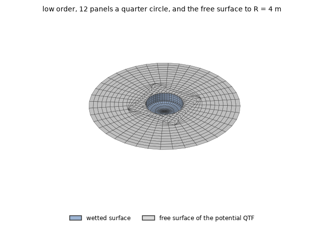
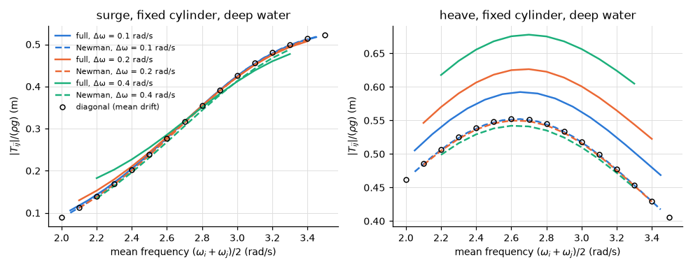
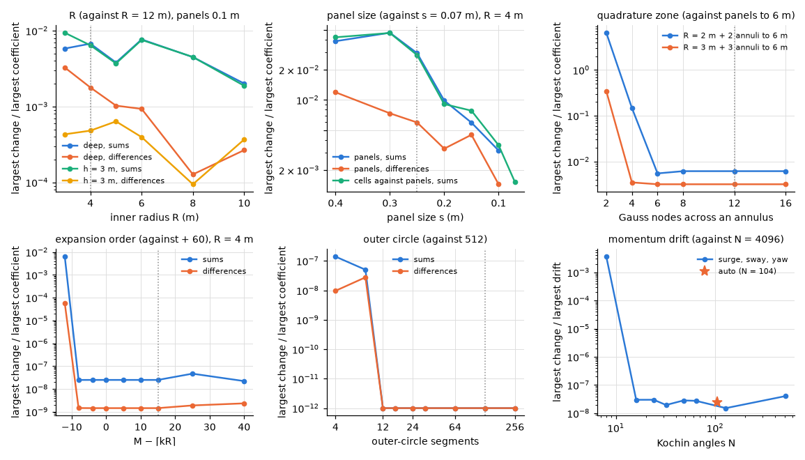

# Truncated cylinder in deep water: second-order loads

**Result.** No independent reference exists for this body, so the page checks the second-order free
surface by convergence. Newman's approximation differs from the full difference-frequency QTF by
6.5 % in surge and 7.2 % in heave at $\Delta\omega = 0.1$ rad/s, growing linearly with
$\Delta\omega$; in heave most of it is the potential part, which the approximation leaves out. The
force of the second-order potential depends on the free-surface discretization by a few tenths of a
per cent of the largest coefficient at the automatic settings, and every series and quadrature
beyond the inner radius is converged far below that.

## The problem

The body is the truncated cylinder of radius 1 m and draft 0.5 m in deep water, the body of the
example [`examples/cylinder`](../../../examples/cylinder), in head seas, fixed (floating where
stated). Without an independent reference, the checks of this page are the grounds of the
second-order free surface ([not verified](../not_verified.md)). Three ranges are used:

- $\omega = 2.0$ to 3.5 rad/s in steps of 0.1 rad/s for Newman's approximation;
- $\omega = 2$ and 3 rad/s for the convergence of the potential QTF (surge, heave and pitch, sums
  and differences);
- 0.6 to 4 rad/s for the momentum drift.

The quadratic transfer function (QTF) gives the second-order force per pair of wave frequencies. Its
quadratic part comes from products of the first-order solution; its potential part, the force of the
second-order potential, needs the free surface around the body to be discretized as well.

*Figure 1. The low-order mesh, expanded to the whole body and seen from below: the cylinder's wetted
surface in blue and the free surface of the potential QTF in grey. The cylinder has 12 panels per
quarter circle, 6 down the side and 6 across the bottom (cosine-spaced); the free surface is
generated to the automatic $R = 4$ m with the automatic panel size. The potential QTF is available
in the low order only.*

## Newman's approximation

Newman's approximation estimates the difference-frequency QTF near its diagonal from the mean drift
forces alone, without the second-order potential. This section measures how far it is from the full
QTF.

*Figure 2. The modulus of the full difference-frequency QTF (the quadratic part by pressure
integration plus the force of the second-order potential, indirect method) along the off-diagonals
$\Delta\omega = \omega_j - \omega_i$ (solid), Newman's approximation (the geometric mean of the
pressure drifts, dashed) and the diagonal, the mean drift (markers).*

The difference grows linearly with $\Delta\omega$, as an approximation about the diagonal should
(Table 1). In heave the potential part, which the approximation does not contain, is most of it.

*Table 1. Largest difference between Newman's approximation and the QTF along each off-diagonal,
relative to the largest modulus of the full QTF.*

| $\Delta\omega$ (rad/s) | surge, full | surge, quadratic part | heave, full | heave, quadratic part |
|---|---|---|---|---|
| 0.1 | 6.5 % | 6 % | 7.2 % | 0.55 % |
| 0.2 | 13 % | 12 % | 13 % | 1.1 % |
| 0.4 | 23 % | 24 % | 22 % | 2.1 % |

## Does the second-order free surface converge?

The force of the second-order potential depends on how the free surface is discretized: an inner
radius $R$ with panels or cells, a quadrature zone of annuli beyond it, and a far field summed as a
series on an outer circle. Each parameter is varied about a reference value while the others are
held (Figure 3, Table 2). The momentum drift depends on one parameter of its own, the number of
angles at which the Kochin functions, the far-field amplitudes of the waves around the body, are
evaluated.

*Figure 3. $\omega = 2$ and 3 rad/s, indirect method: the largest change of the sum and difference
coefficients (surge, heave, pitch) relative to the largest coefficient, when one parameter of the
free surface (theory §12.8–§12.9, reference/inputs-orders §3) is varied about a reference value; the
dotted line marks the automatic value. Last panel: the momentum drift of the floating cylinder
($0.6 \le \omega \le 4$ rad/s, headings $0^\circ$ and $30^\circ$) against the Kochin angle count.
Changes below 1e-12 are drawn at 1e-12; the reference case itself (no change) is not drawn.*

*Table 2. The convergence of the potential QTF and of the momentum drift.*

| Parameter | Range | Largest change |
|---|---|---|
| inner radius $R$ (panels 0.1 m), deep water | 3 to 10 m against 12 m | sums 7.7e-3, differences 3.3e-3; heave of the (3, 3) sum 1.0614 to 1.0588 (0.25 %) |
| inner radius $R$, depth 3 m | 3 to 10 m against 12 m | sums 9.4e-3, differences 6.4e-4; heave of the (3, 3) sum 1.0951 at $R = 3$ m, 1.0847 to 1.0868 from 4 to 12 m (0.2 %) |
| panel size $s$ ($R = 4$ m) | 0.4 to 0.1 m against 0.07 m | sums 4.7e-2 (0.3 m), 2.9e-2 (0.25 m, the automatic size), 3.1e-3 (0.1 m) |
| cells against panels | the same sizes | 4.6e-2 at 0.3 m, 3.5e-3 at 0.1 m, 1.5e-3 at 0.07 m |
| quadrature zone, Gauss nodes across an annulus (panels 0.07 m) | 2 to 16; panels to 2 or 3 m, annuli to 6 m; against panels to 6 m | converged from 6 to 8 nodes; then 6.1e-3 (from 2 m) and 3.2e-3 (from 3 m) |
| expansion order $M - \lceil kR \rceil$ ($kR = 14.7$) | $-12$ to $+40$ against $+60$ | 6.3e-3 at $-12$; $\le$ 5e-8 from $-8$ on |
| outer-circle segments | 4 to 256 against 512 (automatic 128) | $\le$ 1.4e-7 |
| Kochin angles $N$ (momentum drift) | 8 to 512 against 4096 | 3.6e-3 at 8; $\le$ 4.1e-8 from 16 on (automatic 104: 2.5e-8) |

The inner radius $R$: past the body's near field the coefficients change by less than 1 % of the
largest and the differences by less than 0.35 %. The changes are not monotone in $R$, because the
generated panels differ with $R$, and their discretization (0.3 % between $s = 0.1$ and 0.07 m) is
of the same size.

The panel size: the sums oscillate on the free surface with the combined wavenumber $2k + k_\Omega$
of the pair, here 5.5 /m, a combined wavelength of 1.14 m. The automatic size, $a/4 = 0.25$ m (a
third of the combined wavelength is 0.38 m), leaves 2.9 % in the sums and 0.6 % in the differences
against 0.07 m; 0.1 m, about 11 panels per combined wavelength, leaves 0.3 %. The cells and the
generated panels agree to the same discretization error.

The quadrature zone converges in its radial nodes from 6 to 8. It differs from panels to the same
radius by 0.3 % (from 3 m) and 0.6 % (from 2 m, closer to the body), the size of the panels' own
discretization (0.2 % between 0.1 and 0.07 m at $R = 6$ m); the azimuthal nodes change nothing.

The expansion order and the outer-circle segments: the far-field series and the trapezoidal rule on
the circle are converged far below every other error. The automatic order (+15) has a margin of more
than 20 orders over the first one that changes the results, and the automatic segment count a factor
of ten.

The Kochin angle count: $N = 16$ is converged for this body ($kR \le 1.6$), as the rule
$N \ge 2kR + \text{about } 10(kR)^{1/3}$ of theory §11.4 predicts; the automatic count adds the
margin 96.

## Reproducing this page

The example [`examples/cylinder`](../../../examples/cylinder) solves the same body. This page, its
figures and its numbers are written by `validation/qtf.py` through `validation/make_report.py`.
