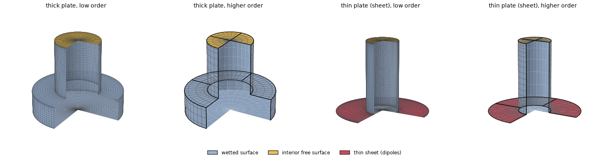
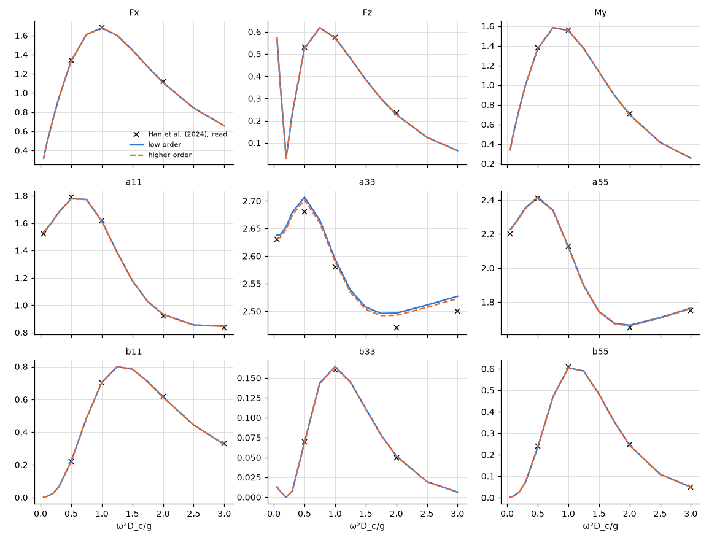
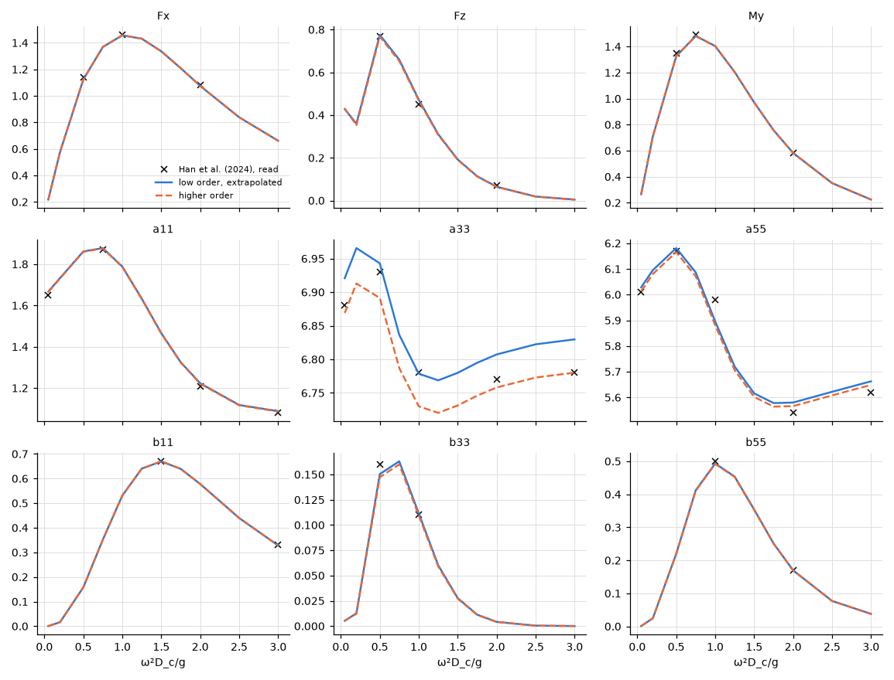

# Truncated cylinder with a heave plate

**Result.** Both methods reproduce the analytical lines of Han et al. (2024) for a cylinder with a
heave plate, thick or thin, to about the accuracy of reading the figures: the higher order within
2 % of the largest value read, except near the small peak of the heave damping $b_{33}$, read
approximately (8 %). For the thick plate the two methods agree with each other within 0.5 %. The
thin plate's sheet converges slowly in the low order and is extrapolated.

## The problem

A surface-piercing circular cylinder stands on a coaxial circular plate and is held at rest in
waves. We compare the exciting forces, added mass and damping in surge, heave and pitch, with a
thick plate and with a thin plate. The geometries are those of Han et al. (2024), their table 1:

- the thick plate (after the DeepCwind column): $D_c = 12$ m, plate diameter $D_d = 24$ m, draft
  $d = 20$ m to the plate's bottom, plate thickness 6 m;
- the thin plate (after HiPRWind): $D_c = 7$ m, $D_d = 20$ m, $d = 15.5$ m, the plate a sheet of
  zero thickness in its mid-plane $z = -15.45$ m (both faces wetted; the cylinder's bottom is part
  of the hull).

The depth is 100 m, the heading $0^\circ$ and the range $0.05 \le \omega^2 D_c/g \le 3$. The
normalization is that of the figures: $F_x$, $F_z / (\rho g D_c^2 A)$, $M_y / (\rho g D_c^3 A)$;
$a_{11}$, $a_{33} / (\rho D_c^3)$, $a_{55} / (\rho D_c^5)$, the damping also over $\omega$; pitch is
about the origin in the free surface on the axis.

A thin sheet stands for a plate whose thickness is negligible: instead of two nearly coincident
faces, the plate is one surface carrying the jump of the potential across it (a distribution of
dipoles).

*Figure 1. The four meshes, expanded to the whole body and cut open (a quarter removed) to show the
inside: the wetted surface in blue, the interior surface in the waterplane in yellow, the thin sheet
in red. From the left, the thick plate in the low and the higher order, then the thin plate in the
low and the higher order. Low order, a quadrant: the meridian divided cosine-spaced into intervals
of at most $D_c/18$, 24 panels around, the graded interior surface; the thin plate a dipole sheet
(shown: the sheet of $D_c/36$; the comparison uses $D_c/36$ and $D_c/72$ and extrapolates, the
constant panels erring in proportion to the interval across the sheet's free edge). Higher order:
each straight segment of the meridian revolved as an analytic patch (exact circles; patch edges in
black, span edges in grey), spans of at most $D_c/8$, order 3, clustered at the ends of each
segment; the waterplane disc is the interior surface, the sheet an annular patch of dipoles.*

## The reference

The reference is Han et al. (2024), figures 4 (thick plate) and 6 (thin plate): the lines of their
matched eigenfunction expansions (MEEM). The paper has no tables of results, so the lines are **read
by eye** from the page images at a few frequencies each, to about 1 % of the values. Near the peaks
of $F_z$ and $b_{33}$ they are read only approximately. Their eigenfunction series is truncated and
includes the thin plate's thickness (0.1 m), which the sheet leaves out.

## Agreement with the figures

*Figure 2. Thick plate (Han et al. figure 4): values read (crosses), low order (solid), higher order
(dashed).*

*Figure 3. Thin plate (Han et al. figure 6): values read (crosses), low order extrapolated in the
sheet's interval (solid), higher order (dashed).*

The thick plate agrees with the lines of Han et al.'s figure 4 to about the reading accuracy in both
methods (Table 1). The remaining differences of the thin plate, largest near the peaks of $F_z$ and
$b_{33}$ and in $a_{55}$, are within the reading of the figure and the truncation and thickness of
the paper's series.

*Table 1. Largest difference from Han et al.'s figures at the points read, relative to the largest
value read of each quantity.*

| Method | $F_{x}$ | $F_{z}$ | $M_{y}$ | $a_{11}$ | $a_{33}$ | $a_{55}$ | $b_{11}$ | $b_{33}$ | $b_{55}$ |
|---|---|---|---|---|---|---|---|---|---|
| thick plate, low order | 0.8 % | 1.3 % | 0.8 % | 0.8 % | 1.0 % | 1.1 % | 1.0 % | 2.7 % | 1.0 % |
| thick plate, higher order | 0.7 % | 1.4 % | 0.8 % | 0.7 % | 0.9 % | 1.0 % | 0.9 % | 2.2 % | 1.0 % |
| thin plate, low order, extrapolated | 1.1 % | 2.9 % | 1.6 % | 0.9 % | 0.7 % | 1.4 % | 0.3 % | 6.0 % | 1.3 % |
| thin plate, low order, fine sheet | 1.1 % | 3.2 % | 1.5 % | 0.8 % | 1.1 % | 1.1 % | 0.3 % | 4.9 % | 1.1 % |
| thin plate, higher order | 1.1 % | 2.4 % | 1.7 % | 0.8 % | 0.7 % | 1.6 % | 0.2 % | 7.9 % | 1.6 % |

## Do the methods agree?

The figures are read to about 1 %, so they cannot show smaller differences. The two methods against
each other can (Table 2): for the thick plate they agree to a few 1e-3.

*Table 2. Largest difference between the methods over the frequencies, relative to the largest value
of the higher order.*

| Low against higher order | $F_{x}$ | $F_{z}$ | $M_{y}$ | $a_{11}$ | $a_{33}$ | $a_{55}$ | $b_{11}$ | $b_{33}$ | $b_{55}$ |
|---|---|---|---|---|---|---|---|---|---|
| thick plate | 5.1e-4 | 2.0e-3 | 1.9e-4 | 9.7e-4 | 1.9e-3 | 1.5e-3 | 8.1e-4 | 4.7e-3 | 4.1e-4 |
| thin plate (extrapolated) | 3.7e-4 | 1.0e-2 | 1.1e-3 | 9.6e-4 | 7.6e-3 | 2.5e-3 | 3.1e-4 | 1.9e-2 | 2.8e-3 |

The thin plate's sheet converges slowly in the low order, at the rate of the interval across its
free edge. Its $a_{33}$ at $\omega^2 D_c/g = 0.05$ is 6.9790 ($D_c/36$), 6.9500 ($D_c/72$), 6.9210
extrapolated and 6.8690 in the higher order, whose spans clustered at the edge converge in one
solve; the figure reads 6.88.

## Reproducing this page

The example [`examples/cylinder_with_heave_plate`](../../../examples/cylinder_with_heave_plate) also
runs the paper's model-scale bodies with their radiated waves and drift. This page, its figures and
its numbers are written by `validation/cylinder_with_heave_plate.py` through
`validation/make_report.py`.
