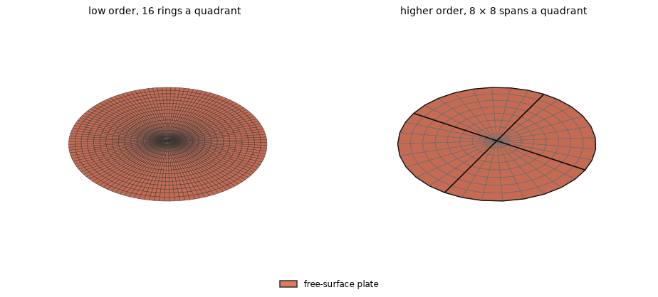
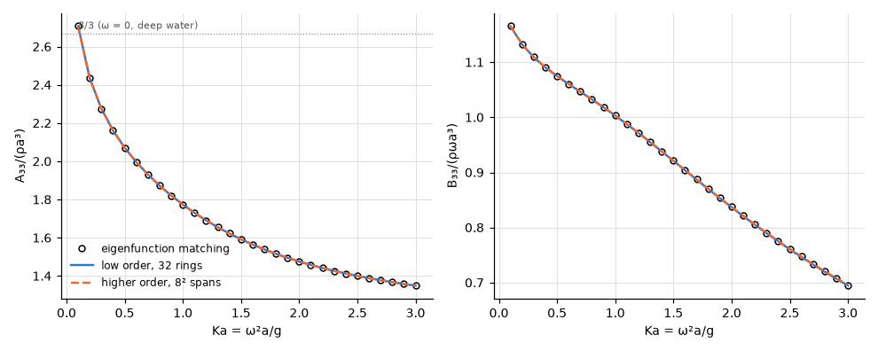

# Dock: a rigid plate in the free surface

**Result.** A rigid disc heaving in the free surface agrees with an eigenfunction-matching solution
within 0.086 % of the largest reference value in the low order (32 rings per quadrant) and
$5.4 \times 10^{-5}$ in the higher order ($8 \times 8$ spans). At zero frequency both methods
reproduce Rayleigh's piston, within $5.1 \times 10^{-6}$ and $2.2 \times 10^{-5}$. The damping, set
by the edge of the plate, is the larger difference throughout and converges as $h^2$.

## The problem

A free-surface plate (theory §9.7) is a rigid, massless surface lying in the free surface $z = 0$.
The water touches only its underside, and the free surface around it carries the usual condition. It
models a dock, a cover over a moonpool ([floating OWC cover](floating_owc_cover.md)) or a very thin
floating body.

Here the plate is a disc of radius $a = 1$ m in $z = 0$, heaving. We compare its added mass
$A_{33}/(\rho a^3)$ and damping $B_{33}/(\rho \omega a^3)$ in water of depth $h = 2a$ at 30 values
$0.1 \le Ka \le 3$, where $Ka = \omega^2 a/g$, and its added mass at $\omega = 0$ in deep water.

*Figure 1. The two meshes of the disc, expanded to the whole plate and seen from above, the plate in
red. Left: low order, a quadrant of $n$ uniform rings and $2n$ divisions around (shown $n = 16$; the
comparison uses $n = 8, 16, 32$). Right: higher order, one rational quarter-disk patch per quadrant
(the exact circle; patch edges in black, span edges in light grey) with $n \times n$ spans of order
3 (shown $n = 8$; the comparison uses $n = 4, 8$).*

## The references

In depth $2a$ the reference is the eigenfunction-matching solution of
`scripts/gen_cylinder_reference.py`, the formulation of Garrett (1971) and Yeung (1981), derived and
implemented in this repository, with zero draft: the whole depth under the plate is the inner
region. Its truncations $N = 200$ and 400 are extrapolated with the order $N^{-2}$ observed; the
step from 200 to 400 is $5 \times 10^{-6}$ of the value.

At $\omega = 0$ the free surface is the rigid plane $z = 0$, and the heaving disc is a piston in it
(Rayleigh 1896, §307). Its added mass is exact:

$$
A_{33}(0) = \frac{\rho}{2\pi} \iint \frac{\mathrm{d}S \, \mathrm{d}S'}{\lvert x - x' \rvert}
= \frac{8}{3} \rho a^3.
$$

## Agreement with the references

*Figure 2. $A_{33}$ and $B_{33}$ against $Ka$ in depth $2a$: eigenfunction matching (circles), the
finest low-order mesh (solid) and the finer higher-order mesh (dashed).*

The curves lie on the reference over the whole range. Table 1 gives the largest difference of each
quantity on every mesh.

*Table 1. Largest difference from the references over $0.1 \le Ka \le 3$, relative to the largest
reference value ($A_{33}(0)$: relative to $8/3$).*

| Mesh | $A_{33}$, depth $2a$ | $B_{33}$, depth $2a$ | $A_{33}(0)$, deep ($8/3$) |
|---|---|---|---|
| low order, 8 rings a quadrant | 7.3e-4 | 1.2e-2 | 6.0e-4 |
| low order, 16 rings a quadrant | 2.2e-4 | 3.2e-3 | 6.4e-5 |
| low order, 32 rings a quadrant | 7.0e-5 | 8.6e-4 | 5.1e-6 |
| higher order, $4 \times 4$ spans | 7.7e-5 | 2.7e-4 | 8.9e-5 |
| higher order, $8 \times 8$ spans | 1.9e-5 | 5.4e-5 | 2.2e-5 |

## Does it converge?

The added mass converges fast in both methods (Table 1). The damping is governed by the edge of the
plate, where it borders the free surface and the velocity is singular. It is the larger difference
throughout, and it falls by a factor of 3.7 and 3.8 per halving of the low-order panels, about
$h^2$.

At $\omega = 0$ the low order approaches Rayleigh's piston by a factor of about 11 per halving of
the uniform rings. The higher order on uniform spans of the rational patch reaches the accuracy of
the finest low-order mesh with $4 \times 4$ spans per quadrant, and its damping difference falls by
a factor of 5.1 from 4 to 8 spans.

## Reproducing this page

This page, its figures and its numbers are written by `validation/dock.py` through
`validation/make_report.py`.
