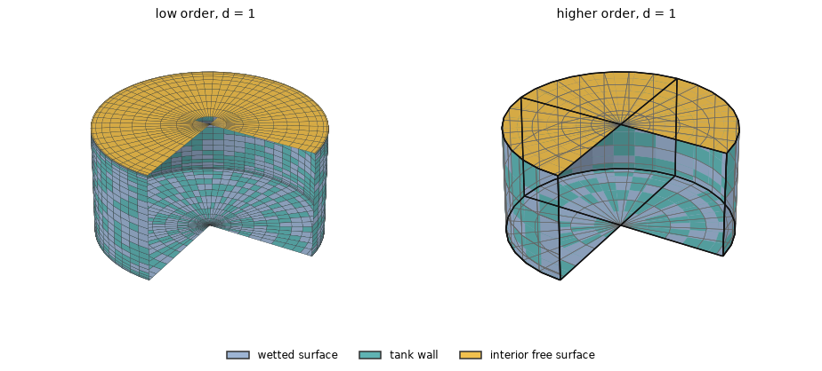
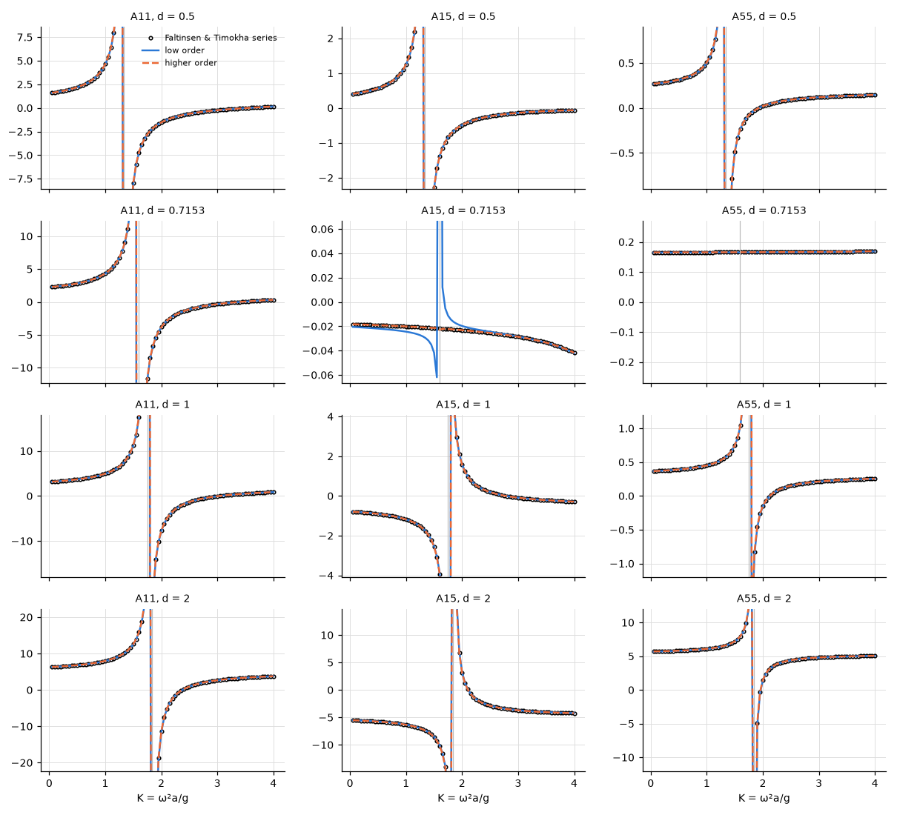
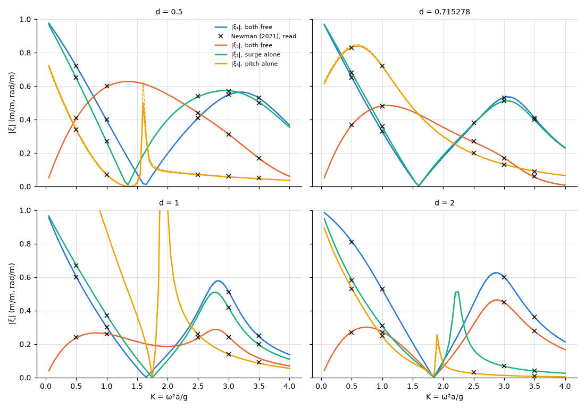

# Fish tanks: the fluid in a circular tank

**Result.** The added mass of the water inside a circular tank, forced in surge and pitch, agrees
with the closed-form interior series away from the sloshing resonance: within 1.6 % of its largest
value in the low order, the discretization of its polygon, and within 0.26 % in the higher order.
Both methods follow the series through the sign changes near the resonance. The one larger
difference, 18 % in the low order, is that of a coefficient that is itself small, $A_{15}$ at the
non-resonant draft. Free in waves, the tank's surge and pitch RAOs agree with the curves of Newman's
Fig. 2, read from the page, within 0.005 (higher order) and 0.012 (low order), against a reading
accuracy of about 0.01.

## The problem

Circular cylindrical fish tanks float in deep water (Newman 2021). The tank's wall has zero
thickness and separates the fluid inside, of the same density, from the sea. Here the tank alone is
forced in surge and in pitch, the check Newman makes against the closed-form interior solution.

The radius is $a = 1$ and the drafts $d = 0.5$, 0.715278, 1 and 2, in infinite depth with
$\rho = g = 1$; the second is the non-resonant draft $\operatorname{arccosh}(2)/k_1$ of Newman's eq.
(1). The origin is at the centre of the tank's free surface. The tank is forced in surge and in
pitch about the origin at $0.05 \le K \le 4$, $K = \omega^2 a/g$. $A_{11}$, $A_{15}$ and $A_{55}$
are those of the tank fluid alone: the body with the tank less the same body with an empty tank. The
two fluids do not influence each other, so the sea's parts cancel.

The first sloshing resonance lies at $K_1 = k_1 \tanh(k_1 d)$, where $k_1 = 1.841184$ is the first
zero of $J_1'$. There the tank's coefficients are infinite.

*Figure 1. The two meshes for $d = 1$, expanded to the whole tank and cut open (a quarter removed)
to show the inside: the hull's wetted surface in blue, the tank's walls in teal, the interior
surface in the waterplane in yellow. The tank's walls are the hull's panels reversed (normals into
the tank), so the two colours overlap on the same surfaces. Left: low order, a quadrant of 16 panels
around, $16 + 8d$ down the side and 14 across the bottom (cosine-spaced), with the graded interior
surface, which removes the exterior's irregular frequencies. Right: higher order, revolved segments
per quadrant (exact circles; patch edges in black, span edges in grey), spans of at most 0.25, order
3, clustered at the bottom corner; the waterplane disc is the interior surface.*

## The reference

The reference is the interior series of Faltinsen & Timokha (2009), §5.4.4, as in Newman's appendix
(his eqs. 2–7). It is derived in this repository for the potentials per unit velocity
(`tests/python/problems.py`, `circular_tank`) and summed to 200 terms, which leave less than
$10^{-6}$.

The comparison leaves out $\lvert K - K_1 \rvert \le 0.25$. There the coefficients pass through
infinity, and a shift of $K_1$ by the discretization (0.003 for the low-order polygon) dominates any
difference.

## Agreement with the series

*Figure 2. $A_{11}$, $A_{15}$, $A_{55}$ of the tank fluid against $K$ for the four drafts (rows):
the series (circles), low order (solid), higher order (dashed); the grey line marks $K_1$.*

Both methods reproduce the interior series across the resonance's sign changes: $A_{15}$ and
$A_{55}$ change sign below $K_1$ for the larger drafts, as Newman describes. The low order agrees to
about 1e-2, the discretization of its polygon, and the higher order two orders of magnitude closer
(Table 1).

*Table 1. Largest difference from the series away from $K_1$ ($\lvert K - K_1 \rvert > 0.25$),
relative to its largest value there.*

| $d$ | $K_1$ | $A_{11}$ low | $A_{15}$ low | $A_{55}$ low | $A_{11}$ higher | $A_{15}$ higher | $A_{55}$ higher |
|---|---|---|---|---|---|---|---|
| 0.5 | 1.3370 | 1.1e-2 | 1.6e-2 | 1.6e-2 | 1.7e-4 | 1.4e-4 | 1.5e-4 |
| 0.715278 | 1.5950 | 1.1e-2 | 1.8e-1 | 3.5e-3 | 8.7e-5 | 2.6e-3 | 1.3e-4 |
| 1 | 1.7510 | 1.1e-2 | 8.2e-3 | 6.9e-3 | 5.7e-5 | 4.7e-5 | 3.8e-5 |
| 2 | 1.8390 | 8.5e-3 | 6.7e-3 | 5.0e-3 | 4.0e-5 | 2.9e-5 | 1.6e-5 |

## The non-resonant draft

At the draft with $\cosh k_1 d = 2$ the pitch coefficients $A_{15}$ and $A_{55}$ stay finite at
$K_1$, as Newman's eq. (1) predicts; $A_{55}$ is about 0.17 throughout. This checks that the
cancellation of the resonance is reproduced.

There $A_{15}$ is small, 0.02 to 0.04. The low order's polygon, whose $k_1$ differs slightly from
the circle's, does not cancel the resonance exactly: it leaves a residual of 0.03 next to $K_1$ and
an offset of 2e-3, 1.8e-1 relative to this small value. The higher order on the exact circle leaves
2.6e-3.

## Free in waves

Newman's section 3 lets the massless tank, with the fluid inside, float freely in head waves of unit
amplitude: surge and pitch both free, or each mode alone. The tank has neither a mass of its own nor
a hydrostatic restoring moment, so its motions follow from the added mass, the damping and the
exciting force alone (theory §3.1 with $M = 0$). HydroBEM solves both modes free as an ordinary
motion. One mode alone is solved here from the same coefficients,
$\xi_i = X_i/(C_{ii} - \omega^2 A_{ii} + i\omega B_{ii})$, the equation of motion of that mode; the
two modes solved from these coefficients reproduce the engine's motion within $3.0 \times 10^{-8}$.

The reference is Newman's Fig. 2. Its RAOs (the solid lines, on the left axis from 0 to 1) are
**read** from the page image, with the axes calibrated on their tick marks, at $K = 0.5$, 1, 2.5, 3
and 3.5 where a curve is at neither a zero nor a resonance, to about $\pm 0.01$ (more where a curve
is steep). The sloshing amplitudes (the dashed lines, on the right axis) are not read.

*Figure 3. The RAOs of the tank free in waves against $K$ for the four drafts: both modes free and
each mode alone, higher order (solid), low order (dashed) and the values read from Newman's Fig. 2
(crosses). Near $K_1$ the curves pass through their zeros and the resonances of the tank.*

*Table 2. Largest difference of each RAO from the values read from Newman's Fig. 2, in the units of
the figure (m/m in surge, rad/m in pitch, the radius 1).*

| $d$ | Method | $\lvert \xi_1 \rvert$ both | $\lvert \xi_5 \rvert$ both | $\lvert \xi_1 \rvert$ alone | $\lvert \xi_5 \rvert$ alone |
|---|---|---|---|---|---|
| 0.5 | low order | 0.004 | 0.005 | 0.005 | 0.006 |
| 0.5 | higher order | 0.005 | 0.005 | 0.005 | 0.004 |
| 0.715278 | low order | 0.004 | 0.005 | 0.006 | 0.012 |
| 0.715278 | higher order | 0.003 | 0.004 | 0.005 | 0.005 |
| 1 | low order | 0.005 | 0.006 | 0.005 | 0.005 |
| 1 | higher order | 0.005 | 0.004 | 0.004 | 0.004 |
| 2 | low order | 0.004 | 0.004 | 0.005 | 0.005 |
| 2 | higher order | 0.004 | 0.005 | 0.005 | 0.005 |

Both methods agree with the figure to about the accuracy of reading it at every draft: the largest
difference is 0.005 in the higher order and 0.012 in the low order. The discretized tank keeps a
small damping that the closed tank does not have (theory §10.2), so the RAOs that vanish at $K_1$ in
the paper are small there but not zero; the points read leave the zeros out.

## Reproducing this page

The example [`examples/fish_tank_cylinders`](../../../examples/fish_tank_cylinders) solves the tank
of $d = 2$ free in surge and pitch in waves and checks the zeros of its RAOs against Newman's
section 3. This page, its figures and its numbers are written by `validation/fish_tank_cylinders.py`
through `validation/make_report.py`.
