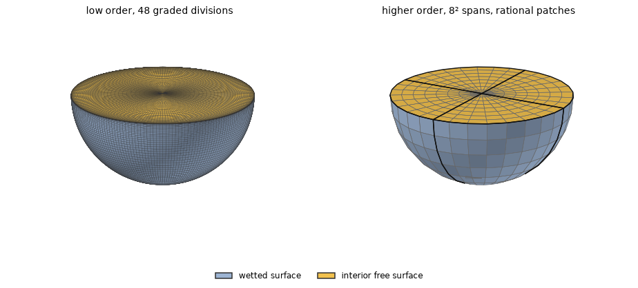
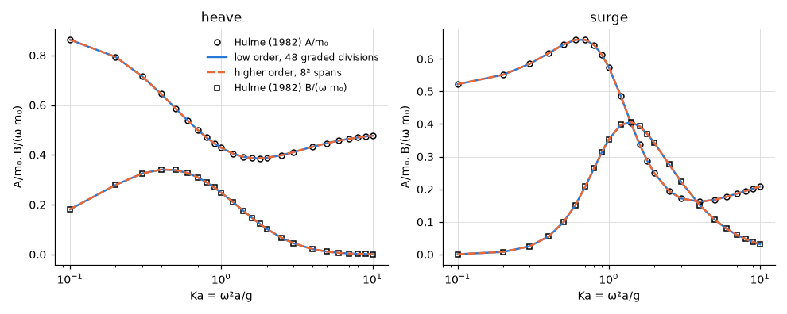
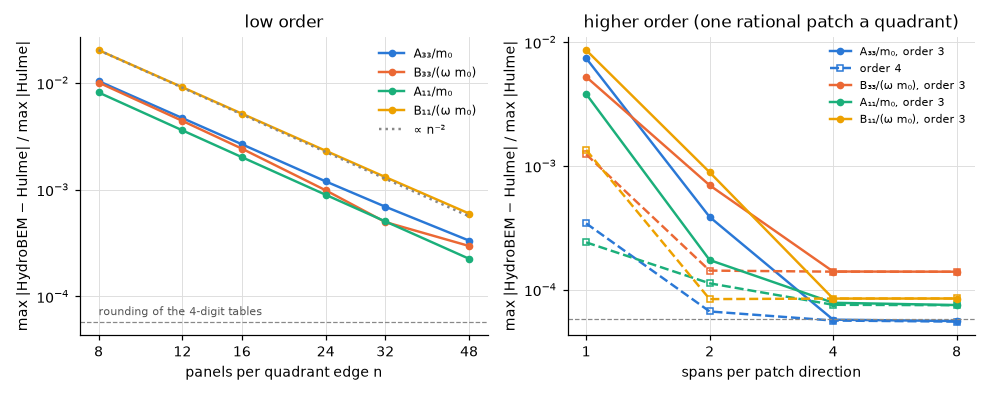
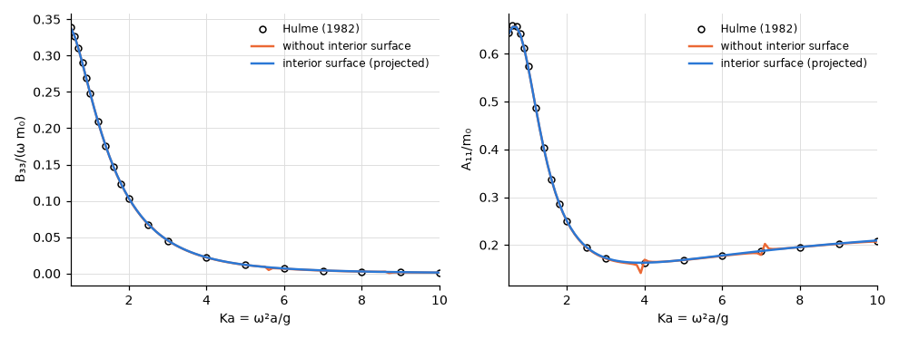

# Floating hemisphere

**Result.** Both methods reproduce the published added mass and damping of a floating hemisphere
(Hulme 1982) to within 0.065 % of the largest tabulated value. The low order converges as $h^2$, and
extrapolated to zero panel size it lands at the rounding of the tables themselves; the higher order
is converged with 4 spans per quadrant. The added masses at $\omega = 0$ and $\omega = \infty$ agree
with their exact values and Hulme's series within 0.029 %. An interior surface removes the irregular
frequencies without changing the results elsewhere.

## The problem

A hemisphere of radius $a = 1$ m floats with its equator in the free surface of deep water. We
compare its heave and surge added mass $A/m_0$ and damping $B/(\omega m_0)$, made dimensionless by
the displaced mass $m_0 = 2\pi\rho a^3/3$, with Hulme's tables at the 24 tabulated values
$0.1 \le Ka \le 10$, where $Ka = \omega^2 a/g$.

*Figure 1. The two meshes, expanded to the whole body and seen from above the free surface: the
wetted surface in blue, the interior surface in the waterplane in yellow. Left: low order, 48
divisions per quadrant edge graded towards the waterline, with the projected interior surface.
Right: higher order, one rational B-spline patch per quadrant (the exact sphere; patch edges in
black, span edges in grey) with $8 \times 8$ spans of order 3, and a rational quarter-disk patch per
quadrant as interior surface.*

## The reference

The reference is Hulme (1982), tables 1 and 2: $A^{(0)}$, $B^{(0)}$ (heave) and $A^{(1)}$, $B^{(1)}$
(surge), extracted into `tests/data/hulme1982_full.txt` by `scripts/extract_hulme.py`. They are
given to four digits. Rounding to four digits alone can leave a difference of up to
$6 \times 10^{-5}$ of the largest value, so agreement at that level is the best a comparison can
show.

## Agreement with the tables

*Figure 2. Heave and surge added mass $A/m_0$ and damping $B/(\omega m_0)$ against $Ka$: the two
methods (lines) and Hulme's values (points).*

The curves lie on the published points over the whole range. Table 1 gives the largest difference of
each quantity.

*Table 1. Largest difference from Hulme (1982) over the 24 tabulated values $0.1 \le Ka \le 10$,
relative to the largest tabulated value of each quantity.*

| Method, mesh | $A_{33}/m_0$ | $B_{33}/(\omega m_0)$ | $A_{11}/m_0$ | $B_{11}/(\omega m_0)$ |
|---|---|---|---|---|
| low order, 48 graded divisions, interior surface | 1.0e-4 | 3.6e-4 | 3.7e-4 | 6.5e-4 |
| higher order, $8 \times 8$ spans, interior surface | 6.0e-5 | 1.6e-4 | 3.7e-4 | 2.6e-4 |

## Does it converge?

Agreement on one mesh could be luck, so Figure 3 refines both meshes at three frequencies. For the
low order the rate of convergence is measured as well: the order $p$ observed on three meshes,
$v_i = v^* + c\,h_i^p$, and Richardson's extrapolation $v^*$, the limit of zero panel size that this
rate implies.

*Figure 3. Largest difference from Hulme (1982) of each quantity at $Ka = 0.5$, 1 and 2 as the
meshes are refined. Left: low order, $n \times n$ panels per quadrant, uniform in the two angles,
$n = 8$ to 48. Right: higher order, one rational patch per quadrant with $s \times s$ spans,
potential splines of order 3 (Gauss 3/4) and 4 (Gauss 4/5). The dashed line is the rounding of the
four-digit tables.*

The low order's difference falls from 2 % ($n = 8$) to 0.06 % ($n = 48$). The orders observed on the
three finest meshes are 2.0, 2.2, 2.0 and 2.0 for $A_{33}$, $B_{33}$, $A_{11}$ and $B_{11}$, the
$O(h^2)$ expected of constant panels. Extrapolating with them lands within $5.3 \times 10^{-5}$ to
$1.3 \times 10^{-4}$ of the tables, the level of their rounding.

The higher order with splines of order 3 differs by 8.6e-3, 8.9e-4, 1.4e-4, 1.4e-4 on 1, 2, 4, 8
spans, and with order 4 by 1.3e-3, 1.4e-4, 1.4e-4, 1.4e-4. The difference reaches the agreement with
the tables at 4 spans per quadrant (order 3) or 2 (order 4), and further refinement changes nothing
visible, because the tables are the limit.

## The limits of zero and infinite frequency

At $\omega = 0$ the free surface acts as a rigid wall ($\partial\phi/\partial z = 0$), and as
$\omega \to \infty$ the potential vanishes on it ($\phi = 0$). In both limits the hemisphere and its
mirror image above $z = 0$ form a whole sphere in unbounded fluid, the image moving with the body or
against it. Heave at $\omega = \infty$ and surge at $\omega = 0$ are then the translating sphere,
and the added mass is half the sphere's, $A/m_0 = 1/2$ exactly. Heave at $\omega = 0$ (the two
halves moving apart) and surge at $\omega = \infty$ (the halves moving in opposite directions) are
given by Hulme (1982) as series: $L = 0.830951$ (his eq. 3.18) and $C_1 = 0.273239$ (his eq. 5.15),
also the first and last rows of his tables 1 and 2 to four digits. Both constants are extracted into
`tests/data/hulme1982_limits.txt` by `scripts/extract_hulme.py`. HydroBEM solves the two limits
directly, as frequencies of their own, on the meshes of Table 1.

*Table 2. The added mass $A/m_0$ at $\omega = 0$ and $\omega = \infty$: the reference, the low order
(48 graded divisions, interior surface) and the higher order ($8 \times 8$ spans, interior surface),
with the difference relative to the reference value.*

| Mode, limit | Reference | $A/m_0$ | Low order | Difference | Higher order | Difference |
|---|---|---|---|---|---|---|
| heave, $\omega = 0$ | Hulme eq. (3.18), $L$ | 0.830951 | 0.8308 | 1.2e-4 | 0.8310 | 7.6e-7 |
| heave, $\omega = \infty$ | exact, $1/2$ | 0.5 | 0.5000 | 3.1e-5 | 0.5000 | $< 10^{-7}$ |
| surge, $\omega = 0$ | exact, $1/2$ | 0.5 | 0.4999 | 2.9e-4 | 0.5000 | $< 10^{-7}$ |
| surge, $\omega = \infty$ | Hulme eq. (5.15), $C_1$ | 0.273239 | 0.2733 | 9.9e-5 | 0.2733 | 2.1e-4 |

Both methods reproduce the four limits: the low order within $2.9 \times 10^{-4}$ and the higher
order within $2.1 \times 10^{-4}$ of each value. On $n \times n$ panels per quadrant, uniform in the
angles, the low order's largest difference is 1.1e-2, 3.3e-3, 9.5e-4 for $n = 12, 24, 48$. The
orders observed are 2.0, 2.0, 2.1, 1.7 (in the order of Table 2), and the extrapolation lands within
$7.1 \times 10^{-5}$ of the references. Surge at $\omega = \infty$ converges the slowest in both
methods: there the velocity of the mirrored sphere changes sign at the waterline, and the potential
is singular along it.

## Irregular frequencies

The integral equation of the exterior problem fails at irregular frequencies, the eigenfrequencies
of the water that would fill the inside of the hull; for this hemisphere the first three lie near
$Ka \approx 3.9$, 5.6 and 7.1. An interior surface, a lid over the waterplane inside the body,
removes them. This section checks that it does, on a mesh coarse enough for the effect to show.

*Figure 4. Heave damping and surge added mass on a coarse mesh (16 divisions per quadrant edge,
graded towards the waterline), $0.5 \le Ka \le 10$, without and with an interior surface, with
Hulme's values.*

Without the interior surface the results depart from the tables near those frequencies; the largest
difference over the tabulated values is 1.1 %. With it the difference is 0.57 %, which is just the
coarseness of this mesh. The three ways HydroBEM can generate the interior surface (`projected`,
`waterline`, `graded`) agree with each other within $8.5 \times 10^{-5}$ of the largest value.

## Reproducing this page

The example [`examples/floating_hemisphere`](../../../examples/floating_hemisphere) solves the same
body. This page, its figures and its numbers are written by `validation/hemisphere.py` through
`validation/make_report.py`.
