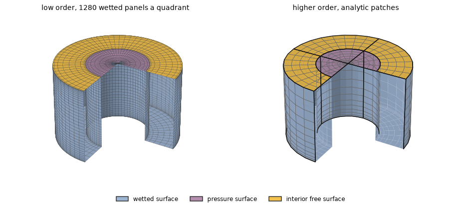
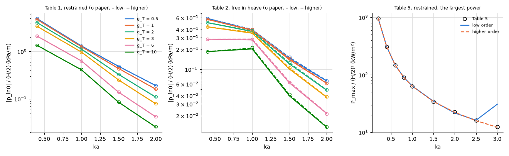

# Oscillating water column chamber with a turbine

**Result.** The chamber pressure of an oscillating water column, restrained and free in heave,
agrees with the printed tables of Mavrakos & Konispoliatis (2012) within 2.4 % in the higher order
and 5.0 % in the low order. The higher order meets the exact capture-width bound of Evans (1982)
within 0.023 % up to $ka = 2.5$, so the remaining differences from the paper are the paper's. The
low order follows the bound within 2.6 % up to $ka = 2.5$ but fails at $ka = 3$, where the chamber
radiates almost nothing.

## The problem

An oscillating water column is a vertical tube open at its bottom: the waves move the water column
inside, and the air above it is pushed through a turbine. Here the tube is thick-walled, the air in
its chamber is at a uniform pressure that drives a linear (Wells) turbine, and the device is
restrained or free in heave.

It is the device of Section 12 of Mavrakos & Konispoliatis (2012): inner radius $b = 2$ m, outer
radius $a = 4$ m, draught 5 m, water depth 15 m, heading $0^\circ$, $0.2 \le ka \le 3$.

In HydroBEM the inner free surface is a pressure surface with one uniform pressure mode. Its
coordinate $\xi$ is the pressure head ($p_{in0} = -\rho g \xi$), coupled to the heave through the
roof (chamber_coupling). The turbine of admittance $g_T$ (the air volume flow $g_T p_{in0}$, the air
incompressible) is the damping $(\rho g)^2 g_T/\omega^2$ of that mode. One solve gives the
coefficients, and the equations of the heave and the chamber are solved for each $g_T$ (theory
§3.1).

The paper's units are t, kN, kPa and kW, its $g_T$ in $\mathrm{m^5/(kN\,s)}$. Its density and
gravity are not stated: $\rho = 1025\ \mathrm{kg/m^3}$ and $g = 9.81\ \mathrm{m/s^2}$ are taken,
with which the restrained column's largest power at $ka = 0.2$ equals the bound below to 1e-3.

The largest power of the restrained device is $\lvert q_D \rvert^2/(8 f_{PP})$ (eq. 11.4, with an
optimal complex turbine), where $q_D$ is the exciting volume flow and $f_{PP}$ the radiation
conductance of the chamber.

*Figure 1. The two meshes, expanded to the whole device and cut open (a quarter removed) to show the
inside: the wetted walls and bottom in blue, the chamber's free surface (the pressure surface) in
purple, the annulus between the walls in $z = 0$ (the interior surface) in yellow. Left: low order,
a quadrant of 16 panels around, 36 down each wall and 8 across the bottom (cosine-spaced, small at
the waterline and the bottom edges), 8 rings across the chamber's free surface (small at its rim)
and 8 across the annulus. Right: higher order, the analytic tube with its inner free surface (patch
edges in black, span edges in grey: outer wall $8 \times 12$, bottom $8 \times 6$, inner wall
$4 \times 12$, inner free surface $4 \times 6$ spans per quadrant, clustered at the bottom edges)
and the annulus as a revolved-segment patch of its own ($8 \times 4$).*

## The references

The published reference is Mavrakos & Konispoliatis (2012), tables 1, 2 and 5, computed by matched
eigenfunction expansions and printed to three to six significant digits:

- the chamber pressure $\lvert p_{in0} \rvert/(H/2)$ in kPa/m at $ka = 0.4$, 1, 1.5, 2 for
  $g_T = 0.5$ to 10, restrained (their table 1) and free in heave (their table 2);
- the largest power of the restrained device at $ka = 0.2$ to 3 (their table 5).

The independent reference is a bound. The capture width of a device is the width of incident wave
crest whose power it absorbs; for an axisymmetric pressure distribution its largest value is $1/k$
(Evans 1982). So $k P_{max} / P_w = 1$ for the restrained chamber, where $P_w = \rho g c_g/2$ is the
power of the incident wave per unit crest and unit amplitude squared. This bound is exact and
independent of the paper.

## Agreement with the tables

*Figure 2. Left and middle: the chamber pressure of the paper's tables 1 and 2 (circles) against
$ka$ for each $g_T$, low order (solid), higher order (dashed). Right: the largest power of the
paper's table 5.*

The pressures of the paper's tables 1 and 2 agree within the percentages of Table 1. The largest
differences, at $ka = 1$ to 2, are those of the paper or of the assumed density and gravity rather
than of the discretization, since the same mesh meets the exact bound there.

*Table 1. Largest relative difference from the printed pressures of the paper's tables 1 and 2 over
the 24 entries of each table.*

| Paper's table | low order | higher order |
|---|---|---|
| table 1 (restrained) | 3.0 % | 2.2 % |
| table 2 (free in heave) | 5.0 % | 2.4 % |

## The capture-width bound

The bound checks the chamber against exact theory rather than against another computation (Table 2).
The higher order meets it within 2.3e-4 up to $ka = 2.5$ and by 1.1 % at $ka = 3$. The paper's table
5 lies up to 1.4 % above the higher order, at the larger $ka$, where the higher order meets the
bound: the differences are the paper's.

*Table 2. The largest power ($\mathrm{kW/m^2}$) of the paper's table 5 and of both methods, and
$k P_{max}/P_w$, 1 for an exact solution.*

| $ka$ | paper's table 5 | low | diff. | $k P/P_w$ | higher | diff. | $k P/P_w$ |
|---|---|---|---|---|---|---|---|
| 0.2 | 956.983 | 956.7 | -0.0 % | 1.000 | 956.6 | -0.0 % | 1.0000 |
| 0.4 | 308.105 | 308 | -0.0 % | 1.000 | 307.8 | -0.1 % | 1.0000 |
| 0.6 | 147.688 | 147.7 | -0.0 % | 1.002 | 147.4 | -0.2 % | 1.0000 |
| 0.8 | 90.6602 | 90.79 | +0.1 % | 1.004 | 90.42 | -0.3 % | 1.0000 |
| 1 | 63.7096 | 63.93 | +0.4 % | 1.007 | 63.48 | -0.4 % | 1.0000 |
| 1.5 | 34.5299 | 34.63 | +0.3 % | 1.010 | 34.3 | -0.7 % | 1.0000 |
| 2 | 22.5046 | 21.7 | -3.6 % | 0.974 | 22.28 | -1.0 % | 1.0000 |
| 2.5 | 16.1687 | 16.23 | +0.4 % | 1.019 | 15.94 | -1.4 % | 1.0000 |
| 3 | 12.35 | 30.85 | +149.8 % | 2.545 | 12.25 | -0.8 % | 1.0110 |

The low order follows the bound within 2.6 % up to $ka = 2.5$ but fails at $ka = 3$
($k P_{max}/P_w = 2.54$), where the chamber radiates almost nothing. Its exciting flow there is the
small sum of the incident and the scattered parts on the inner surface, which the constant panels
resolve poorly.

## Reproducing this page

The example [`examples/floating_owc_chamber`](../../../examples/floating_owc_chamber) runs this
device and the paper's other cases (the open device, thin-walled chambers). This page, its figures
and its numbers are written by `validation/floating_owc_chamber.py` through
`validation/make_report.py`.
