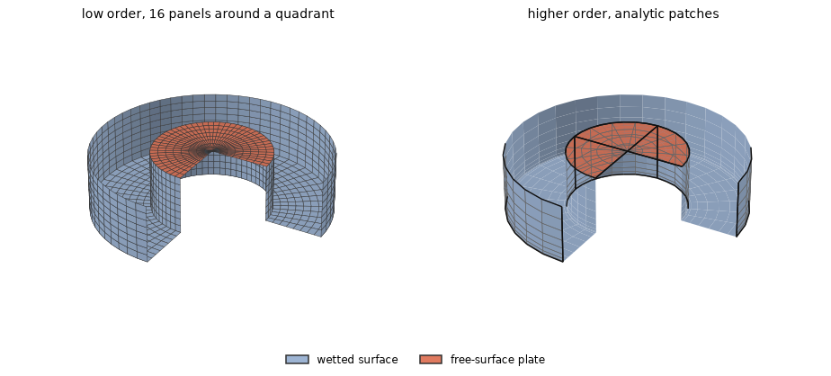
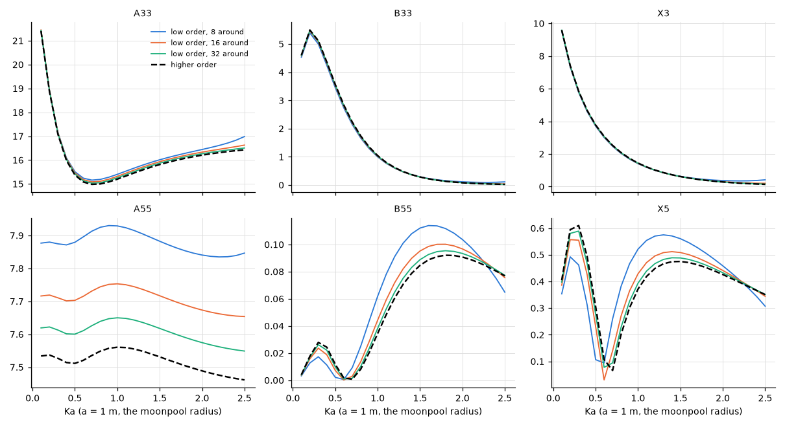

# Floating OWC cover: a plate over a moonpool

**Result.** No independent solution of this body is known, so the case checks consistency, not
accuracy. The low order converges to the higher order as the mesh is refined, its largest difference
falling from 33 % to 4.8 % over 8, 16, 32 panels around a quadrant. The energy identity and the
Haskind relation hold in the higher order within $2.1 \times 10^{-5}$ and $7.3 \times 10^{-5}$, and
in both methods to their discretization.

## The problem

A floating tube has its moonpool closed by a rigid cover lying in the free surface. The cover is a
free-surface plate of the hull's body (theory §9.7) and moves with it, as the roof of a closed
oscillating water column whose air chamber has collapsed, or a hatch. The [dock](dock.md) checks the
plate against independent solutions; here the plate is part of a floating body.

The tube has outer radius 2 m, moonpool radius $a = 1$ m and draft 1 m, in deep water, heading
$0^\circ$; the cover is the disc $r < 1$ m in $z = 0$, its edge on the moonpool wall. We compare
heave and pitch about the origin in the free surface: $A_{33}/(\rho a^3)$,
$B_{33}/(\rho \omega a^3)$, $\lvert X_3 \rvert/(\rho g A a^2)$, $A_{55}/(\rho a^5)$ (as
$A_{55}/\rho$ with $a = 1$), $B_{55}$ and $\lvert X_5 \rvert$, at $0.1 \le Ka \le 2.5$ with
$Ka = \omega^2 a/g$.

The range lies below the first irregular frequency of the tube's wall, near $Ka = 3$, where the
integral equation would fail because the water that would fill the wall resonates; so no interior
surface is used.

*Figure 1. The two meshes, expanded to the whole body and cut open (a quarter removed): the wetted
walls and bottom in blue, the cover in red. Left: low order, a quadrant of $n$ panels around, $n/2$
down each wall, across the bottom and across the cover (shown $n = 16$; the comparison uses
$n = 8, 16, 32$). Right: higher order, the analytic tube with its inner free surface as the plate
(patch edges in black, span edges in grey), $8 \times 8$ spans on the walls, $8 \times 4$ on the
bottom, $4 \times 8$ on the inner wall and $4 \times 4$ on the cover per quadrant (the comparison
also uses half these), order 3, clustered at the bottom edges.*

## The references

No published or analytic solution of this body is known to us. Three checks take its place:

- **The energy of the radiated waves.** The waves a body radiates carry away exactly the energy its
  damping absorbs. For an axisymmetric body in deep water this ties the heave damping to the
  exciting force, $B_{33} = \omega^3 \lvert X_3 \rvert^2/(2\rho g^3)$, exactly (Newman 1977, the
  Haskind relation for the damping), with the cover part of the radiating and diffracting surface.
- **The Haskind relation.** The exciting force can be computed from the radiation potentials alone,
  without solving the diffraction problem; it is compared with the force from the pressure of the
  diffraction problem.
- **The methods against each other.** The low order on three meshes is compared with the higher
  order on the exact geometry.

## Agreement between the methods

*Figure 2. Heave and pitch against $Ka$: the low order on three meshes and the higher order
(dashed).*

The low order converges to the higher order as the mesh is refined (Table 1), at the rate of its
other problems: the cover's edge meets the moonpool wall at a right angle of the fluid.

*Table 1. Largest difference from the higher order over $Ka$, relative to its largest value of each
quantity.*

| Mesh | $A_{33}$ | $B_{33}$ | $\lvert X_3 \rvert$ | $A_{55}$ | $B_{55}$ | $\lvert X_5 \rvert$ |
|---|---|---|---|---|---|---|
| low order, 8 around | 2.6e-2 | 2.2e-2 | 2.9e-2 | 5.1e-2 | 3.3e-1 | 3.3e-1 |
| low order, 16 around | 9.1e-3 | 8.3e-3 | 6.9e-3 | 2.6e-2 | 1.2e-1 | 1.3e-1 |
| low order, 32 around | 3.5e-3 | 3.3e-3 | 1.6e-3 | 1.2e-2 | 4.8e-2 | 4.8e-2 |
| higher order, half the spans | 5.2e-4 | 1.9e-4 | 1.6e-4 | 1.2e-3 | 3.6e-3 | 1.8e-3 |

## The identities

The energy identity and the Haskind relation hold in both methods to their discretization (Table 2).

*Table 2. The identities: largest $\lvert B_{33} - \omega^3 \lvert X_3 \rvert^2/(2\rho g^3) \rvert$
relative to the largest $B_{33}$, and largest $\lvert X - X_{\mathrm{Haskind}} \rvert$ relative to
the largest $\lvert X \rvert$ (heave and pitch).*

| Mesh | energy identity | Haskind relation |
|---|---|---|
| low order, 8 around | 6.1e-2 | 9.9e-2 |
| low order, 16 around | 7.2e-3 | 3.5e-2 |
| low order, 32 around | 1.4e-3 | 1.1e-2 |
| higher order, half the spans | 9.0e-4 | 2.7e-3 |
| higher order, the spans above | 2.1e-5 | 7.3e-5 |

This case shows consistency, not accuracy against an independent solution
([not verified](../not_verified.md)).

## Reproducing this page

This page, its figures and its numbers are written by `validation/floating_owc_cover.py` through
`validation/make_report.py`.
