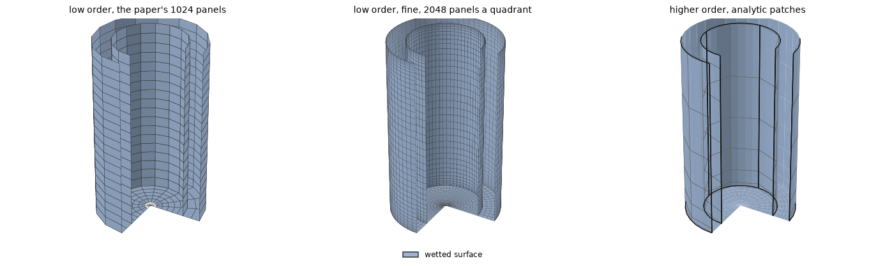
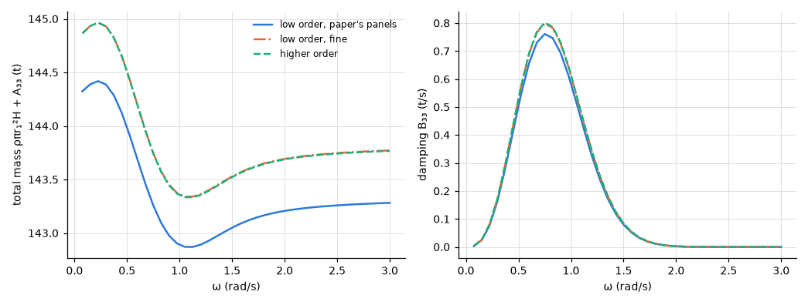

# Floating oscillating water column: hull and piston

**Result.** No independent solution of this two-body model is known, so the case checks consistency,
not accuracy. Fine low-order panels converge to the higher order on the exact geometry, within
0.42 % of its largest value. The paper's coarse polygons stay up to 5.1 % away, mostly by their
smaller area; the total mass, dominated by the column, differs by at most 0.4 %.

## The problem

A floating oscillating water column is modelled here as two bodies (the two-body method): the hull
of the device, a vertical tube, and an imaginary rigid piston that fills its water column, the
piston's side wall lying on the hull's inner wall. The case is that of Raghavan et al. (2024, §3.4,
case 4).

The hull has inner radius $r_1 = 2$ m, outer radius $r_2 = 3$ m and draft $H = 10$ m (outer wall,
bottom annulus, inner wall). The piston has radius $r_1$, length $H$ and its top in $z = 0$ (side
wall and bottom disc). The water is infinitely deep, $\rho = 1000\ \mathrm{kg/m^3}$, and
$0.075 \le \omega \le 3$ rad/s. We compare the piston's heave added mass $A_{33}$ and damping
$B_{33}$; the paper's figures 17 and 18 show the total mass $\rho \pi r_1^2 H + A_{33}$ and
$B_{33}$.

There is no interior surface, as in the paper. The first irregular frequency of the piston's
interior, where the integral equation fails because the water that would fill the piston resonates,
is at $k r_1 = 2.405$, near 3.4 rad/s, above the range.

*Figure 1. The three meshes, expanded to the whole device and cut open (a quarter removed) to show
the piston inside the tube: all surfaces are wetted (blue). Left: the paper's division, 16 panels
around the circle, the outer wall 20 down, the bottom annulus 2 across, the inner wall 18 down (640
panels), the piston's side on the same 18 rows and its bottom 6 across (384). Middle: a quadrant of
16 around, 40, 4 and 36 down (cosine-spaced in depth) and 12 across the piston's bottom. Right: the
analytic tube and cylinder (patch edges in black, span edges in grey), the spans per quadrant
$3 \times 6$ (outer wall), $3 \times 2$ (bottom), $2 \times 6$ (inner wall), $2 \times 6$ and
$2 \times 3$ (the piston), order 3, clustered at the bottom edges.*

## The reference

No independent solution of the two-body model is known to us, and the paper's curves are not read:
they are those of its coarse meshes, 16-sided polygons whose area is 2.5 % smaller than the
circle's. The comparison is therefore of three discretizations of the same problem: the paper's
coarse polygons, fine panels and the higher order on the exact circles, which serves as the
reference. The physics of the piston model (a rigid lid on the column instead of a free surface) is
the paper's choice, not checked here.

## Agreement between the methods

*Figure 2. The piston's total mass and damping in heave against $\omega$.*

The fine panels converge to the higher order (Table 1). The paper's polygons stay a few per cent
away, mostly by the smaller area of the polygons. At the peak of $B_{33}$, at $\omega = 0.75$ rad/s,
the damping is 0.761 t/s on the paper's panels, 0.798 t/s on the fine ones and 0.801 t/s in the
higher order. The total mass, dominated by the column, differs by at most 0.4 %.

*Table 1. Largest difference from the higher order over $\omega$, relative to its largest value.*

| Mesh | $A_{33}$ | $B_{33}$ |
|---|---|---|
| low order, the paper's panels (16 around) | 2.8e-2 | 5.1e-2 |
| low order, fine (64 around) | 3.3e-4 | 4.2e-3 |

The coincident walls of the two bodies need nothing special in either method. This case shows
consistency, not accuracy against an independent solution ([not verified](../not_verified.md)).

## Reproducing this page

The example [`examples/floating_owc_piston`](../../../examples/floating_owc_piston) runs the case of
Raghavan et al. (2024, §3.4) at three of its frequencies and at the infinite frequency. This page,
its figures and its numbers are written by `validation/floating_owc_piston.py` through
`validation/make_report.py`.
