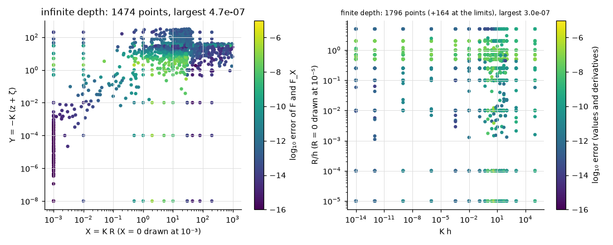

# Green functions

**Result.** The engine's free-surface Green functions are within the target accuracy of
$2 \times 10^{-6}$ at every point of high-precision reference tables: the largest error is
$4.7 \times 10^{-7}$ in infinite depth and $3.0 \times 10^{-7}$ in finite depth, and the median
errors are smaller by orders of magnitude.

## The problem

A free-surface Green function is the potential of a pulsating source below the free surface that
already satisfies the free-surface, bottom and radiation conditions; every low- and higher-order
result of HydroBEM is built from it, so its accuracy bounds theirs. This page checks it by itself,
at every point of the reference tables (test-plan A2), including the frequency limits:

- in infinite depth, the regular part $F$ and its derivative $F_X$ over $X = KR$ and
  $Y = -K(z + \zeta)$;
- in finite depth, the Green function (real and imaginary parts and their derivatives) over $Kh$ and
  $R/h$.

## The reference

The reference is the integral representations evaluated at 30 digits by
`scripts/gen_green_reference_data.py` and `scripts/gen_green_finite_reference_data.py` (mpmath;
Wehausen & Laitone 1960, John 1950, Newman 1985), stored in `tests/data/green_inf_reference.txt` and
`green_fin_reference.txt`. At 30 digits the reference is exact for this purpose.

The error is relative to
$\max(\lvert \text{value} \rvert, \text{the local scale of the singular parts})$. The engine's
values come from the example `crates/hydrobem/examples/green_error_map.rs`.

## Agreement with the reference

*Figure 1. Left: infinite depth, the error of $F$ and $F_X$ over $X$ and $Y$. Right: finite depth,
over $Kh$ and $R/h$ (ordinary frequencies; the points of the limits are counted in the title).*

Both kernels are within the target 2.0e-6 of theory §8 everywhere (Table 1, Figure 1).

*Table 1. The number of reference points of each kernel and the largest and median error over them.*

| Kernel | points | largest error | median |
|---|---|---|---|
| infinite depth | 1474 | 4.7e-7 | 2.3e-13 |
| finite depth | 1960 | 3.0e-7 | 3.7e-10 |
| finite depth, frequency limits | | 1.2e-7 | |

The summaries of the tables' own error maps are in
[development/error-maps/](../../development/error-maps/).

## Reproducing this page

This page, its figure and its numbers are written by `validation/kernels.py` through
`validation/make_report.py`, which builds and runs the example with cargo.
