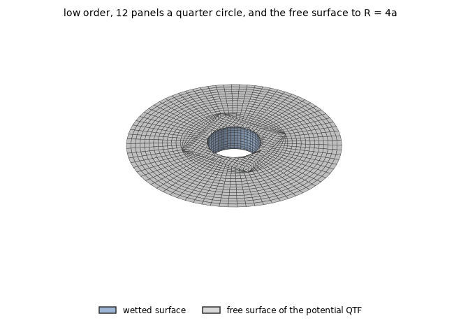
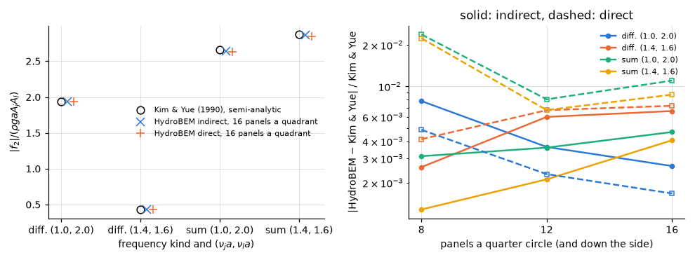

# Second-order force on a bottom-mounted cylinder

**Result.** The force of the second-order potential on a fixed bottom-mounted cylinder agrees with
the semi-analytic values of Kim & Yue (1990) within 1.1 % from 12 panels per quarter circle on, by
both the indirect and the direct method, and within 2.4 % on every mesh compared. This is the size
of the free surface's own discretization at its automatic panel size.

## The problem

In bichromatic waves, waves of two frequencies together, a body feels second-order forces at the sum
and the difference of the two frequencies; the quadratic transfer function (QTF) gives them per pair
of frequencies. Part of that force comes from quadratic products of the first-order solution, and
part from the second-order potential, which those products leave out. This page checks the second
part.

A vertical circular cylinder of radius $a = 1$ m stands fixed on the sea bed in water of depth
$h = a$, in head seas. The first-order frequencies are $\nu a = 1.0$, 1.4, 1.6, 2.0, with
$\nu = \omega^2/g$. We compare the modulus of the surge force of the second-order potential,
$\lvert f_2 \rvert/(\rho g a A_j A_l)$, at the pairs $(\nu_j a, \nu_l a) = (1.0, 2.0)$ and
$(1.4, 1.6)$, at the difference and the sum frequencies.

HydroBEM computes it in two ways, both in one solve: the indirect method (Green's identity with an
assisting radiation potential) and the direct method (the second-order potential solved). The
potential QTF is available in the low order only (theory §12.10), so there is no higher-order
result.

*Figure 1. The low-order mesh, expanded to the whole body and seen from above: the cylinder's wetted
wall in blue and the free surface of the potential QTF in grey. The cylinder has $n$ panels per
quarter circle and $n$ down the side (cosine-spaced; shown $n = 12$, the comparison uses
$n = 8, 12, 16$) and no bottom, since it stands on the sea bed. The engine generates the free
surface from the waterline to $R = 4a$ with the automatic panel size; the quadrature zone and the
far field beyond are automatic.*

## The reference

The reference is Kim & Yue (1990), table 3: their semi-analytic values, given to three decimals and
extracted into `tests/data/kim_yue1990.txt` by `scripts/extract_kim_yue.py`.

## Agreement with the table

*Figure 2. Left: $\lvert f_2 \rvert$ of the finest mesh and both methods against the published
values. Right: the relative difference against $n$ (solid: indirect, dashed: direct).*

Every value is within 2.4 % (Table 1).

*Table 1. Signed relative difference from Kim & Yue (1990).*

| $n$ | method | diff. (1.0, 2.0) | diff. (1.4, 1.6) | sum (1.0, 2.0) | sum (1.4, 1.6) |
|---|---|---|---|---|---|
| 8 | indirect | +0.78 % | -0.26 % | +0.31 % | -0.13 % |
| 8 | direct | +0.48 % | -0.41 % | -2.39 % | -2.24 % |
| 12 | indirect | +0.36 % | -0.60 % | +0.36 % | +0.21 % |
| 12 | direct | +0.23 % | -0.67 % | -0.81 % | -0.67 % |
| 16 | indirect | +0.26 % | -0.66 % | -0.47 % | -0.41 % |
| 16 | direct | +0.17 % | -0.72 % | -1.10 % | -0.87 % |

## Does it converge?

The differences do not fall further with the body mesh. The published values have three decimals,
and the free surface keeps its automatic panel size, whose discretization, a few tenths of a per
cent ([cylinder](cylinder.md)), is of the same size as the differences.

## Reproducing this page

The example
[`examples/second_order_bottom_cylinder`](../../../examples/second_order_bottom_cylinder) runs the
case. This page, its figures and its numbers are written by `validation/qtf.py` through
`validation/make_report.py`.
