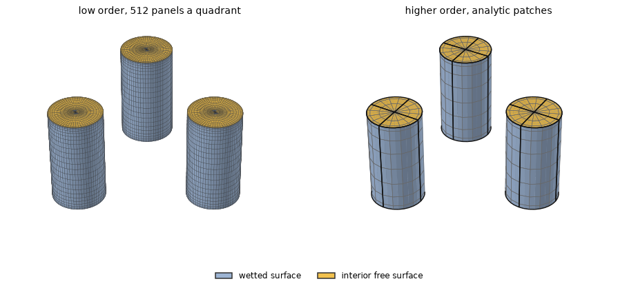
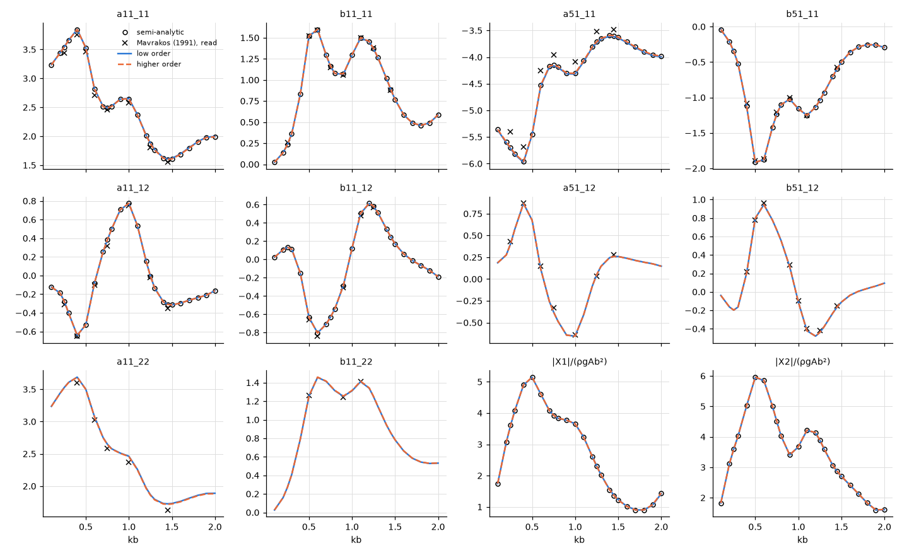

# Three truncated cylinders in finite depth

**Result.** For three interacting cylinders in finite depth, both methods agree with a semi-analytic
interaction solution over the whole range: the low order within 0.42 % and the higher order within
0.011 % of the largest value of each quantity. The damping and the interaction coefficients agree
with the published figures of Mavrakos (1991) to the accuracy of reading them. The cylinders' own
added mass lies 1 % to 7 % above the published curves, in the converged solution as much as in
HydroBEM.

## The problem

Three floating truncated vertical circular cylinders stand at the corners of an equilateral triangle
in head seas. Their radius is $b = 1$ m, their draught $3.65b$ and the water depth $40b$. The axes
are at the corners of a triangle of side $5b$: cylinder 1 at $(5b/\sqrt{3}, 0)$, cylinders 2 and 3
at $(-5b/(2\sqrt{3}), \pm 5b/2)$. The heading is $0^\circ$ and the range $0.1 \le kb \le 2.0$.

We compare the added mass and damping of each cylinder and of their interaction, and the exciting
forces. The coefficients are those of Mavrakos (1991), about each cylinder's own point on its axis
in the free surface: $a_{11}^{qp}$ is the surge force on cylinder $q$ from the surge of cylinder
$p$, and $a_{51}^{qp}$ the pitch moment on $q$ from the surge of $p$. They are divided by
$\rho \pi b^3$ ($\rho \pi b^4$ for pitch-surge), the damping also by $\omega$. $X$ is the surge
exciting force on a cylinder over $\rho g A b^2$.

*Figure 1. The two meshes, expanded to the three cylinders and seen from above the free surface: the
wetted surface in blue, the interior surface in the waterplane in yellow. Left: low order, one
quadrant of 16 panels per quarter circle, 24 down the side and 8 across the bottom (cosine-spaced),
expanded at each cylinder, with the graded interior surface. Right: higher order, the analytic
cylinder (patch edges in black, span edges in grey), $4 \times 8$ spans on the side and $4 \times 3$
on the bottom and on the waterplane (the interior surface) per quadrant, order 3, the nonuniform
mapping.*

The interior surface, a lid over the waterplane inside each column, removes the irregular
frequencies, at which the integral equation of the exterior problem fails because the water that
would fill the column resonates. Here the first lies near $kb = 2.4$, just above the range.

## The references

The main reference is the semi-analytic interaction solution of
`scripts/gen_cylinder_array_reference.py` (the case "three"), derived and implemented in this
repository. It matches eigenfunctions at each cylinder and scatters the waves exactly between them
(Kagemoto & Yue 1986). With cylinder 1 moving in surge it gives $a_{11}^{11}$, $b_{11}^{11}$,
$a_{51}^{11}$, $b_{51}^{11}$, the interaction $a_{11}^{12} = a_{11}^{21}$ (reciprocity),
$b_{11}^{12}$ and the exciting forces on cylinders 1 and 2. It is evaluated here at every $kb$ with
200 and 400 vertical modes, extrapolated with the order 4/3; the two extrapolations of
`tests/data/cylinder_array.txt` agree to $4 \times 10^{-5}$.

The published reference is Mavrakos (1991), figures 5b and 5c: the solid curves (the own
coefficients of cylinders I and II) and the dash-dot curves (the interaction). They are **read by
eye** from the page images at $kb = 0.25$ to 1.45, to about $\pm 0.05$ in the units of the figures.
That is 1 to 3 % of the own coefficients, more where a curve is steep; the scale of fig. 5c is taken
linear from its ticks 2 and $-2$. These figures are the only reference of $a_{11}^{22}$,
$b_{11}^{22}$, $a_{51}^{12}$ and $b_{51}^{12}$.

## Agreement with the references

*Figure 2. The coefficients against $kb$: the semi-analytic solution (circles), Mavrakos' figures
(crosses, read), HydroBEM low order (solid) and higher order (dashed).*

Both methods agree with the semi-analytic interaction solution to their discretization over the
range (Table 1).

*Table 1. Largest difference from the semi-analytic solution over $0.1 \le kb \le 2$, relative to
its largest value of each quantity.*

| Method | $a_{11}^{11}$ | $b_{11}^{11}$ | $a_{51}^{11}$ | $b_{51}^{11}$ | $a_{11}^{12}$ | $b_{11}^{12}$ | $X_1$ | $X_2$ |
|---|---|---|---|---|---|---|---|---|
| low order | 2.2e-3 | 3.1e-3 | 2.5e-3 | 1.1e-3 | 3.3e-3 | 4.1e-3 | 4.2e-3 | 1.5e-3 |
| higher order | 2.9e-5 | 8.4e-5 | 5.1e-5 | 2.6e-5 | 3.7e-5 | 8.1e-5 | 1.1e-4 | 1.8e-5 |

The damping and the interaction coefficients agree with the curves of Mavrakos (1991) to the reading
accuracy (Table 2).

*Table 2. Largest difference from Mavrakos' figures 5b and 5c at the points read, relative to the
largest value read of each quantity.*

| Against figs. 5b, 5c (read) | $a_{11}^{11}$ | $a_{11}^{22}$ | $a_{11}^{12}$ | $b_{11}^{11}$ | $b_{11}^{22}$ | $b_{11}^{12}$ | $a_{51}^{11}$ | $a_{51}^{12}$ | $b_{51}^{11}$ | $b_{51}^{12}$ |
|---|---|---|---|---|---|---|---|---|---|---|
| low order | 3 % | 3 % | 8 % | 2 % | 1 % | 4 % | 6 % | 6 % | 2 % | 2 % |
| higher order | 3 % | 2 % | 8 % | 2 % | 1 % | 4 % | 5 % | 6 % | 2 % | 2 % |
| semi-analytic | 3 % | — | 8 % | 2 % | — | 4 % | 5 % | — | 2 % | — |

The cylinders' own added mass of the semi-analytic solution lies above the curves read:
$a_{11}^{11}$ by 1 % to 4 % and $a_{51}^{11}$ by 3 % to 7 % in magnitude at the points read. Both
HydroBEM methods lie above them by the same amount. The offset is therefore between the published
curves and the converged solution of the stated geometry, not a discretization error; its cause in
the publication is not known.

## Reproducing this page

The example [`examples/three_truncated_cylinders`](../../../examples/three_truncated_cylinders) runs
the case at full scale ($b = 3$ m). This page, its figures and its numbers are written by
`validation/three_truncated_cylinders.py` through `validation/make_report.py`.
