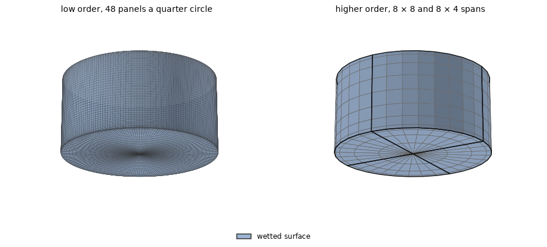
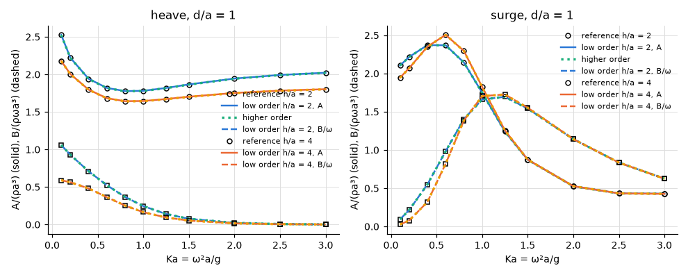
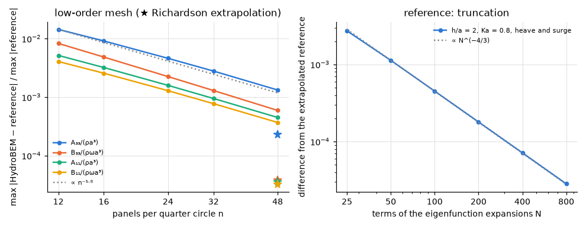

# Truncated cylinder in finite depth

**Result.** In water two and four radii deep, the low order on 48 panels per quarter circle agrees
with an eigenfunction-matching solution within 0.1 % of the largest reference value, and the higher
order within $1.7 \times 10^{-5}$. The low order converges at the order observed, 1.7 to 1.8, and
its extrapolation to zero panel size reaches the reference within $3.2 \times 10^{-5}$ to
$2.3 \times 10^{-4}$.

## The problem

A truncated vertical cylinder of radius $a = 1$ m and draft $d = a$ floats in water of depth
$h = 2a$ and $4a$. We compare its heave and surge added mass $A/(\rho a^3)$ and damping
$B/(\rho\omega a^3)$ at 11 values $0.1 \le Ka \le 3$, where $Ka = \omega^2 a/g$.

*Figure 1. The two meshes, expanded to the whole body and seen from below: the wetted surface (side
and bottom) in blue. Left: low order, 48 panels per quarter circle, cosine-spaced in depth and
radius. Right: higher order, the analytic cylinder (patch edges in black, span edges in grey),
$8 \times 8$ spans on the side and $8 \times 4$ on the bottom per quadrant, order 3, the spans
clustered at the waterline and the bottom edge. There is no interior surface: the first irregular
frequency lies above the range.*

## The reference

The reference is the eigenfunction-matching solution of `scripts/gen_cylinder_reference.py`: the
formulation of Yeung (1981) and Garrett (1971), heave as Bhatta & Rahman (1995) and surge as Bhatta
(2003), derived and implemented in this repository. Its truncation is extrapolated (Figure 3,
right), and the result is converged to better than $5 \times 10^{-6}$.

Its sources give their results as figures only, so no published number anchors it. It rests on the
published formulation, its truncation convergence and its agreement with the panel method (test-plan
A5).

## Agreement with the reference

*Figure 2. Heave and surge added mass $A/(\rho a^3)$ (solid) and damping $B/(\rho\omega a^3)$
(dashed) against $Ka$ for $h/a = 2$ and 4: the reference (markers), the low order and the higher
order (dotted).*

The curves of both methods lie on the reference at both depths. Table 1 gives the largest difference
of each quantity.

*Table 1. Largest difference from the reference over $0.1 \le Ka \le 3$, relative to the largest
reference value of each quantity.*

| $h/a$ | method | $A_{33}$ | $B_{33}$ | $A_{11}$ | $B_{11}$ |
|---|---|---|---|---|---|
| 2 | low, 48 | 1.0e-3 | 4.0e-4 | 4.3e-4 | 3.2e-4 |
| 4 | low, 48 | 1.0e-3 | 7.5e-4 | 4.4e-4 | 3.6e-4 |
| 2 | higher, $8 \times 8$ spans | 1.5e-5 | 3.4e-6 | 6.6e-6 | 5.4e-6 |
| 4 | higher, $8 \times 8$ spans | 1.7e-5 | 7.8e-6 | 6.5e-6 | 5.9e-6 |

## Does it converge?

A reference built in this repository needs a check of its own, and the low order needs its rate.
Figure 3 refines the low-order mesh on the six tabulated cases and the reference's truncation. The
order $p$ is observed on three meshes, $v_i = v^* + c\,h_i^p$, and Richardson's extrapolation $v^*$
is the limit of zero panel size that this rate implies.

*Figure 3. Left: the six tabulated cases (`tests/data/cylinder_finite_depth.txt`) on 12, 16, 24, 32,
48 panels per quarter circle; the stars are Richardson's extrapolation from the three finest meshes
with the order observed for each value. Right: the reference's truncation, $N$ terms in each
eigenfunction expansion, against its extrapolation ($h/a = 2$, $Ka = 0.8$, heave and surge).*

The low order's differences fall monotonically from 1.4e-2 to 1.3e-3 ($n = 12$ to 48). The observed
orders are 1.66, 1.80, 1.76 and 1.72 for $A_{33}$, $B_{33}$, $A_{11}$ and $B_{11}$; the bottom edge
of the cylinder keeps them below 2. The extrapolation leaves 2.3e-4, 3.8e-5, 3.6e-5, 3.2e-5.

The reference converges as $N^{-4/3}$, the rate set by the $270^\circ$ corner of the water at the
bottom edge. Its extrapolations from $N = 200$, 400 and from 400, 800 agree to better than
$5 \times 10^{-6}$; the script refuses otherwise.

The higher order on 160 unknowns per quadrant agrees with the reference to about $10^{-5}$ directly,
without extrapolation.

## Reproducing this page

The example
[`examples/truncated_cylinder_finite_depth`](../../../examples/truncated_cylinder_finite_depth) runs
the tabulated cases. This page, its figures and its numbers are written by `validation/cylinder.py`
through `validation/make_report.py`.
