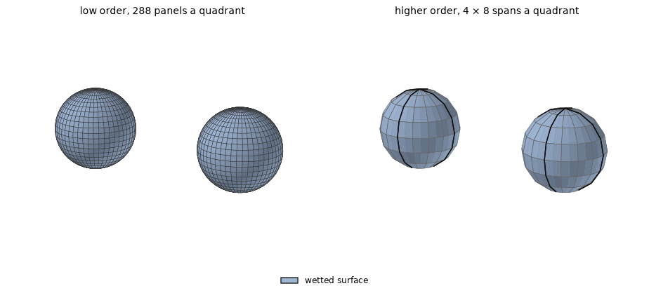
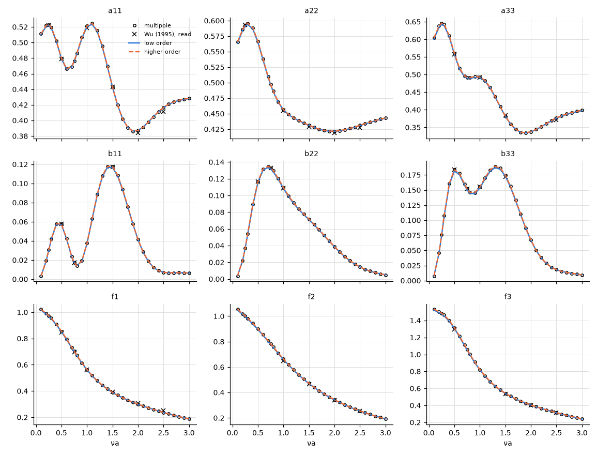

# Two submerged spheres

**Result.** For two interacting submerged spheres in deep water, the higher order agrees with a
multipole solution within $2.2 \times 10^{-5}$ of the largest value of each quantity, and the low
order within 1.1 %, its discretization. The published figures of Wu (1995) are matched within 2.4 %
of their largest value read, by the multipole solution as by HydroBEM: the accuracy of reading them.

## The problem

Two spheres of radius $a = 1$ m are submerged side by side in deep water, their centres at
$(\pm 2a, 0, -1.5a)$: spacing $4a$, $1.5a$ below the free surface. Waves come at $45^\circ$, over
$0.1 \le \nu a \le 3$ with $\nu a = \omega^2 a/g$. Both spheres move together in each mode.

The quantities are those of sphere 2 with both spheres moving in the same mode (Wu 1995, §7): the
added mass and damping $A^{21} + A^{22}$ over $\rho V$ and $\rho \omega V$, with $V = 4\pi a^3/3$,
and the exciting force $\lvert E^2 \rvert$ over $\rho \omega^2 V A e^{-\nu a}$. That is the
normalization of the figures: the text's eq. (46) has $e^{-\nu h}$ with $h$ the depth of the
centres, but the figures agree with $e^{-\nu a}$.

*Figure 1. The two meshes, expanded to both spheres: the wetted surface in blue. Left: low order,
one quadrant of 24 bands of latitude by 12 meridians (equal angles), expanded about each centre.
Right: higher order, the exact sphere as one analytic patch per quadrant (the revolved meridian;
patch edges in black, span edges in grey), $4 \times 8$ spans of order 3. There is no interior
surface: the spheres are submerged, so there are no irregular frequencies.*

## The references

The main reference is the multipole solution of `scripts/gen_sphere_array_reference.py`, the method
of Wu (1995), derived and implemented in this repository: spherical multipoles about each centre
with their free-surface images and the wave integral. It uses degree 10 and 160 points of the wave
integral; degree 8 reproduces it to $7 \times 10^{-7}$ of the largest value
(`tests/data/two_spheres.txt`). It is evaluated here at every $\nu a$.

The published reference is Wu (1995), figures 2–10: the curves of case 2, **read by eye** from the
page images at $\nu a = 0.25$ to 2.5. They are read to about $\pm 0.005$ in the added mass and the
damping and $\pm 0.01$ in the exciting force, about 1 % of the values, more where a curve is steep.

## Agreement with the references

*Figure 2. Sphere 2 against $\nu a$: the multipole solution (circles), Wu's figures (crosses, read),
HydroBEM low order (solid) and higher order (dashed); the columns are surge, sway and heave.*

The higher order agrees with the multipole solution within 2.2e-5 of the largest value of each
quantity with 480 unknowns in all (Table 1). The low order of 2304 flat panels agrees within 1.1e-2,
its discretization, which is largest in the damping, whose peak is small.

*Table 1. Largest difference from the multipole solution over $0.1 \le \nu a \le 3$, relative to its
largest value of each quantity.*

| Method | $a_{11}$ | $b_{11}$ | $f_{1}$ | $a_{22}$ | $b_{22}$ | $f_{2}$ | $a_{33}$ | $b_{33}$ | $f_{3}$ |
|---|---|---|---|---|---|---|---|---|---|
| low order | 2.3e-3 | 9.3e-3 | 5.4e-3 | 3.2e-3 | 9.8e-3 | 5.6e-3 | 6.1e-3 | 1.1e-2 | 6.7e-3 |
| higher order | 2.8e-6 | 9.3e-6 | 1.7e-5 | 1.4e-6 | 6.2e-6 | 1.7e-5 | 4.3e-6 | 2.2e-5 | 8.3e-6 |

The figures read are matched by the multipole solution within 2.4 % of the largest value read, as by
HydroBEM (Table 2): that is the reading accuracy.

*Table 2. Largest difference from Wu's figures 2–10 at the points read, relative to the largest
value read of each quantity.*

| Against figs. 2–10 (read) | $a_{11}$ | $a_{22}$ | $a_{33}$ | $b_{11}$ | $b_{22}$ | $b_{33}$ | $f_{1}$ | $f_{2}$ | $f_{3}$ |
|---|---|---|---|---|---|---|---|---|---|
| low order | 1.1 % | 0.7 % | 0.9 % | 0.9 % | 1.1 % | 1.4 % | 1.7 % | 1.9 % | 0.9 % |
| higher order | 1.1 % | 0.7 % | 1.0 % | 0.6 % | 0.4 % | 1.5 % | 1.7 % | 2.4 % | 1.6 % |
| multipole | 1.1 % | 0.7 % | 1.0 % | 0.6 % | 0.4 % | 1.5 % | 1.7 % | 2.4 % | 1.6 % |

## Reproducing this page

The example [`examples/two_submerged_spheres`](../../../examples/two_submerged_spheres) runs the
case at full scale ($a = 3$ m). This page, its figures and its numbers are written by
`validation/two_submerged_spheres.py` through `validation/make_report.py`.
