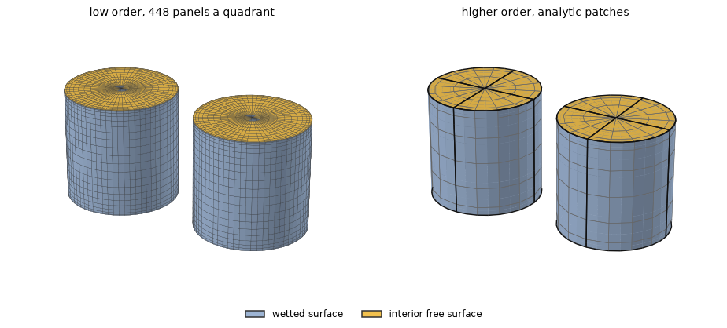
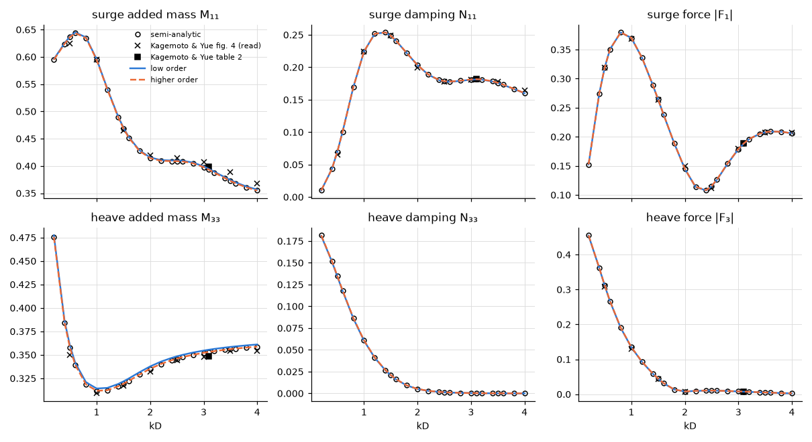

# Two truncated cylinders in finite depth

**Result.** For two interacting cylinders in finite depth, both methods agree with a semi-analytic
interaction solution over the whole range: the low order within 0.54 % and the higher order within
$7.6 \times 10^{-5}$ of the largest value of each quantity. The published figure of Kagemoto & Yue
(1986) is matched to within 3 % of its largest value read, about as closely as the semi-analytic
solution matches it, so what remains is the reading. Their printed table differs from both by up to
1.3 %.

## The problem

Two floating truncated vertical circular cylinders stand side by side in head seas, both moving
together in surge and in heave. This is geometry 2 of Kagemoto & Yue (1986): radius $a = 1$ m
(diameter $D = 2a$), draft $H = 2a = D$, water depth $h = 4a = 2D$, centres at $x = \pm 1.3a$ on the
$x$ axis (spacing $L = 1.3D$), heading $0^\circ$, along the line of the cylinders. The range is
$0.1 \le ka \le 2.0$ ($kD = 0.2$ to 4), below the first irregular frequency of the columns.

The quantities are the totals of the two cylinders moving together:
$A_{11} + A_{17} + A_{71} + A_{77}$ for surge (each cylinder's six modes in turn) and the summed
exciting force. They are given in the normalization (4.1) of Kagemoto & Yue (1986): force
$/ (\rho g \pi a H A N)$, added mass $/ (\rho \pi a^2 H N)$ and damping
$/ (\omega \rho \pi a^2 H N)$, with $N = 2$ legs and $A$ the wave amplitude.

*Figure 1. The two meshes, expanded to both cylinders and seen from above the free surface: the
wetted surface in blue, the interior surface in the waterplane in yellow. Left: low order, one
quadrant of 16 panels per quarter circle, 20 down the side and 8 across the bottom (cosine-spaced),
expanded over $x = 0$ and $y = 0$ at each cylinder, with the graded interior surface. Right: higher
order, the analytic cylinder (exact side, bottom and waterplane; patch edges in black, span edges in
grey), $4 \times 6$ spans on the side and $4 \times 3$ on the bottom and the waterplane per
quadrant, splines of order 3, the spans clustered at the waterline and at the bottom edge (mapping
"nonuniform"); its waterplane is the interior surface.*

## The references

The main reference is the semi-analytic interaction solution of
`scripts/gen_cylinder_array_reference.py`, derived and implemented in this repository. It matches
eigenfunctions at each cylinder (Yeung 1981, Garrett 1971) and scatters the propagating and
evanescent modes exactly between them (Kagemoto & Yue 1986). Here it is evaluated at every $ka$ of
the figure with 200 and 400 vertical modes, extrapolated with the order 4/3 of the corner at the
bottom edge. Its two extrapolations agree to $2 \times 10^{-6}$ of the largest value at the three
tabulated $ka$ of `tests/data/cylinder_array.txt`.

Two published sources are compared as well:

- **Kagemoto & Yue (1986), table 2**: their full diffraction computation at $kD = 3.1$, as printed.
- **Kagemoto & Yue (1986), figure 4**: the curve L (their interaction theory), **read by eye** from
  the page images at $kD = 0.5$ to 4, to about $\pm 0.005$ in the units of the figure (1 to 3 % of
  the values, more where a curve is steep).

## Agreement with the references

*Figure 2. The totals against $kD$: the semi-analytic solution (circles), Kagemoto & Yue figure 4
(crosses, read) and table 2 (square), HydroBEM low order (solid) and higher order (dashed).*

Both methods agree with the semi-analytic interaction solution to their discretization over the
whole range (Table 1): the low order (3584 panels in all) within 5.4e-3, the higher order (864
unknowns) within 7.6e-5 of the largest value of each quantity.

*Table 1. Largest difference from the semi-analytic solution over $0.1 \le ka \le 2$, relative to
its largest value of each quantity.*

| Method | $M_{11}$ | $N_{11}$ | $\lvert F_1 \rvert$ | $M_{33}$ | $N_{33}$ | $\lvert F_3 \rvert$ |
|---|---|---|---|---|---|---|
| low order, 448 panels a quadrant | 2.5e-3 | 1.6e-3 | 1.3e-3 | 5.4e-3 | 3.4e-3 | 1.7e-3 |
| higher order, $4 \times 6$ spans | 1.2e-5 | 7.6e-5 | 1.5e-5 | 3.3e-5 | 6.8e-6 | 3.3e-6 |

The semi-analytic solution matches the figure read as closely as HydroBEM does, within 3 % of the
largest value read (Table 2). The remaining differences are therefore those of the reading and of
the published curve.

*Table 2. Largest difference from Kagemoto & Yue figure 4 at the points read, relative to the
largest value read of each quantity.*

| Against figure 4 (read) | $\lvert F_1 \rvert$ | $N_{11}$ | $M_{11}$ | $\lvert F_3 \rvert$ | $M_{33}$ |
|---|---|---|---|---|---|
| low order | 1.4 % | 1.8 % | 2.4 % | 1.4 % | 2.8 % |
| higher order | 1.4 % | 1.8 % | 2.6 % | 1.6 % | 2.2 % |
| semi-analytic | 1.4 % | 1.8 % | 2.6 % | 1.6 % | 2.2 % |

Kagemoto & Yue's table 2 differs from the semi-analytic solution by up to 1.3 % in the added mass
and the damping, and by 2 % in the small heave force, printed as 0.00779 (Table 3). It differs from
HydroBEM alike: the published full diffraction computation is itself a discretization, whose
accuracy the paper does not state.

*Table 3. Signed relative difference from the values printed in Kagemoto & Yue table 2 at $kD = 3.1$
($F_3$ is small there, 0.008).*

| Against table 2 ($kD = 3.1$) | $\lvert F_1 \rvert$ | $N_{11}$ | $M_{11}$ | $\lvert F_3 \rvert$ | $M_{33}$ |
|---|---|---|---|---|---|
| low order | +0.00 % | -0.10 % | -0.88 % | -3.74 % | +2.02 % |
| higher order | +0.18 % | +0.12 % | -1.24 % | -1.69 % | +1.33 % |
| semi-analytic | +0.18 % | +0.13 % | -1.24 % | -1.70 % | +1.33 % |

## Reproducing this page

The example [`examples/two_truncated_cylinders`](../../../examples/two_truncated_cylinders) runs the
case of the paper at full scale. This page, its figures and its numbers are written by
`validation/two_truncated_cylinders.py` through `validation/make_report.py`.
